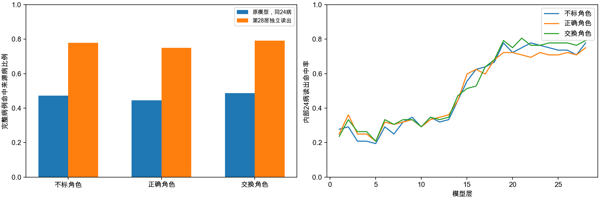

# 模型是否混淆了既往病史和当前表现？

**正确标注事实角色没有带来明确的总体命中率改善。** 正确角色相对不标角色，原模型49病命中率变化为-4.17% [-11.11, 2.78]，第28层读出变化为-2.78% [-9.72, 4.17]。

这一解释由新队列中的心肌梗死/HIV例子触发，属于结果驱动的探索。我们随后对全部72个预选完整轨迹病例测试，不只测试该例。问题、答案、顺序和类别说明相同，仅将每组来源角色标为正确、未指定或反向。

| 条件 | 原模型49病 | 原模型同24病 | 第28层24病读出 |
|---|---|---|---|
| 不标角色 | 43.06% [31.94, 54.17] | 47.22% [36.11, 59.72] | 77.78% [68.06, 87.50] |
| 正确角色 | 38.89% [27.78, 50.00] | 44.44% [33.33, 55.56] | 75.00% [65.28, 84.72] |
| 交换角色 | 40.28% [29.17, 51.39] | 48.61% [37.50, 61.11] | 79.17% [69.44, 87.50] |

触发例ddx_test_0053572的来源诊断为Possible NSTEMI / STEMI：

| 条件 | 原模型首选 | 第28层读出 |
|---|---|---|
| neutral | HIV (initial infection) | Possible NSTEMI / STEMI |
| correct | Pulmonary embolism | Possible NSTEMI / STEMI |
| swapped | Possible NSTEMI / STEMI | Possible NSTEMI / STEMI |

HISTORY/CURRENT由来源is_antecedent标记生成，没有使用来源诊断生成提示。交换角色是反事实元数据；不能把它与原病例视作相同临床语义。主比较为正确角色与未指定角色，它们都有同一类别解释和标记格式。实验回答显式角色信息是否帮助当前测量，单项提示成败不等于定位唯一内部回路。

[逐病例](cases.csv) · [所有层](layers.csv) · [精确汇总](summary.json)
