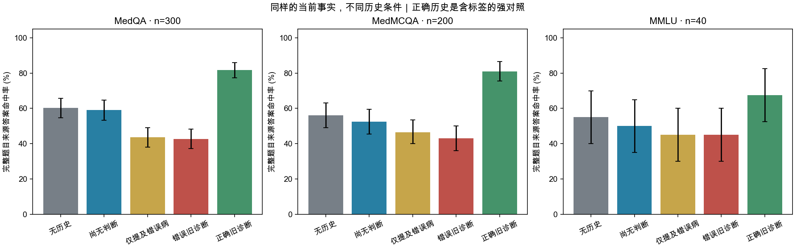
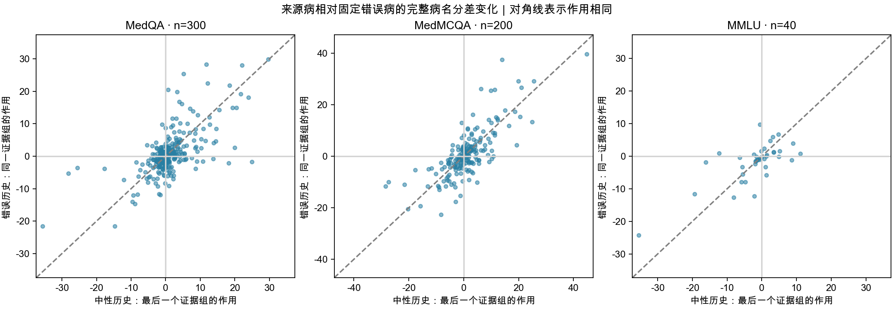
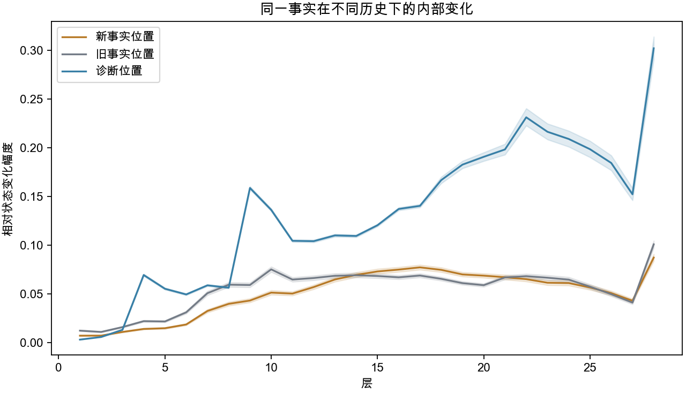
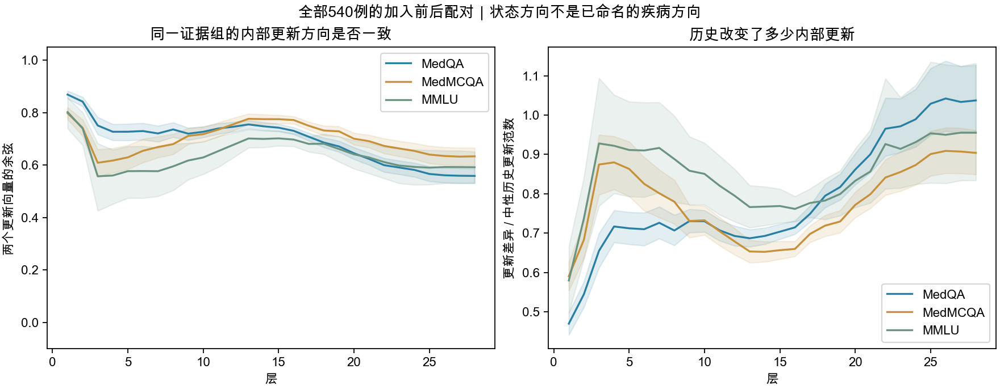
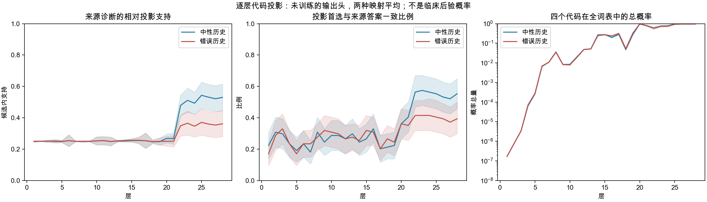

# 多来源医学信念：540例之外，更重要的是区分作用环节

本阶段完成540个新增病例、6823个观测条件；内部完整轨迹子集94例。全部使用本地Qwen3-1.7B，API费用0美元。这里使用考试病例的逐句揭示，不是真实就诊时间线。

## 相同当前事实，先前判断带来多大影响

| 来源 | 病例数 | 无历史命中 | 中性历史命中 | 错误历史命中 | 仅提及错误病命中 | 错误−中性，95%CI |
|---|---:|---:|---:|---:|---:|---|
| MedQA | 300 | 181 | 177 | 128 | 131 | -16.33% [-22.00, -10.67] |
| MedMCQA | 200 | 112 | 105 | 86 | 93 | -9.50% [-15.51, -3.00] |
| MMLU | 40 | 22 | 20 | 18 | 18 | -5.00% [-17.50, 7.50] |

正确历史含来源答案，只作为强对照。四选项分数、自由生成和来源标签的定义分别保留；不把考试成绩当临床诊断能力。

## 同一条新事实的作用有没有变化

分差为来源病减去预先固定的错误病。下表比较加入最后一个原文证据组前后，错误历史与中性历史下增量的差。

| 来源 | 平均交互及95%CI | 交互绝对值均值 | 增量方向相反且两侧绝对值>0.1 | 更新Spearman相关 |
|---|---|---:|---:|---:|
| MedQA | -0.23 [-0.85, 0.37] | 3.610 | 76/300 | 0.578 |
| MedMCQA | -0.03 [-0.84, 0.81] | 4.237 | 42/200 | 0.716 |
| MMLU | 0.17 [-1.48, 1.88] | 3.892 | 8/40 | 0.649 |

方向不同仅表示更新依赖历史，不能单凭最终来源答案把中间变化判为医学错误。signed均值与绝对变化分别报告，避免相反效应互相抵消。

## 内部记录

全部540例均有28层的加入前后诊断位置记录，以及最终新/旧事实位置的FP32均值。状态变化反映历史内容进入计算；它本身不说明模型朝哪个疾病移动。

代码投影不使用旧DDxPlus24病探针；每个病例在自身四个选项内比较，两种映射平均。未训练输出头在中间层没有校准，所以该图是输出倾向的辅助读表，机制判断仍需要位置干预。

## 复核与可追踪材料

开发与确认集结果分别保存在[summary.json](summary.json)。[逐病例指标](patient_results.csv)、[逐句轨迹](trajectories.csv)、[代码对照](code_controls.csv)、[全部候选分数](all_candidate_scores.csv.gz)与[内部变化](internal_history_change.csv)均保留。常数历史偏置预测与“不更新”基线是描述性补充，不据此宣称发现认知机制。

内部干预单独交付，不能将观测阶段的完成状态当作因果实验完成。
