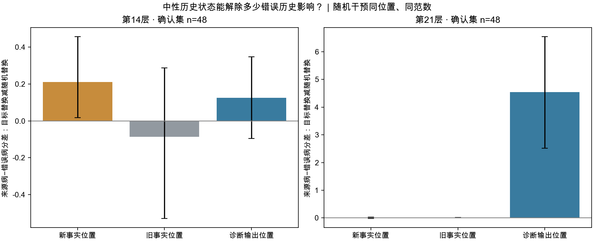

# 医学信念内部作用：新事实、旧事实与诊断位置

94个预先选定病例、2444个干预条件完成。供体来自同患者中性历史条件，没有正确答案标签。第14、21层均重新计算干预后的后续层及缓存。

## 独立确认集

| 层 | 位置 | 病例 | 目标−随机分差，95%CI | Holm校正p | 诊断首选改变比例 | 准确率相对错误历史变化 |
|---|---|---:|---|---:|---|---|
| 14 | 新事实位置 | 48 | 0.21 [0.02, 0.46] | 0.30934 | 0.00% [0.00, 0.00] | 0.00% [0.00, 0.00] |
| 14 | 旧事实位置 | 48 | -0.09 [-0.53, 0.29] | 1.00000 | 2.08% [0.00, 6.25] | 0.00% [0.00, 0.00] |
| 14 | 诊断输出位置 | 48 | 0.13 [-0.10, 0.35] | 0.84514 | 0.00% [0.00, 0.00] | 0.00% [0.00, 0.00] |
| 21 | 新事实位置 | 48 | 0.01 [-0.02, 0.03] | 1.00000 | 0.00% [0.00, 0.00] | 0.00% [0.00, 0.00] |
| 21 | 旧事实位置 | 48 | 0.01 [0.00, 0.02] | 0.30996 | 0.00% [0.00, 0.00] | 0.00% [0.00, 0.00] |
| 21 | 诊断输出位置 | 48 | 4.55 [2.51, 6.54] | 0.00075 | 20.83% [10.42, 33.33] | 6.25% [-2.08, 14.58] |

分差增加意味着在预定的两个诊断之间向来源答案移动，不等于每例改对。首选变化、准确率和自由生成分别记录。旧事实位置是有效性对照，不预先假定旧事实无关。

## 新事实是否比旧事实更特殊

| 层 | 确认集新−旧位置作用，95%CI | 两层校正p |
|---|---|---:|
| 14 | 0.30 [-0.15, 0.77] | 0.45419 |
| 21 | -0.00 [-0.02, 0.02] | 0.75766 |

这项直接对照决定能否把作用特别归于新增事实。各位置单独显著，并不意味着位置之间显著不同。不同位置的自然改变量和词元数量可能不同；同范数随机对照控制各位置内部的任意扰动效应，不使跨位置比较成为完全等量干预。

## 解释范围

状态替换检验历史影响经过哪些位置传播；它不能单独证明模型曲解了某条事实的临床意义。中性与错误历史长度可能不同，已保存对齐位置差；全部新/旧事实词元须按同一原文对齐。开发、确认、数据来源分开的结果及反向替换保留在[汇总](summary.json)和[患者级干预表](patient_interventions.csv)。
