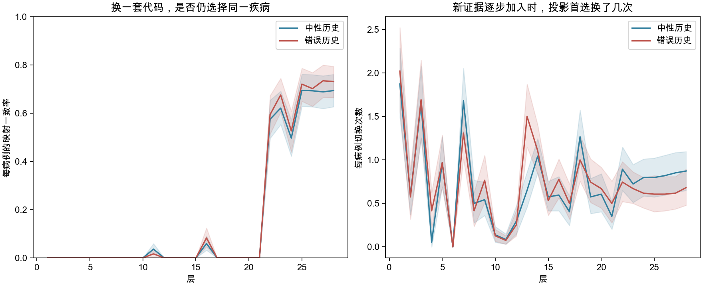
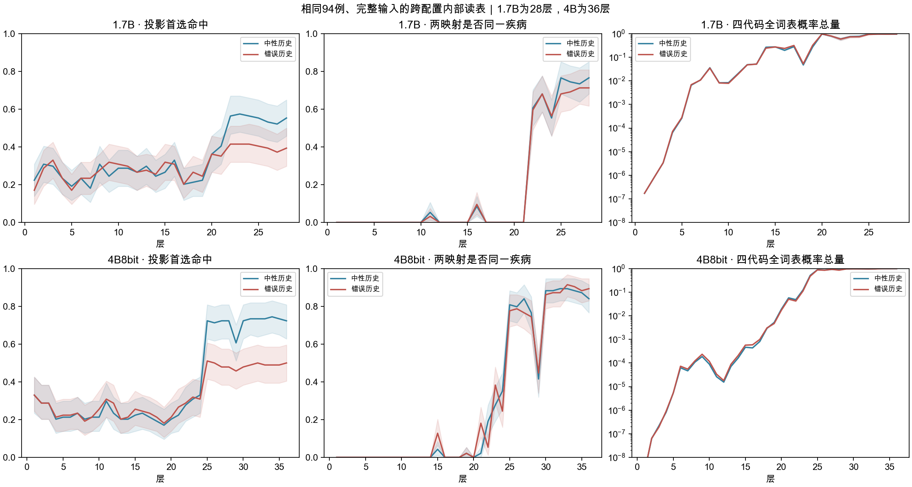

# 逐轮逐层展开与模型复核

本阶段覆盖同94例，共537个累计证据前缀。每个前缀均有中性/错误历史、两种代码映射、28层、四候选的投影支持。完整病名的原生评分另行保留。

## 同病例跨配置复核

| 来源 | 例数 | 1.7B无历史正确 | 4B无历史正确 | 1.7B错误−中性变化 | 4B错误−中性变化 |
|---|---:|---:|---:|---|---|
| MedQA | 32 | 17 | 23 | -18.75% [-34.38, -3.12] | -21.88% [-37.50, -6.25] |
| MedMCQA | 32 | 19 | 25 | 0.00% [-12.50, 12.50] | -12.50% [-28.12, 0.00] |
| MMLU | 30 | 16 | 23 | -10.00% [-23.33, 3.33] | -13.33% [-26.67, -3.33] |

1.7B为FP16，4B为8-bit，大小与精度共同变化。两者使用相同病例和候选；本表不将差异单独归因于参数规模。

## 每轮每层究竟读到了什么

模型中间层没有天然命名为疾病的概率槽。此处把最终输出头接到中间状态，读取四个代码的相对支持；两种映射一致性帮助判断读表受代码本身影响的程度。它与原先训练的DDxPlus疾病读出器不同。

[全部病例图谱](CASE_ATLAS.md) · [每轮每层全部候选分数](all_round_layer_candidates.csv.gz) · [每病例逐层指标](layer_patient_metrics.csv) · [逐层逐头注意力](attention_by_case_layer_head.csv.gz) · [同病例模型比较](matched_models.csv)

[跨配置逐层数据](cross_configuration_layers.csv)

## 未采纳病名的代码作答复核

这是开发集观察后追加的检验；每患者对两种预定代码映射取平均，区间按患者计算。

| 确认集来源 | 病例数 | 中性准确率 | 错误历史准确率 | 仅提及准确率 | 提及−中性及95%CI |
|---|---:|---|---|---|---|
| MedQA | 16 | 65.62% [46.88, 84.38] | 40.62% [18.75, 62.50] | 37.50% [15.62, 59.38] | -28.12% [-46.88, -12.50] |
| MedMCQA | 16 | 78.12% [59.38, 93.75] | 62.50% [40.62, 81.25] | 59.38% [37.50, 78.12] | -18.75% [-34.38, -3.12] |
| MMLU | 16 | 28.12% [9.38, 50.00] | 25.00% [6.25, 46.88] | 25.00% [6.25, 46.88] | -3.12% [-18.75, 12.50] |
| all | 48 | 57.29% [44.79, 69.79] | 42.71% [30.21, 56.25] | 40.62% [28.12, 54.17] | -16.67% [-27.08, -7.29] |
