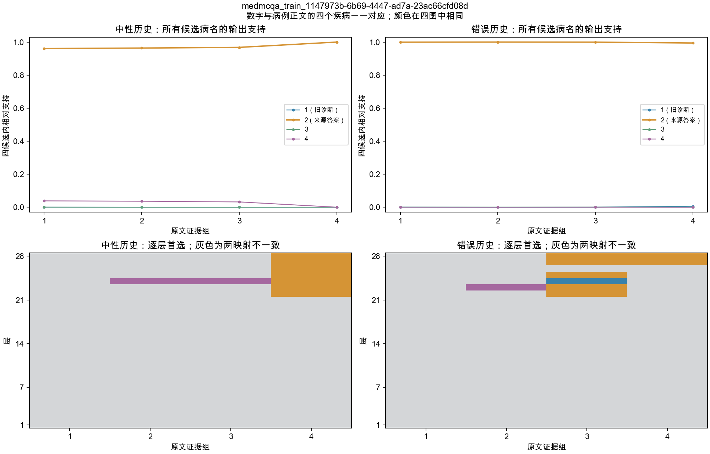
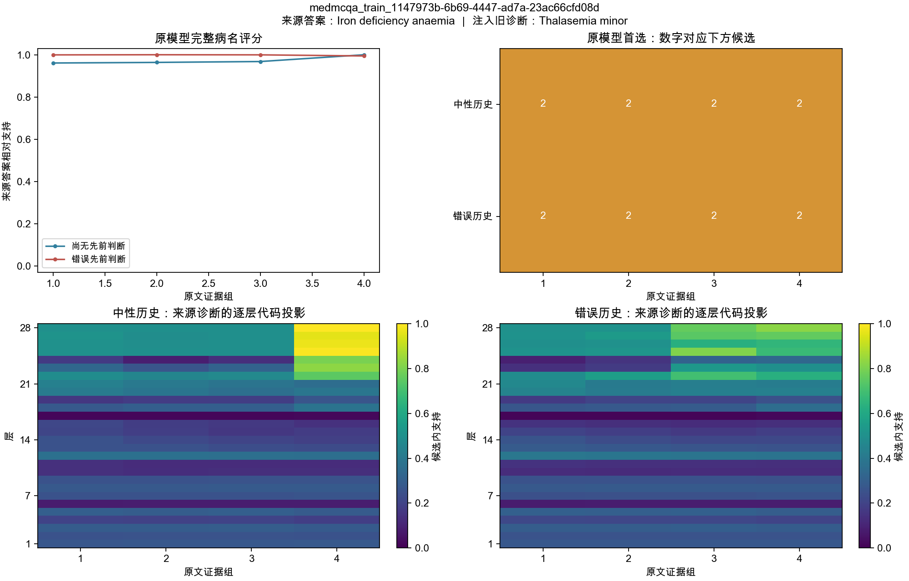

# medmcqa_train_1147973b-6b69-4447-ad7a-23ac66cfd08d

来源：MedMCQA，train，原始第10857行（零起始）。完整题目来源答案：**Iron deficiency anaemia**；人为指定的错误旧诊断：**Thalasemia minor**。

候选：1 = Thalasemia minor；2 = Iron deficiency anaemia；3 = Chronic malaria；4 = Folate deficiency。

上排分别显示两种历史下四种候选的病名支持；下排颜色为逐层代码首选，灰色表示两套代码没有指向同一疾病，不能稳定命名该层倾向。

上排是原模型病名评分，下面是未训练输出头的代码投影、两种映射平均；二者接口不同。来源标签只评价完整题目。

| 轮 | 新增原文证据组 | 中性历史首选 | 错误历史首选 |
|---:|---|---|---|
| 1 | A 25 yr old female presented with malaise and generalized weakness since 6 months. | Iron deficiency anaemia | Iron deficiency anaemia |
| 2 | Her appetite is reduced and she has giddiness and palpitations on and off. | Iron deficiency anaemia | Iron deficiency anaemia |
| 3 | There was no organomegaly. | Iron deficiency anaemia | Iron deficiency anaemia |
| 4 | Laboratory study showed normochromic to hypochromic anaemia, RDW=60, and MCV=50. | Iron deficiency anaemia | Iron deficiency anaemia |

## 关键层的投影读表

每格先检查两套答案代码是否指向同一候选；不一致就不命名。括号内为四个答案代码在全词表中的概率总量，接近0时说明输出头尚不适合在该层读取答案。映射一致本身不等于医学判断正确。

### 中性历史

| 轮 | 第7层 | 第14层 | 第21层 | 第28层 |
|---:|---|---|---|---|
| 1 | 映射不一致 | 映射不一致 | 映射不一致 | 映射不一致 |
| 2 | 映射不一致 | 映射不一致 | 映射不一致 | 映射不一致 |
| 3 | 映射不一致 | 映射不一致 | 映射不一致 | 映射不一致 |
| 4 | 映射不一致 | 映射不一致 | 映射不一致 | Iron deficiency anaemia（代码总量 1） |

### 错误历史

| 轮 | 第7层 | 第14层 | 第21层 | 第28层 |
|---:|---|---|---|---|
| 1 | 映射不一致 | 映射不一致 | 映射不一致 | 映射不一致 |
| 2 | 映射不一致 | 映射不一致 | 映射不一致 | 映射不一致 |
| 3 | 映射不一致 | 映射不一致 | 映射不一致 | Iron deficiency anaemia（代码总量 1） |
| 4 | 映射不一致 | 映射不一致 | 映射不一致 | Iron deficiency anaemia（代码总量 1） |
