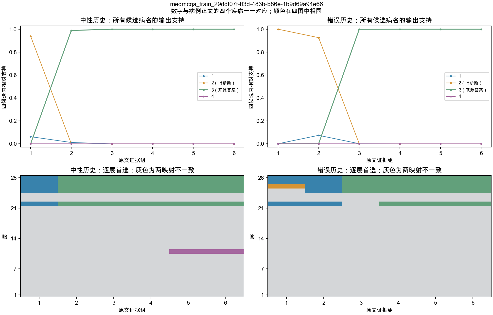
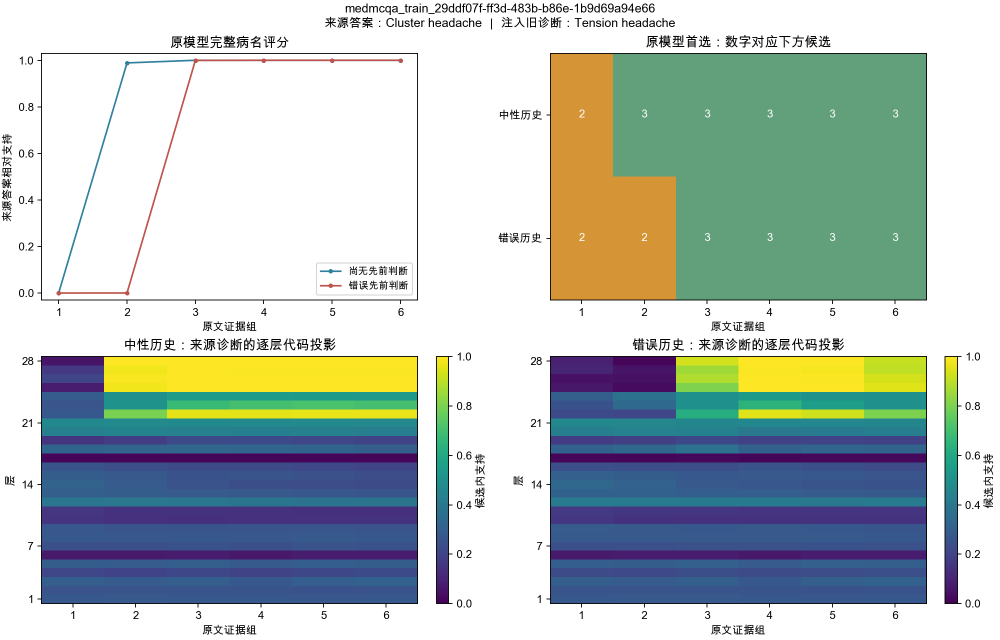

# medmcqa_train_29ddf07f-ff3d-483b-b86e-1b9d69a94e66

来源：MedMCQA，train，原始第54860行（零起始）。完整题目来源答案：**Cluster headache**；人为指定的错误旧诊断：**Tension headache**。

候选：1 = Migraine headache；2 = Tension headache；3 = Cluster headache；4 = Brain tumour。

上排分别显示两种历史下四种候选的病名支持；下排颜色为逐层代码首选，灰色表示两套代码没有指向同一疾病，不能稳定命名该层倾向。

上排是原模型病名评分，下面是未训练输出头的代码投影、两种映射平均；二者接口不同。来源标签只评价完整题目。

| 轮 | 新增原文证据组 | 中性历史首选 | 错误历史首选 |
|---:|---|---|---|
| 1 | A 35-year-old man presents with daily headache. | Tension headache | Tension headache |
| 2 | He describes two attacks per day over the last 3 weeks. | Cluster headache | Tension headache |
| 3 | Each attack lasts about an hour and awakens him from sleep. | Cluster headache | Cluster headache |
| 4 | The patient has noticed associated tearingand reddening of the right eye as well as nasal stuffness. | Cluster headache | Cluster headache |
| 5 | The pain's deep, excruciating, and limiting to the right side of the head. | Cluster headache | Cluster headache |
| 6 | The neurological examination is normal. | Cluster headache | Cluster headache |

## 关键层的投影读表

每格先检查两套答案代码是否指向同一候选；不一致就不命名。括号内为四个答案代码在全词表中的概率总量，接近0时说明输出头尚不适合在该层读取答案。映射一致本身不等于医学判断正确。

### 中性历史

| 轮 | 第7层 | 第14层 | 第21层 | 第28层 |
|---:|---|---|---|---|
| 1 | 映射不一致 | 映射不一致 | 映射不一致 | Migraine headache（代码总量 0.96） |
| 2 | 映射不一致 | 映射不一致 | 映射不一致 | Cluster headache（代码总量 1） |
| 3 | 映射不一致 | 映射不一致 | 映射不一致 | Cluster headache（代码总量 1） |
| 4 | 映射不一致 | 映射不一致 | 映射不一致 | Cluster headache（代码总量 1） |
| 5 | 映射不一致 | 映射不一致 | 映射不一致 | Cluster headache（代码总量 1） |
| 6 | 映射不一致 | 映射不一致 | 映射不一致 | Cluster headache（代码总量 1） |

### 错误历史

| 轮 | 第7层 | 第14层 | 第21层 | 第28层 |
|---:|---|---|---|---|
| 1 | 映射不一致 | 映射不一致 | 映射不一致 | Migraine headache（代码总量 0.11） |
| 2 | 映射不一致 | 映射不一致 | 映射不一致 | Migraine headache（代码总量 0.98） |
| 3 | 映射不一致 | 映射不一致 | 映射不一致 | Cluster headache（代码总量 1） |
| 4 | 映射不一致 | 映射不一致 | 映射不一致 | Cluster headache（代码总量 1） |
| 5 | 映射不一致 | 映射不一致 | 映射不一致 | Cluster headache（代码总量 1） |
| 6 | 映射不一致 | 映射不一致 | 映射不一致 | Cluster headache（代码总量 1） |
