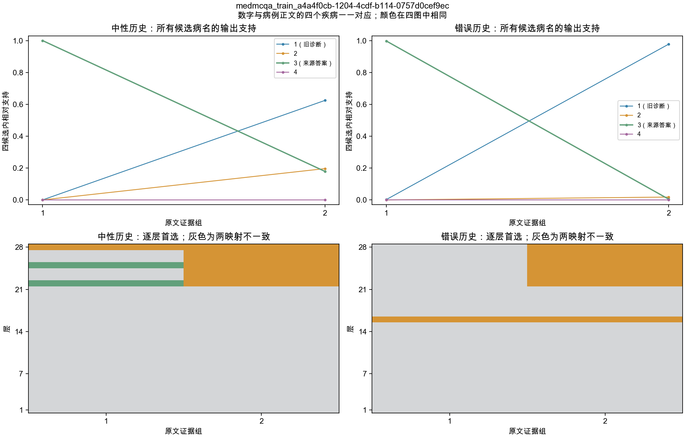
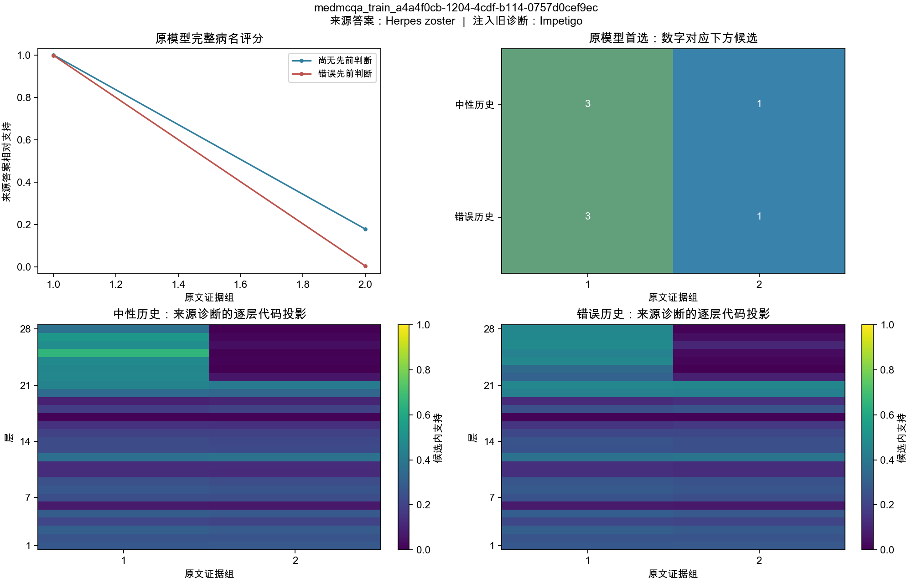

# medmcqa_train_a4a4f0cb-1204-4cdf-b114-0757d0cef9ec

来源：MedMCQA，train，原始第119463行（零起始）。完整题目来源答案：**Herpes zoster**；人为指定的错误旧诊断：**Impetigo**。

候选：1 = Impetigo；2 = Adult chickenpox；3 = Herpes zoster；4 = Coxsackie A virus。

上排分别显示两种历史下四种候选的病名支持；下排颜色为逐层代码首选，灰色表示两套代码没有指向同一疾病，不能稳定命名该层倾向。

上排是原模型病名评分，下面是未训练输出头的代码投影、两种映射平均；二者接口不同。来源标签只评价完整题目。

| 轮 | 新增原文证据组 | 中性历史首选 | 错误历史首选 |
|---:|---|---|---|
| 1 | An 80-year-old female patient complains of a 3-day history of a painful rash extending over the right half of her forehead and down to her right eyelid. | Herpes zoster | Herpes zoster |
| 2 | There are weeping vesicular lesions on physical examination. | Impetigo | Impetigo |

## 关键层的投影读表

每格先检查两套答案代码是否指向同一候选；不一致就不命名。括号内为四个答案代码在全词表中的概率总量，接近0时说明输出头尚不适合在该层读取答案。映射一致本身不等于医学判断正确。

### 中性历史

| 轮 | 第7层 | 第14层 | 第21层 | 第28层 |
|---:|---|---|---|---|
| 1 | 映射不一致 | 映射不一致 | 映射不一致 | Adult chickenpox（代码总量 1） |
| 2 | 映射不一致 | 映射不一致 | 映射不一致 | Adult chickenpox（代码总量 0.93） |

### 错误历史

| 轮 | 第7层 | 第14层 | 第21层 | 第28层 |
|---:|---|---|---|---|
| 1 | 映射不一致 | 映射不一致 | 映射不一致 | 映射不一致 |
| 2 | 映射不一致 | 映射不一致 | 映射不一致 | Adult chickenpox（代码总量 1） |
