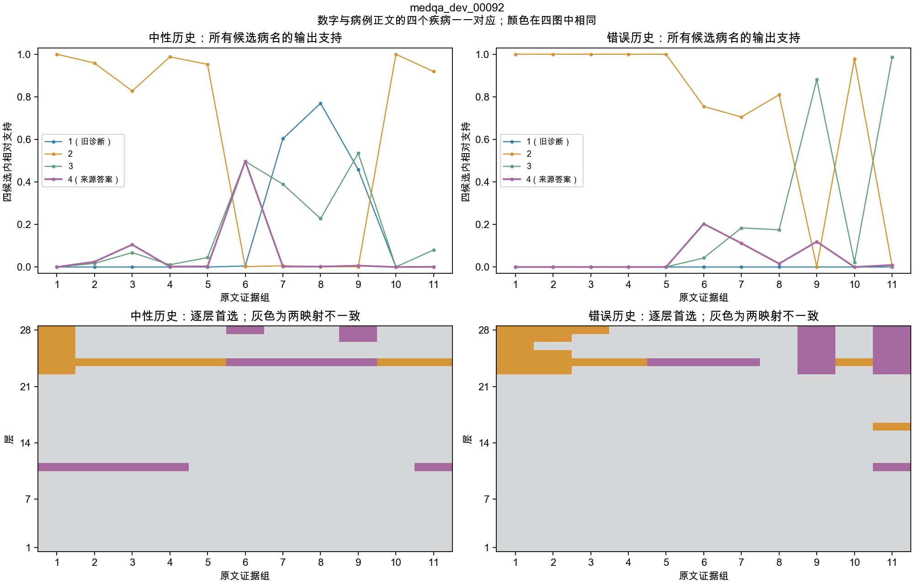
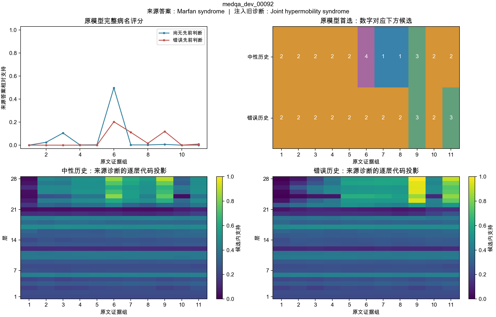

# medqa_dev_00092

来源：MedQA，dev，原始第92行（零起始）。完整题目来源答案：**Marfan syndrome**；人为指定的错误旧诊断：**Joint hypermobility syndrome**。

候选：1 = Joint hypermobility syndrome；2 = Sturge-Weber syndrome；3 = Ehlers-Danlos syndrome；4 = Marfan syndrome。

上排分别显示两种历史下四种候选的病名支持；下排颜色为逐层代码首选，灰色表示两套代码没有指向同一疾病，不能稳定命名该层倾向。

上排是原模型病名评分，下面是未训练输出头的代码投影、两种映射平均；二者接口不同。来源标签只评价完整题目。

| 轮 | 新增原文证据组 | 中性历史首选 | 错误历史首选 |
|---:|---|---|---|
| 1 | A 19-year-old female college student comes to the physician for a sudden loss of visual acuity of her right eye. | Sturge-Weber syndrome | Sturge-Weber syndrome |
| 2 | She noticed that she was unable to read the time on the alarm clock when she woke up in the morning. | Sturge-Weber syndrome | Sturge-Weber syndrome |
| 3 | When she closes her right eye, she is able to see sharply. | Sturge-Weber syndrome | Sturge-Weber syndrome |
| 4 | When she closes her left eye, she has blurry double vision. | Sturge-Weber syndrome | Sturge-Weber syndrome |
| 5 | She does not recall trauma to her eye but has been working long nights on her honors thesis. | Sturge-Weber syndrome | Sturge-Weber syndrome |
| 6 | She has a history of occasional shoulder luxation. | Marfan syndrome | Sturge-Weber syndrome |
| 7 | She is 180 cm (5 ft 11 in) tall, and weighs 62 kg (136 lbs); her BMI is 19.1 kg/m2. | Joint hypermobility syndrome | Sturge-Weber syndrome |
| 8 | Her vital signs are within normal limits. | Joint hypermobility syndrome | Sturge-Weber syndrome |
| 9 | On physical examination, slender and long fingers are noted. | Ehlers-Danlos syndrome | Ehlers-Danlos syndrome |
| 10 | She has several flat, demarcated brownish nevi on her left cheek. | Sturge-Weber syndrome | Sturge-Weber syndrome |
| 11 | Ocular examination shows upward temporal subluxation of her right lens. | Sturge-Weber syndrome | Ehlers-Danlos syndrome |

## 关键层的投影读表

每格先检查两套答案代码是否指向同一候选；不一致就不命名。括号内为四个答案代码在全词表中的概率总量，接近0时说明输出头尚不适合在该层读取答案。映射一致本身不等于医学判断正确。

### 中性历史

| 轮 | 第7层 | 第14层 | 第21层 | 第28层 |
|---:|---|---|---|---|
| 1 | 映射不一致 | 映射不一致 | 映射不一致 | Sturge-Weber syndrome（代码总量 0.95） |
| 2 | 映射不一致 | 映射不一致 | 映射不一致 | 映射不一致 |
| 3 | 映射不一致 | 映射不一致 | 映射不一致 | 映射不一致 |
| 4 | 映射不一致 | 映射不一致 | 映射不一致 | 映射不一致 |
| 5 | 映射不一致 | 映射不一致 | 映射不一致 | 映射不一致 |
| 6 | 映射不一致 | 映射不一致 | 映射不一致 | Marfan syndrome（代码总量 0.98） |
| 7 | 映射不一致 | 映射不一致 | 映射不一致 | 映射不一致 |
| 8 | 映射不一致 | 映射不一致 | 映射不一致 | 映射不一致 |
| 9 | 映射不一致 | 映射不一致 | 映射不一致 | Marfan syndrome（代码总量 0.86） |
| 10 | 映射不一致 | 映射不一致 | 映射不一致 | 映射不一致 |
| 11 | 映射不一致 | 映射不一致 | 映射不一致 | 映射不一致 |

### 错误历史

| 轮 | 第7层 | 第14层 | 第21层 | 第28层 |
|---:|---|---|---|---|
| 1 | 映射不一致 | 映射不一致 | 映射不一致 | Sturge-Weber syndrome（代码总量 1） |
| 2 | 映射不一致 | 映射不一致 | 映射不一致 | Sturge-Weber syndrome（代码总量 1） |
| 3 | 映射不一致 | 映射不一致 | 映射不一致 | Sturge-Weber syndrome（代码总量 1） |
| 4 | 映射不一致 | 映射不一致 | 映射不一致 | 映射不一致 |
| 5 | 映射不一致 | 映射不一致 | 映射不一致 | 映射不一致 |
| 6 | 映射不一致 | 映射不一致 | 映射不一致 | 映射不一致 |
| 7 | 映射不一致 | 映射不一致 | 映射不一致 | 映射不一致 |
| 8 | 映射不一致 | 映射不一致 | 映射不一致 | 映射不一致 |
| 9 | 映射不一致 | 映射不一致 | 映射不一致 | Marfan syndrome（代码总量 1） |
| 10 | 映射不一致 | 映射不一致 | 映射不一致 | 映射不一致 |
| 11 | 映射不一致 | 映射不一致 | 映射不一致 | Marfan syndrome（代码总量 0.96） |
