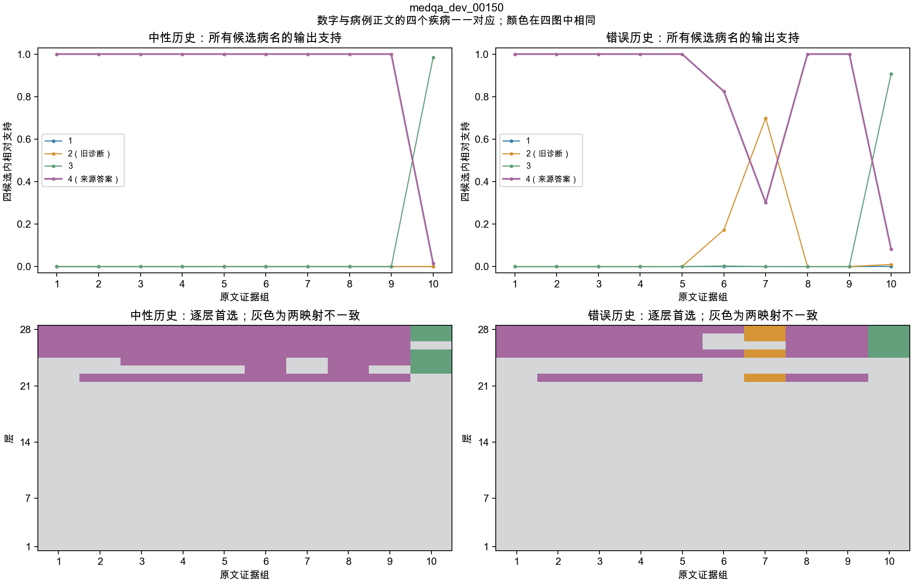
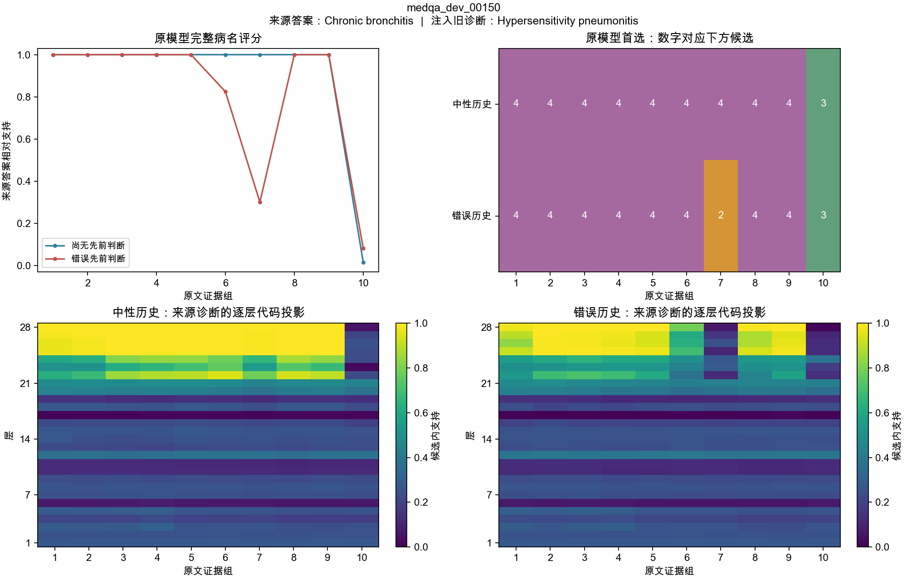

# medqa_dev_00150

来源：MedQA，dev，原始第150行（零起始）。完整题目来源答案：**Chronic bronchitis**；人为指定的错误旧诊断：**Hypersensitivity pneumonitis**。

候选：1 = Asbestosis；2 = Hypersensitivity pneumonitis；3 = Asthma；4 = Chronic bronchitis。

上排分别显示两种历史下四种候选的病名支持；下排颜色为逐层代码首选，灰色表示两套代码没有指向同一疾病，不能稳定命名该层倾向。

上排是原模型病名评分，下面是未训练输出头的代码投影、两种映射平均；二者接口不同。来源标签只评价完整题目。

| 轮 | 新增原文证据组 | 中性历史首选 | 错误历史首选 |
|---:|---|---|---|
| 1 | A 48-year-old man comes to the physician because of a 4-month history of persistent cough productive of white phlegm. | Chronic bronchitis | Chronic bronchitis |
| 2 | He coughs consistently throughout the day, and he has not noticed any particular triggers that make it worse. | Chronic bronchitis | Chronic bronchitis |
| 3 | He has also recently experienced some shortness of breath with exertion. | Chronic bronchitis | Chronic bronchitis |
| 4 | He has not had any weight loss, fever, or chills. | Chronic bronchitis | Chronic bronchitis |
| 5 | He had similar symptoms last year, which lasted about 6 months. | Chronic bronchitis | Chronic bronchitis |
| 6 | He has hypertension, for which he takes amlodipine. | Chronic bronchitis | Chronic bronchitis |
| 7 | He has worked in construction for the past 10 years. | Chronic bronchitis | Hypersensitivity pneumonitis |
| 8 | He has smoked a pack of cigarettes per day for 30 years. | Chronic bronchitis | Chronic bronchitis |
| 9 | Vital signs are within normal limits. | Chronic bronchitis | Chronic bronchitis |
| 10 | Examination shows an end-expiratory wheeze throughout all lung zones. | Asthma | Asthma |

## 关键层的投影读表

每格先检查两套答案代码是否指向同一候选；不一致就不命名。括号内为四个答案代码在全词表中的概率总量，接近0时说明输出头尚不适合在该层读取答案。映射一致本身不等于医学判断正确。

### 中性历史

| 轮 | 第7层 | 第14层 | 第21层 | 第28层 |
|---:|---|---|---|---|
| 1 | 映射不一致 | 映射不一致 | 映射不一致 | Chronic bronchitis（代码总量 0.15） |
| 2 | 映射不一致 | 映射不一致 | 映射不一致 | Chronic bronchitis（代码总量 0.18） |
| 3 | 映射不一致 | 映射不一致 | 映射不一致 | Chronic bronchitis（代码总量 0.94） |
| 4 | 映射不一致 | 映射不一致 | 映射不一致 | Chronic bronchitis（代码总量 0.96） |
| 5 | 映射不一致 | 映射不一致 | 映射不一致 | Chronic bronchitis（代码总量 0.99） |
| 6 | 映射不一致 | 映射不一致 | 映射不一致 | Chronic bronchitis（代码总量 1） |
| 7 | 映射不一致 | 映射不一致 | 映射不一致 | Chronic bronchitis（代码总量 1） |
| 8 | 映射不一致 | 映射不一致 | 映射不一致 | Chronic bronchitis（代码总量 1） |
| 9 | 映射不一致 | 映射不一致 | 映射不一致 | Chronic bronchitis（代码总量 1） |
| 10 | 映射不一致 | 映射不一致 | 映射不一致 | Asthma（代码总量 1） |

### 错误历史

| 轮 | 第7层 | 第14层 | 第21层 | 第28层 |
|---:|---|---|---|---|
| 1 | 映射不一致 | 映射不一致 | 映射不一致 | Chronic bronchitis（代码总量 0.022） |
| 2 | 映射不一致 | 映射不一致 | 映射不一致 | Chronic bronchitis（代码总量 0.22） |
| 3 | 映射不一致 | 映射不一致 | 映射不一致 | Chronic bronchitis（代码总量 0.97） |
| 4 | 映射不一致 | 映射不一致 | 映射不一致 | Chronic bronchitis（代码总量 0.97） |
| 5 | 映射不一致 | 映射不一致 | 映射不一致 | Chronic bronchitis（代码总量 1） |
| 6 | 映射不一致 | 映射不一致 | 映射不一致 | Chronic bronchitis（代码总量 1） |
| 7 | 映射不一致 | 映射不一致 | 映射不一致 | Hypersensitivity pneumonitis（代码总量 0.99） |
| 8 | 映射不一致 | 映射不一致 | 映射不一致 | Chronic bronchitis（代码总量 1） |
| 9 | 映射不一致 | 映射不一致 | 映射不一致 | Chronic bronchitis（代码总量 1） |
| 10 | 映射不一致 | 映射不一致 | 映射不一致 | Asthma（代码总量 1） |
