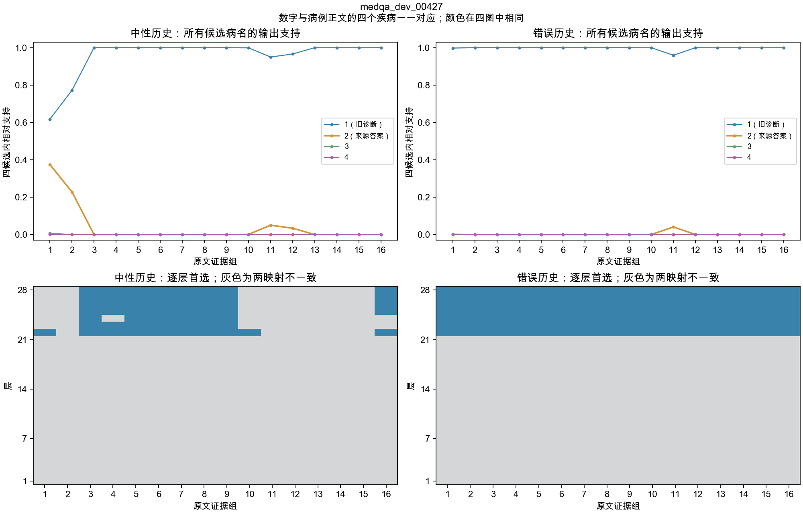
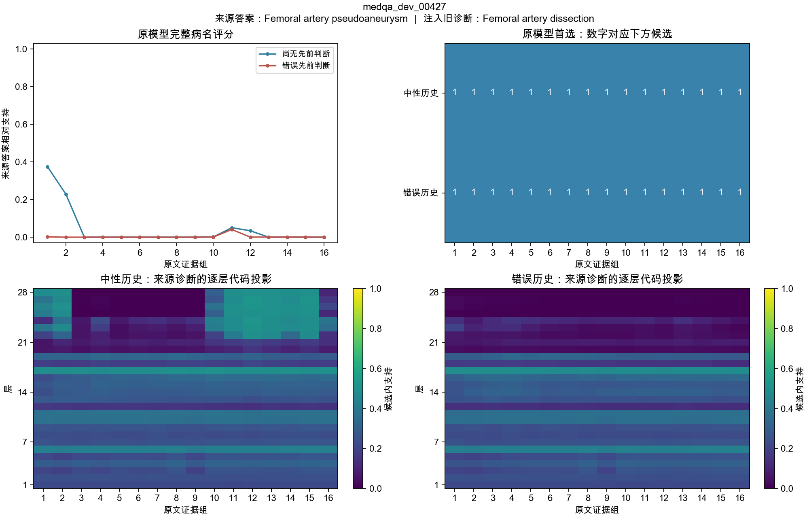

# medqa_dev_00427

来源：MedQA，dev，原始第427行（零起始）。完整题目来源答案：**Femoral artery pseudoaneurysm**；人为指定的错误旧诊断：**Femoral artery dissection**。

候选：1 = Femoral artery dissection；2 = Femoral artery pseudoaneurysm；3 = Femoral artery thrombosis；4 = Femoral abscess。

上排分别显示两种历史下四种候选的病名支持；下排颜色为逐层代码首选，灰色表示两套代码没有指向同一疾病，不能稳定命名该层倾向。

上排是原模型病名评分，下面是未训练输出头的代码投影、两种映射平均；二者接口不同。来源标签只评价完整题目。

| 轮 | 新增原文证据组 | 中性历史首选 | 错误历史首选 |
|---:|---|---|---|
| 1 | A 56-year-old man comes to the physician for a routine health maintenance examination. | Femoral artery dissection | Femoral artery dissection |
| 2 | He has had mild pain in his left groin for 2 weeks. | Femoral artery dissection | Femoral artery dissection |
| 3 | He was admitted to the hospital 1 month ago for myocardial infarction. | Femoral artery dissection | Femoral artery dissection |
| 4 | Cardiac catheterization and angiography showed occlusion of the left anterior descending artery and he underwent placement of 2 stents. | Femoral artery dissection | Femoral artery dissection |
| 5 | He has hypertension and hypercholesterolemia. | Femoral artery dissection | Femoral artery dissection |
| 6 | There is no family history of serious illness. | Femoral artery dissection | Femoral artery dissection |
| 7 | He has smoked 2 packs of cigarettes daily for 30 years. | Femoral artery dissection | Femoral artery dissection |
| 8 | Current medications include aspirin, clopidogrel, rosuvastatin, and enalapril. | Femoral artery dissection | Femoral artery dissection |
| 9 | His temperature is 36.7°C (98°F), pulse is 88/min, and blood pressure is 130/84 mm Hg. | Femoral artery dissection | Femoral artery dissection |
| 10 | Examination shows a 3-cm (1.2-in), tender, pulsatile mass in the left thigh, below the inguinal ligament. | Femoral artery dissection | Femoral artery dissection |
| 11 | There is mild erythema of the overlying skin. | Femoral artery dissection | Femoral artery dissection |
| 12 | A loud murmur is heard on auscultation of the mass. | Femoral artery dissection | Femoral artery dissection |
| 13 | Cardiopulmonary examination shows no abnormalities. | Femoral artery dissection | Femoral artery dissection |
| 14 | There is no edema in the lower limbs. | Femoral artery dissection | Femoral artery dissection |
| 15 | Femoral and pedal pulses are palpable bilaterally. | Femoral artery dissection | Femoral artery dissection |
| 16 | Neurologic examination shows no focal findings. | Femoral artery dissection | Femoral artery dissection |

## 关键层的投影读表

每格先检查两套答案代码是否指向同一候选；不一致就不命名。括号内为四个答案代码在全词表中的概率总量，接近0时说明输出头尚不适合在该层读取答案。映射一致本身不等于医学判断正确。

### 中性历史

| 轮 | 第7层 | 第14层 | 第21层 | 第28层 |
|---:|---|---|---|---|
| 1 | 映射不一致 | 映射不一致 | 映射不一致 | 映射不一致 |
| 2 | 映射不一致 | 映射不一致 | 映射不一致 | 映射不一致 |
| 3 | 映射不一致 | 映射不一致 | 映射不一致 | Femoral artery dissection（代码总量 1） |
| 4 | 映射不一致 | 映射不一致 | 映射不一致 | Femoral artery dissection（代码总量 1） |
| 5 | 映射不一致 | 映射不一致 | 映射不一致 | Femoral artery dissection（代码总量 1） |
| 6 | 映射不一致 | 映射不一致 | 映射不一致 | Femoral artery dissection（代码总量 1） |
| 7 | 映射不一致 | 映射不一致 | 映射不一致 | Femoral artery dissection（代码总量 1） |
| 8 | 映射不一致 | 映射不一致 | 映射不一致 | Femoral artery dissection（代码总量 1） |
| 9 | 映射不一致 | 映射不一致 | 映射不一致 | Femoral artery dissection（代码总量 1） |
| 10 | 映射不一致 | 映射不一致 | 映射不一致 | 映射不一致 |
| 11 | 映射不一致 | 映射不一致 | 映射不一致 | 映射不一致 |
| 12 | 映射不一致 | 映射不一致 | 映射不一致 | 映射不一致 |
| 13 | 映射不一致 | 映射不一致 | 映射不一致 | 映射不一致 |
| 14 | 映射不一致 | 映射不一致 | 映射不一致 | 映射不一致 |
| 15 | 映射不一致 | 映射不一致 | 映射不一致 | 映射不一致 |
| 16 | 映射不一致 | 映射不一致 | 映射不一致 | Femoral artery dissection（代码总量 1） |

### 错误历史

| 轮 | 第7层 | 第14层 | 第21层 | 第28层 |
|---:|---|---|---|---|
| 1 | 映射不一致 | 映射不一致 | 映射不一致 | Femoral artery dissection（代码总量 0.18） |
| 2 | 映射不一致 | 映射不一致 | 映射不一致 | Femoral artery dissection（代码总量 0.38） |
| 3 | 映射不一致 | 映射不一致 | 映射不一致 | Femoral artery dissection（代码总量 0.25） |
| 4 | 映射不一致 | 映射不一致 | 映射不一致 | Femoral artery dissection（代码总量 0.4） |
| 5 | 映射不一致 | 映射不一致 | 映射不一致 | Femoral artery dissection（代码总量 0.7） |
| 6 | 映射不一致 | 映射不一致 | 映射不一致 | Femoral artery dissection（代码总量 0.91） |
| 7 | 映射不一致 | 映射不一致 | 映射不一致 | Femoral artery dissection（代码总量 0.88） |
| 8 | 映射不一致 | 映射不一致 | 映射不一致 | Femoral artery dissection（代码总量 0.99） |
| 9 | 映射不一致 | 映射不一致 | 映射不一致 | Femoral artery dissection（代码总量 0.97） |
| 10 | 映射不一致 | 映射不一致 | 映射不一致 | Femoral artery dissection（代码总量 1） |
| 11 | 映射不一致 | 映射不一致 | 映射不一致 | Femoral artery dissection（代码总量 0.98） |
| 12 | 映射不一致 | 映射不一致 | 映射不一致 | Femoral artery dissection（代码总量 0.99） |
| 13 | 映射不一致 | 映射不一致 | 映射不一致 | Femoral artery dissection（代码总量 0.98） |
| 14 | 映射不一致 | 映射不一致 | 映射不一致 | Femoral artery dissection（代码总量 0.94） |
| 15 | 映射不一致 | 映射不一致 | 映射不一致 | Femoral artery dissection（代码总量 0.99） |
| 16 | 映射不一致 | 映射不一致 | 映射不一致 | Femoral artery dissection（代码总量 0.97） |
