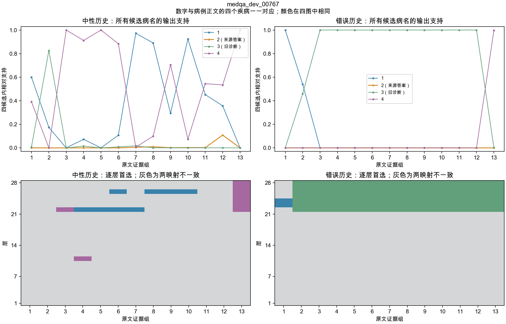
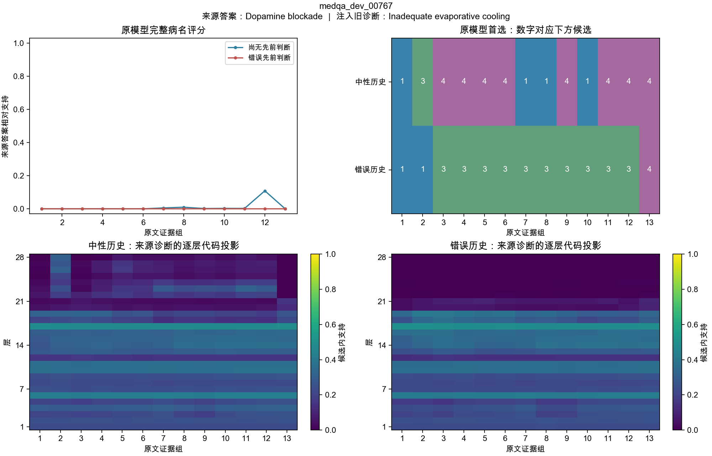

# medqa_dev_00767

来源：MedQA，dev，原始第767行（零起始）。完整题目来源答案：**Dopamine blockade**；人为指定的错误旧诊断：**Inadequate evaporative cooling**。

候选：1 = Dehydration；2 = Dopamine blockade；3 = Inadequate evaporative cooling；4 = Infection。

上排分别显示两种历史下四种候选的病名支持；下排颜色为逐层代码首选，灰色表示两套代码没有指向同一疾病，不能稳定命名该层倾向。

上排是原模型病名评分，下面是未训练输出头的代码投影、两种映射平均；二者接口不同。来源标签只评价完整题目。

| 轮 | 新增原文证据组 | 中性历史首选 | 错误历史首选 |
|---:|---|---|---|
| 1 | A 24-year-old man is brought to the emergency department for bowling at a local bowling alley while inappropriately dressed. | Dehydration | Dehydration |
| 2 | The patient refused to speak with police and was seen conversing with inanimate objects in the back of the police car. | Inadequate evaporative cooling | Dehydration |
| 3 | The patient states that his clothes were contaminated by assassins who have been tracking him for years. | Infection | Inadequate evaporative cooling |
| 4 | The patient refuses to answer any further questions, and continues to whisper toward someone else. | Infection | Inadequate evaporative cooling |
| 5 | The patient has a past medical history of homelessness, alcohol abuse, marijuana use, and cocaine abuse. | Infection | Inadequate evaporative cooling |
| 6 | Physical exam is notable for a healthy young man who seems mistrustful of all hospital personnel. | Infection | Inadequate evaporative cooling |
| 7 | The patient is started on a medication and is transferred to the psychiatric inpatient unit. | Dehydration | Inadequate evaporative cooling |
| 8 | The patient’s condition improves, but he still often speaks of a contamination that is on his clothes and skin that is coming from external parties. | Dehydration | Inadequate evaporative cooling |
| 9 | The patient is started on a new medication. | Infection | Inadequate evaporative cooling |
| 10 | He is then sent to group therapy, followed by physical activity in the yard. | Dehydration | Inadequate evaporative cooling |
| 11 | The physician is called over when the patient is found down in the recreation yard while he was exercising. | Infection | Inadequate evaporative cooling |
| 12 | The patient is not responsive, and his limbs seem to resist passive force. | Infection | Inadequate evaporative cooling |
| 13 | His temperature is 104°F (40°C), pulse is 112/min, blood pressure is 140/90 mmHg, respirations are 18/min, and oxygen saturation is 95% on room air. | Infection | Infection |

## 关键层的投影读表

每格先检查两套答案代码是否指向同一候选；不一致就不命名。括号内为四个答案代码在全词表中的概率总量，接近0时说明输出头尚不适合在该层读取答案。映射一致本身不等于医学判断正确。

### 中性历史

| 轮 | 第7层 | 第14层 | 第21层 | 第28层 |
|---:|---|---|---|---|
| 1 | 映射不一致 | 映射不一致 | 映射不一致 | 映射不一致 |
| 2 | 映射不一致 | 映射不一致 | 映射不一致 | 映射不一致 |
| 3 | 映射不一致 | 映射不一致 | 映射不一致 | 映射不一致 |
| 4 | 映射不一致 | 映射不一致 | 映射不一致 | 映射不一致 |
| 5 | 映射不一致 | 映射不一致 | 映射不一致 | 映射不一致 |
| 6 | 映射不一致 | 映射不一致 | 映射不一致 | 映射不一致 |
| 7 | 映射不一致 | 映射不一致 | 映射不一致 | 映射不一致 |
| 8 | 映射不一致 | 映射不一致 | 映射不一致 | 映射不一致 |
| 9 | 映射不一致 | 映射不一致 | 映射不一致 | 映射不一致 |
| 10 | 映射不一致 | 映射不一致 | 映射不一致 | 映射不一致 |
| 11 | 映射不一致 | 映射不一致 | 映射不一致 | 映射不一致 |
| 12 | 映射不一致 | 映射不一致 | 映射不一致 | 映射不一致 |
| 13 | 映射不一致 | 映射不一致 | 映射不一致 | Infection（代码总量 1） |

### 错误历史

| 轮 | 第7层 | 第14层 | 第21层 | 第28层 |
|---:|---|---|---|---|
| 1 | 映射不一致 | 映射不一致 | 映射不一致 | 映射不一致 |
| 2 | 映射不一致 | 映射不一致 | 映射不一致 | Inadequate evaporative cooling（代码总量 1） |
| 3 | 映射不一致 | 映射不一致 | 映射不一致 | Inadequate evaporative cooling（代码总量 1） |
| 4 | 映射不一致 | 映射不一致 | 映射不一致 | Inadequate evaporative cooling（代码总量 1） |
| 5 | 映射不一致 | 映射不一致 | 映射不一致 | Inadequate evaporative cooling（代码总量 1） |
| 6 | 映射不一致 | 映射不一致 | 映射不一致 | Inadequate evaporative cooling（代码总量 1） |
| 7 | 映射不一致 | 映射不一致 | 映射不一致 | Inadequate evaporative cooling（代码总量 1） |
| 8 | 映射不一致 | 映射不一致 | 映射不一致 | Inadequate evaporative cooling（代码总量 1） |
| 9 | 映射不一致 | 映射不一致 | 映射不一致 | Inadequate evaporative cooling（代码总量 1） |
| 10 | 映射不一致 | 映射不一致 | 映射不一致 | Inadequate evaporative cooling（代码总量 1） |
| 11 | 映射不一致 | 映射不一致 | 映射不一致 | Inadequate evaporative cooling（代码总量 1） |
| 12 | 映射不一致 | 映射不一致 | 映射不一致 | Inadequate evaporative cooling（代码总量 1） |
| 13 | 映射不一致 | 映射不一致 | 映射不一致 | Inadequate evaporative cooling（代码总量 1） |
