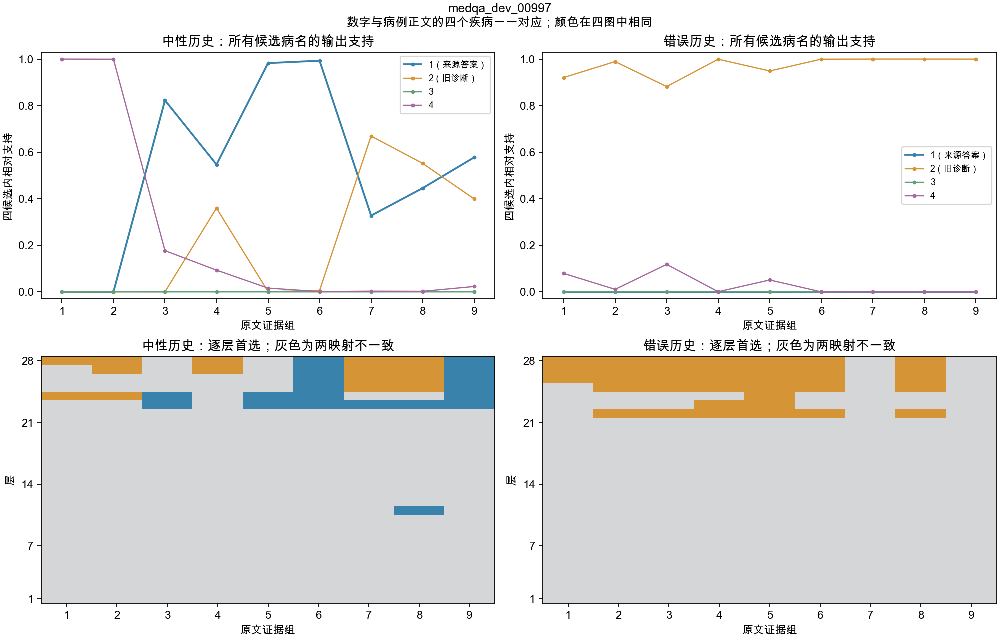
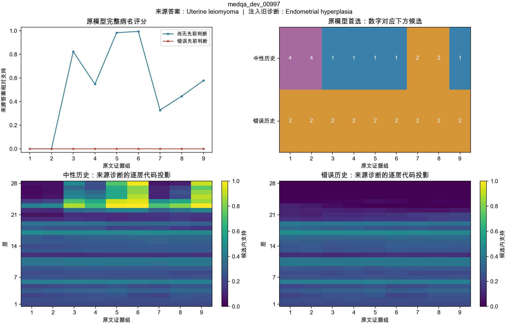

# medqa_dev_00997

来源：MedQA，dev，原始第997行（零起始）。完整题目来源答案：**Uterine leiomyoma**；人为指定的错误旧诊断：**Endometrial hyperplasia**。

**文本审计标记：本例末尾含任务引导语；原始分组完整保留，不将该轮解释为新增医学事实。严格敏感性分析排除此例。**

候选：1 = Uterine leiomyoma；2 = Endometrial hyperplasia；3 = Endometrial carcinoma；4 = Endometrial polyp。

上排分别显示两种历史下四种候选的病名支持；下排颜色为逐层代码首选，灰色表示两套代码没有指向同一疾病，不能稳定命名该层倾向。

上排是原模型病名评分，下面是未训练输出头的代码投影、两种映射平均；二者接口不同。来源标签只评价完整题目。

| 轮 | 新增原文证据组 | 中性历史首选 | 错误历史首选 |
|---:|---|---|---|
| 1 | A 30-year-old woman seeks evaluation at a local walk-in clinic with a week-long history of lightheadedness and palpitations. | Endometrial polyp | Endometrial hyperplasia |
| 2 | She also complains of fatigability and shortness of breath of the same duration. | Endometrial polyp | Endometrial hyperplasia |
| 3 | The past medical history is significant for menarche at 9 years of age, heavy menstrual bleeding for the past several years and abdominal pain that worsens during menses. | Uterine leiomyoma | Endometrial hyperplasia |
| 4 | She stopped trying to conceive a child after 2 spontaneous abortions in the past 4 years and has been on iron oral supplementation for the last 2 years. | Uterine leiomyoma | Endometrial hyperplasia |
| 5 | She adds that she feels a dull pressure-like discomfort in her pelvis and constipation. | Uterine leiomyoma | Endometrial hyperplasia |
| 6 | The physical examination is significant for pale mucous membranes and a grade 2/6 ejection systolic murmur in the area of the pulmonic valve. | Uterine leiomyoma | Endometrial hyperplasia |
| 7 | Pelvic examination reveals an enlarged, mobile uterus with an irregular contour. | Endometrial hyperplasia | Endometrial hyperplasia |
| 8 | The hemoglobin level is 10 g/dL and the hematocrit is 27%. | Endometrial hyperplasia | Endometrial hyperplasia |
| 9 | Based on these findings, | Uterine leiomyoma | Endometrial hyperplasia |

## 关键层的投影读表

每格先检查两套答案代码是否指向同一候选；不一致就不命名。括号内为四个答案代码在全词表中的概率总量，接近0时说明输出头尚不适合在该层读取答案。映射一致本身不等于医学判断正确。

### 中性历史

| 轮 | 第7层 | 第14层 | 第21层 | 第28层 |
|---:|---|---|---|---|
| 1 | 映射不一致 | 映射不一致 | 映射不一致 | Endometrial hyperplasia（代码总量 0.99） |
| 2 | 映射不一致 | 映射不一致 | 映射不一致 | Endometrial hyperplasia（代码总量 0.98） |
| 3 | 映射不一致 | 映射不一致 | 映射不一致 | 映射不一致 |
| 4 | 映射不一致 | 映射不一致 | 映射不一致 | Endometrial hyperplasia（代码总量 1） |
| 5 | 映射不一致 | 映射不一致 | 映射不一致 | 映射不一致 |
| 6 | 映射不一致 | 映射不一致 | 映射不一致 | Uterine leiomyoma（代码总量 1） |
| 7 | 映射不一致 | 映射不一致 | 映射不一致 | Endometrial hyperplasia（代码总量 1） |
| 8 | 映射不一致 | 映射不一致 | 映射不一致 | Endometrial hyperplasia（代码总量 1） |
| 9 | 映射不一致 | 映射不一致 | 映射不一致 | Uterine leiomyoma（代码总量 1） |

### 错误历史

| 轮 | 第7层 | 第14层 | 第21层 | 第28层 |
|---:|---|---|---|---|
| 1 | 映射不一致 | 映射不一致 | 映射不一致 | Endometrial hyperplasia（代码总量 1） |
| 2 | 映射不一致 | 映射不一致 | 映射不一致 | Endometrial hyperplasia（代码总量 1） |
| 3 | 映射不一致 | 映射不一致 | 映射不一致 | Endometrial hyperplasia（代码总量 1） |
| 4 | 映射不一致 | 映射不一致 | 映射不一致 | Endometrial hyperplasia（代码总量 1） |
| 5 | 映射不一致 | 映射不一致 | 映射不一致 | Endometrial hyperplasia（代码总量 1） |
| 6 | 映射不一致 | 映射不一致 | 映射不一致 | Endometrial hyperplasia（代码总量 1） |
| 7 | 映射不一致 | 映射不一致 | 映射不一致 | 映射不一致 |
| 8 | 映射不一致 | 映射不一致 | 映射不一致 | Endometrial hyperplasia（代码总量 1） |
| 9 | 映射不一致 | 映射不一致 | 映射不一致 | 映射不一致 |
