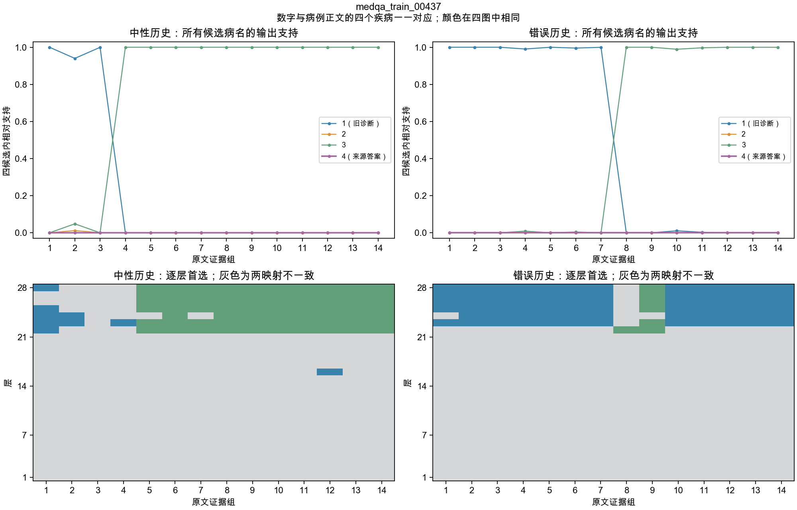
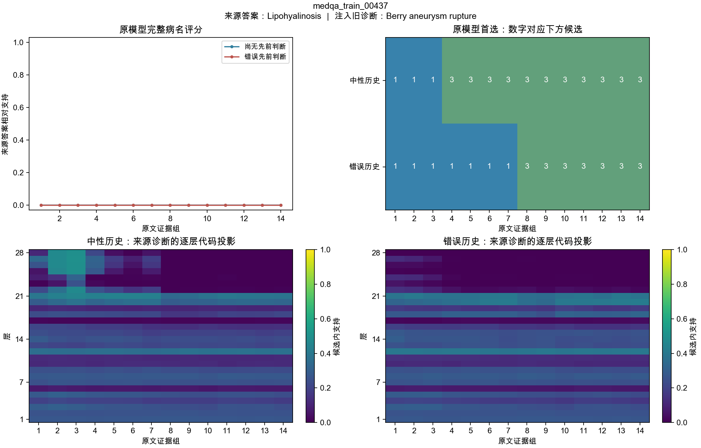

# medqa_train_00437

来源：MedQA，train，原始第437行（零起始）。完整题目来源答案：**Lipohyalinosis**；人为指定的错误旧诊断：**Berry aneurysm rupture**。

候选：1 = Berry aneurysm rupture；2 = Bridging vein tear；3 = Hypertensive encephalopathy；4 = Lipohyalinosis。

上排分别显示两种历史下四种候选的病名支持；下排颜色为逐层代码首选，灰色表示两套代码没有指向同一疾病，不能稳定命名该层倾向。

上排是原模型病名评分，下面是未训练输出头的代码投影、两种映射平均；二者接口不同。来源标签只评价完整题目。

| 轮 | 新增原文证据组 | 中性历史首选 | 错误历史首选 |
|---:|---|---|---|
| 1 | A 65-year-old man presents to the emergency department for sudden weakness. | Berry aneurysm rupture | Berry aneurysm rupture |
| 2 | The patient states that he was at home enjoying his morning coffee when his symptoms began. | Berry aneurysm rupture | Berry aneurysm rupture |
| 3 | He says that his left arm suddenly felt very odd and weak thus prompting him to come to the ED. | Berry aneurysm rupture | Berry aneurysm rupture |
| 4 | The patient has a past medical history of diabetes, COPD, hypertension, anxiety, alcohol abuse, and PTSD. | Hypertensive encephalopathy | Berry aneurysm rupture |
| 5 | He recently fell off a horse while horseback riding but claims to not have experienced any significant injuries. | Hypertensive encephalopathy | Berry aneurysm rupture |
| 6 | He typically drinks 5-7 drinks per day and his last drink was yesterday afternoon. | Hypertensive encephalopathy | Berry aneurysm rupture |
| 7 | His current medications include insulin, metformin, atorvastatin, lisinopril, albuterol, and fluoxetine. | Hypertensive encephalopathy | Berry aneurysm rupture |
| 8 | His temperature is 99.5°F (37.5°C), blood pressure is 177/118 mmHg, pulse is 120/min, respirations are 18/min, and oxygen saturation is 93% on room air. | Hypertensive encephalopathy | Hypertensive encephalopathy |
| 9 | On physical exam, you note an elderly man who is mildly confused. | Hypertensive encephalopathy | Hypertensive encephalopathy |
| 10 | Cardiopulmonary exam demonstrates bilateral expiratory wheezes and a systolic murmur along the right upper sternal border that radiates to the carotids. | Hypertensive encephalopathy | Hypertensive encephalopathy |
| 11 | Neurological exam reveals cranial nerves II-XII as grossly intact with finger-nose exam mildly abnormal on the left and heel-shin exam within normal limits. | Hypertensive encephalopathy | Hypertensive encephalopathy |
| 12 | The patient has 5/5 strength in his right arm and 3/5 strength in his left arm. | Hypertensive encephalopathy | Hypertensive encephalopathy |
| 13 | The patient struggles to manipulate objects such as a pen with his left hand. | Hypertensive encephalopathy | Hypertensive encephalopathy |
| 14 | The patient is given a dose of diazepam and started on IV fluids. | Hypertensive encephalopathy | Hypertensive encephalopathy |

## 关键层的投影读表

每格先检查两套答案代码是否指向同一候选；不一致就不命名。括号内为四个答案代码在全词表中的概率总量，接近0时说明输出头尚不适合在该层读取答案。映射一致本身不等于医学判断正确。

### 中性历史

| 轮 | 第7层 | 第14层 | 第21层 | 第28层 |
|---:|---|---|---|---|
| 1 | 映射不一致 | 映射不一致 | 映射不一致 | Berry aneurysm rupture（代码总量 1） |
| 2 | 映射不一致 | 映射不一致 | 映射不一致 | 映射不一致 |
| 3 | 映射不一致 | 映射不一致 | 映射不一致 | 映射不一致 |
| 4 | 映射不一致 | 映射不一致 | 映射不一致 | 映射不一致 |
| 5 | 映射不一致 | 映射不一致 | 映射不一致 | Hypertensive encephalopathy（代码总量 1） |
| 6 | 映射不一致 | 映射不一致 | 映射不一致 | Hypertensive encephalopathy（代码总量 1） |
| 7 | 映射不一致 | 映射不一致 | 映射不一致 | Hypertensive encephalopathy（代码总量 1） |
| 8 | 映射不一致 | 映射不一致 | 映射不一致 | Hypertensive encephalopathy（代码总量 1） |
| 9 | 映射不一致 | 映射不一致 | 映射不一致 | Hypertensive encephalopathy（代码总量 1） |
| 10 | 映射不一致 | 映射不一致 | 映射不一致 | Hypertensive encephalopathy（代码总量 1） |
| 11 | 映射不一致 | 映射不一致 | 映射不一致 | Hypertensive encephalopathy（代码总量 1） |
| 12 | 映射不一致 | 映射不一致 | 映射不一致 | Hypertensive encephalopathy（代码总量 1） |
| 13 | 映射不一致 | 映射不一致 | 映射不一致 | Hypertensive encephalopathy（代码总量 1） |
| 14 | 映射不一致 | 映射不一致 | 映射不一致 | Hypertensive encephalopathy（代码总量 1） |

### 错误历史

| 轮 | 第7层 | 第14层 | 第21层 | 第28层 |
|---:|---|---|---|---|
| 1 | 映射不一致 | 映射不一致 | 映射不一致 | Berry aneurysm rupture（代码总量 0.94） |
| 2 | 映射不一致 | 映射不一致 | 映射不一致 | Berry aneurysm rupture（代码总量 0.96） |
| 3 | 映射不一致 | 映射不一致 | 映射不一致 | Berry aneurysm rupture（代码总量 1） |
| 4 | 映射不一致 | 映射不一致 | 映射不一致 | Berry aneurysm rupture（代码总量 1） |
| 5 | 映射不一致 | 映射不一致 | 映射不一致 | Berry aneurysm rupture（代码总量 1） |
| 6 | 映射不一致 | 映射不一致 | 映射不一致 | Berry aneurysm rupture（代码总量 1） |
| 7 | 映射不一致 | 映射不一致 | 映射不一致 | Berry aneurysm rupture（代码总量 1） |
| 8 | 映射不一致 | 映射不一致 | 映射不一致 | 映射不一致 |
| 9 | 映射不一致 | 映射不一致 | 映射不一致 | Hypertensive encephalopathy（代码总量 1） |
| 10 | 映射不一致 | 映射不一致 | 映射不一致 | Berry aneurysm rupture（代码总量 1） |
| 11 | 映射不一致 | 映射不一致 | 映射不一致 | Berry aneurysm rupture（代码总量 1） |
| 12 | 映射不一致 | 映射不一致 | 映射不一致 | Berry aneurysm rupture（代码总量 1） |
| 13 | 映射不一致 | 映射不一致 | 映射不一致 | Berry aneurysm rupture（代码总量 1） |
| 14 | 映射不一致 | 映射不一致 | 映射不一致 | Berry aneurysm rupture（代码总量 1） |
