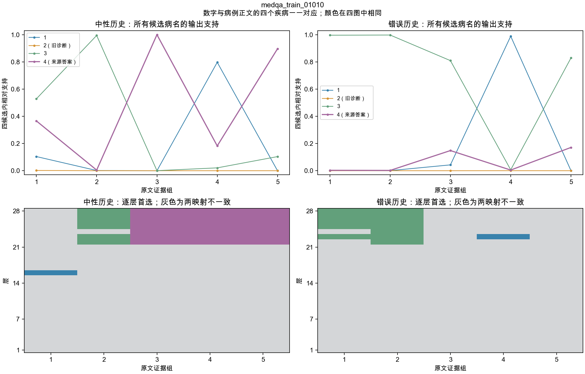
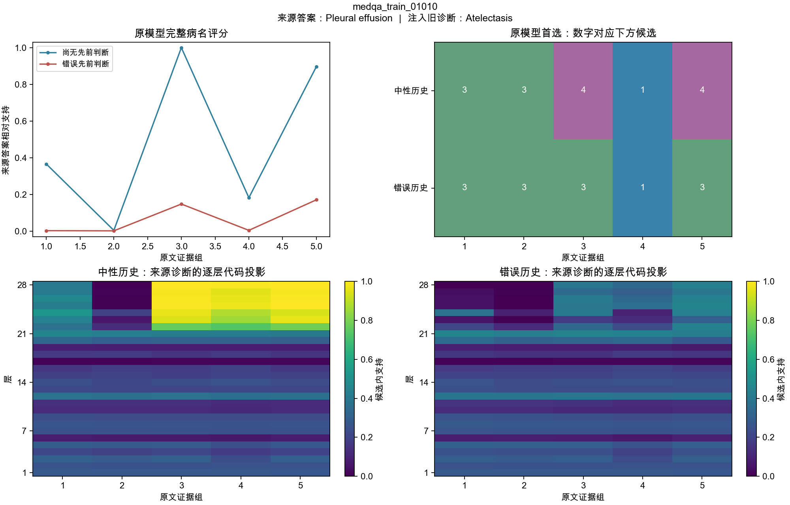

# medqa_train_01010

来源：MedQA，train，原始第1010行（零起始）。完整题目来源答案：**Pleural effusion**；人为指定的错误旧诊断：**Atelectasis**。

候选：1 = Pneumonia；2 = Atelectasis；3 = Pneumothorax；4 = Pleural effusion。

上排分别显示两种历史下四种候选的病名支持；下排颜色为逐层代码首选，灰色表示两套代码没有指向同一疾病，不能稳定命名该层倾向。

上排是原模型病名评分，下面是未训练输出头的代码投影、两种映射平均；二者接口不同。来源标签只评价完整题目。

| 轮 | 新增原文证据组 | 中性历史首选 | 错误历史首选 |
|---:|---|---|---|
| 1 | A 70-year-old man presents to the clinic with right-sided chest pain and difficulty breathing for the past 10 days. | Pneumothorax | Pneumothorax |
| 2 | When it began, the pain was mild, but as time went on, it increased to a level at which the man found it difficult to breathe. | Pneumothorax | Pneumothorax |
| 3 | Two years ago, he was diagnosed with clear cell carcinoma of the kidney. | Pleural effusion | Pneumothorax |
| 4 | Vital signs include: pulse rate is 72/min, blood pressure is 122/80 mm Hg, respiratory rate is 16/min, and temperature is 37.0°C (98.6°F). | Pneumonia | Pneumonia |
| 5 | On physical examination, the trachea appears to have deviated to the left, respiratory movements are diminished, there is decreased resonance on percussion, and there is an absence of breath sounds over the right hemithorax. | Pleural effusion | Pneumothorax |

## 关键层的投影读表

每格先检查两套答案代码是否指向同一候选；不一致就不命名。括号内为四个答案代码在全词表中的概率总量，接近0时说明输出头尚不适合在该层读取答案。映射一致本身不等于医学判断正确。

### 中性历史

| 轮 | 第7层 | 第14层 | 第21层 | 第28层 |
|---:|---|---|---|---|
| 1 | 映射不一致 | 映射不一致 | 映射不一致 | 映射不一致 |
| 2 | 映射不一致 | 映射不一致 | 映射不一致 | Pneumothorax（代码总量 1） |
| 3 | 映射不一致 | 映射不一致 | 映射不一致 | Pleural effusion（代码总量 1） |
| 4 | 映射不一致 | 映射不一致 | 映射不一致 | Pleural effusion（代码总量 1） |
| 5 | 映射不一致 | 映射不一致 | 映射不一致 | Pleural effusion（代码总量 1） |

### 错误历史

| 轮 | 第7层 | 第14层 | 第21层 | 第28层 |
|---:|---|---|---|---|
| 1 | 映射不一致 | 映射不一致 | 映射不一致 | Pneumothorax（代码总量 1） |
| 2 | 映射不一致 | 映射不一致 | 映射不一致 | Pneumothorax（代码总量 1） |
| 3 | 映射不一致 | 映射不一致 | 映射不一致 | 映射不一致 |
| 4 | 映射不一致 | 映射不一致 | 映射不一致 | 映射不一致 |
| 5 | 映射不一致 | 映射不一致 | 映射不一致 | 映射不一致 |
