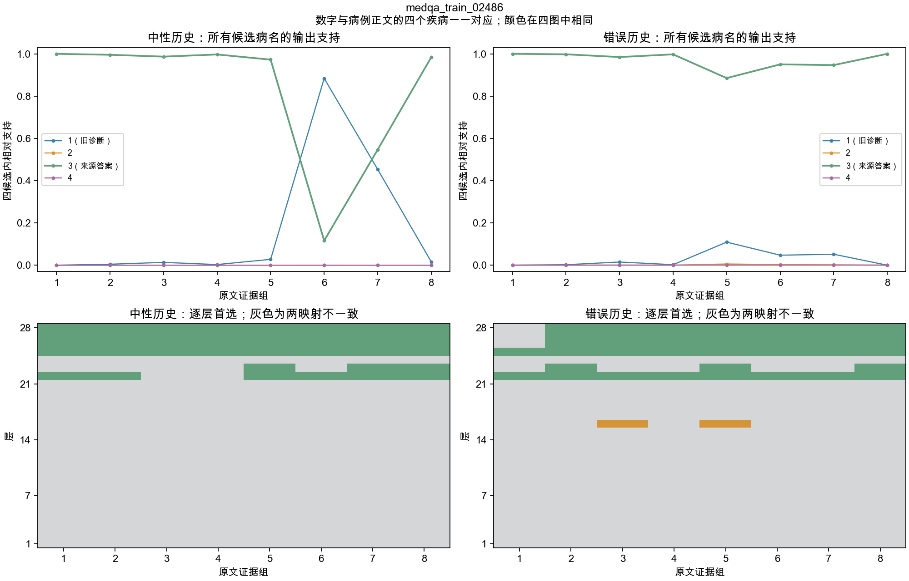
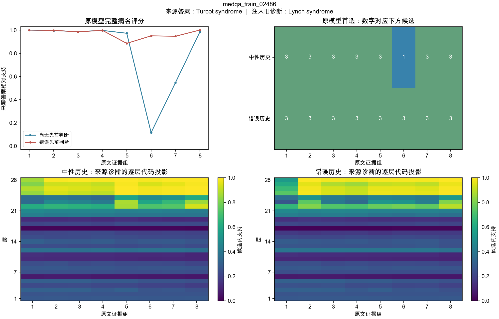

# medqa_train_02486

来源：MedQA，train，原始第2486行（零起始）。完整题目来源答案：**Turcot syndrome**；人为指定的错误旧诊断：**Lynch syndrome**。

候选：1 = Lynch syndrome；2 = Gardner syndrome；3 = Turcot syndrome；4 = Cowden syndrome。

上排分别显示两种历史下四种候选的病名支持；下排颜色为逐层代码首选，灰色表示两套代码没有指向同一疾病，不能稳定命名该层倾向。

上排是原模型病名评分，下面是未训练输出头的代码投影、两种映射平均；二者接口不同。来源标签只评价完整题目。

| 轮 | 新增原文证据组 | 中性历史首选 | 错误历史首选 |
|---:|---|---|---|
| 1 | A 16-year-old boy presents after suffering a tonic-clonic seizure. | Turcot syndrome | Turcot syndrome |
| 2 | He says it had a duration of 2 minutes and a postictal period of 10 minutes. | Turcot syndrome | Turcot syndrome |
| 3 | Patient denies any similar episodes in the past. | Turcot syndrome | Turcot syndrome |
| 4 | Past medical history is unremarkable. | Turcot syndrome | Turcot syndrome |
| 5 | Family history is significant for his mother and older brother who died of colorectal cancer at ages 40 and 20, respectively. | Turcot syndrome | Turcot syndrome |
| 6 | On physical examination, the patient is drowsy but arousable and responsive to commands. | Lynch syndrome | Turcot syndrome |
| 7 | Both pupils are symmetrical and responsive to light. | Turcot syndrome | Turcot syndrome |
| 8 | An MRI of the brain reveals an infratentorial hypointense cerebellar mass with a small cystic area. | Turcot syndrome | Turcot syndrome |

## 关键层的投影读表

每格先检查两套答案代码是否指向同一候选；不一致就不命名。括号内为四个答案代码在全词表中的概率总量，接近0时说明输出头尚不适合在该层读取答案。映射一致本身不等于医学判断正确。

### 中性历史

| 轮 | 第7层 | 第14层 | 第21层 | 第28层 |
|---:|---|---|---|---|
| 1 | 映射不一致 | 映射不一致 | 映射不一致 | Turcot syndrome（代码总量 0.82） |
| 2 | 映射不一致 | 映射不一致 | 映射不一致 | Turcot syndrome（代码总量 0.99） |
| 3 | 映射不一致 | 映射不一致 | 映射不一致 | Turcot syndrome（代码总量 0.98） |
| 4 | 映射不一致 | 映射不一致 | 映射不一致 | Turcot syndrome（代码总量 0.97） |
| 5 | 映射不一致 | 映射不一致 | 映射不一致 | Turcot syndrome（代码总量 1） |
| 6 | 映射不一致 | 映射不一致 | 映射不一致 | Turcot syndrome（代码总量 1） |
| 7 | 映射不一致 | 映射不一致 | 映射不一致 | Turcot syndrome（代码总量 1） |
| 8 | 映射不一致 | 映射不一致 | 映射不一致 | Turcot syndrome（代码总量 1） |

### 错误历史

| 轮 | 第7层 | 第14层 | 第21层 | 第28层 |
|---:|---|---|---|---|
| 1 | 映射不一致 | 映射不一致 | 映射不一致 | 映射不一致 |
| 2 | 映射不一致 | 映射不一致 | 映射不一致 | Turcot syndrome（代码总量 0.95） |
| 3 | 映射不一致 | 映射不一致 | 映射不一致 | Turcot syndrome（代码总量 0.98） |
| 4 | 映射不一致 | 映射不一致 | 映射不一致 | Turcot syndrome（代码总量 0.98） |
| 5 | 映射不一致 | 映射不一致 | 映射不一致 | Turcot syndrome（代码总量 1） |
| 6 | 映射不一致 | 映射不一致 | 映射不一致 | Turcot syndrome（代码总量 1） |
| 7 | 映射不一致 | 映射不一致 | 映射不一致 | Turcot syndrome（代码总量 1） |
| 8 | 映射不一致 | 映射不一致 | 映射不一致 | Turcot syndrome（代码总量 1） |
