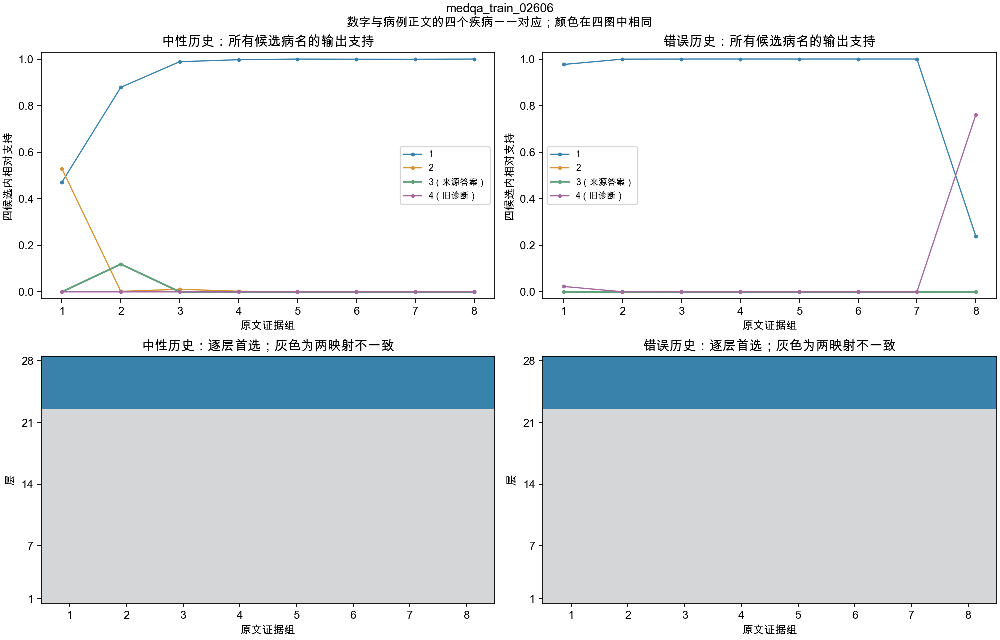
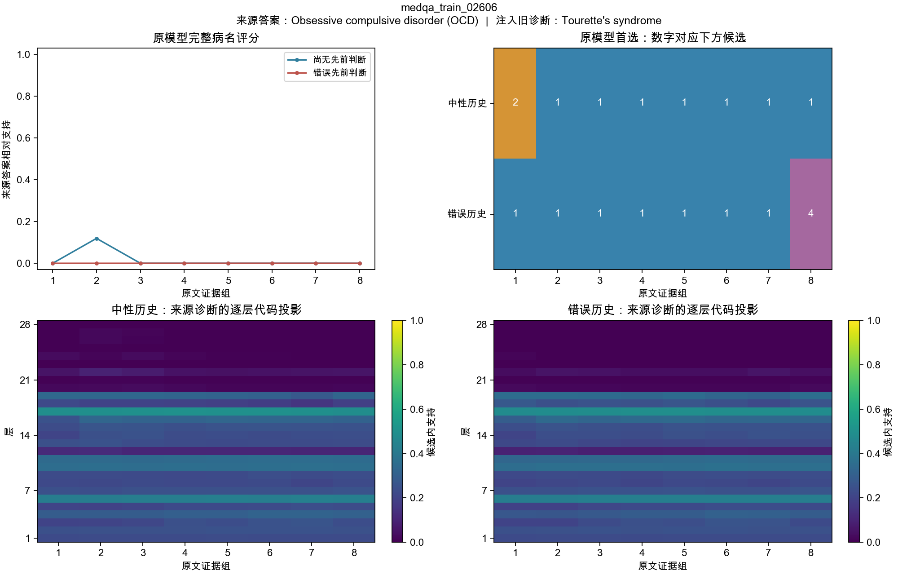

# medqa_train_02606

来源：MedQA，train，原始第2606行（零起始）。完整题目来源答案：**Obsessive compulsive disorder (OCD)**；人为指定的错误旧诊断：**Tourette's syndrome**。

候选：1 = Autism spectrum disorder (ASD)；2 = Generalized anxiety disorder (GAD)；3 = Obsessive compulsive disorder (OCD)；4 = Tourette's syndrome。

上排分别显示两种历史下四种候选的病名支持；下排颜色为逐层代码首选，灰色表示两套代码没有指向同一疾病，不能稳定命名该层倾向。

上排是原模型病名评分，下面是未训练输出头的代码投影、两种映射平均；二者接口不同。来源标签只评价完整题目。

| 轮 | 新增原文证据组 | 中性历史首选 | 错误历史首选 |
|---:|---|---|---|
| 1 | An 11-year-old girl is brought into the clinic by her parents, who are distraught over her behavior. | Generalized anxiety disorder (GAD) | Autism spectrum disorder (ASD) |
| 2 | They state that over the past several months she has started to act oddly, combing the hair of her toy dolls for hours without stopping and repetitively counting her steps in the house. | Autism spectrum disorder (ASD) | Autism spectrum disorder (ASD) |
| 3 | She is often brought to tears when confronted about these behaviors. | Autism spectrum disorder (ASD) | Autism spectrum disorder (ASD) |
| 4 | The patient has no past medical history. | Autism spectrum disorder (ASD) | Autism spectrum disorder (ASD) |
| 5 | When questioned about family history, the mother states she has needed close medical follow-up in the past, but declines to elaborate. | Autism spectrum disorder (ASD) | Autism spectrum disorder (ASD) |
| 6 | The patient's vital signs are all within normal limits. | Autism spectrum disorder (ASD) | Autism spectrum disorder (ASD) |
| 7 | On physical exam the patient is a well nourished 11-year-old girl in no acute distress. | Autism spectrum disorder (ASD) | Autism spectrum disorder (ASD) |
| 8 | She has occasional motor tics, but the remainder of the exam is benign. | Autism spectrum disorder (ASD) | Tourette's syndrome |

## 关键层的投影读表

每格先检查两套答案代码是否指向同一候选；不一致就不命名。括号内为四个答案代码在全词表中的概率总量，接近0时说明输出头尚不适合在该层读取答案。映射一致本身不等于医学判断正确。

### 中性历史

| 轮 | 第7层 | 第14层 | 第21层 | 第28层 |
|---:|---|---|---|---|
| 1 | 映射不一致 | 映射不一致 | 映射不一致 | Autism spectrum disorder (ASD)（代码总量 1） |
| 2 | 映射不一致 | 映射不一致 | 映射不一致 | Autism spectrum disorder (ASD)（代码总量 1） |
| 3 | 映射不一致 | 映射不一致 | 映射不一致 | Autism spectrum disorder (ASD)（代码总量 1） |
| 4 | 映射不一致 | 映射不一致 | 映射不一致 | Autism spectrum disorder (ASD)（代码总量 1） |
| 5 | 映射不一致 | 映射不一致 | 映射不一致 | Autism spectrum disorder (ASD)（代码总量 1） |
| 6 | 映射不一致 | 映射不一致 | 映射不一致 | Autism spectrum disorder (ASD)（代码总量 1） |
| 7 | 映射不一致 | 映射不一致 | 映射不一致 | Autism spectrum disorder (ASD)（代码总量 1） |
| 8 | 映射不一致 | 映射不一致 | 映射不一致 | Autism spectrum disorder (ASD)（代码总量 1） |

### 错误历史

| 轮 | 第7层 | 第14层 | 第21层 | 第28层 |
|---:|---|---|---|---|
| 1 | 映射不一致 | 映射不一致 | 映射不一致 | Autism spectrum disorder (ASD)（代码总量 1） |
| 2 | 映射不一致 | 映射不一致 | 映射不一致 | Autism spectrum disorder (ASD)（代码总量 1） |
| 3 | 映射不一致 | 映射不一致 | 映射不一致 | Autism spectrum disorder (ASD)（代码总量 1） |
| 4 | 映射不一致 | 映射不一致 | 映射不一致 | Autism spectrum disorder (ASD)（代码总量 1） |
| 5 | 映射不一致 | 映射不一致 | 映射不一致 | Autism spectrum disorder (ASD)（代码总量 1） |
| 6 | 映射不一致 | 映射不一致 | 映射不一致 | Autism spectrum disorder (ASD)（代码总量 1） |
| 7 | 映射不一致 | 映射不一致 | 映射不一致 | Autism spectrum disorder (ASD)（代码总量 1） |
| 8 | 映射不一致 | 映射不一致 | 映射不一致 | Autism spectrum disorder (ASD)（代码总量 1） |
