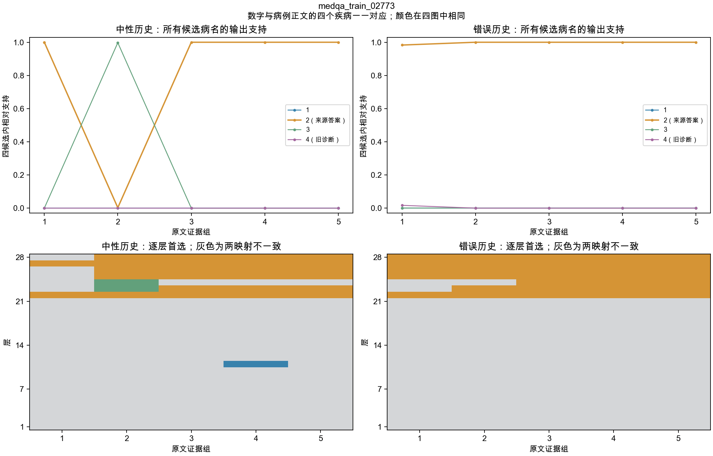
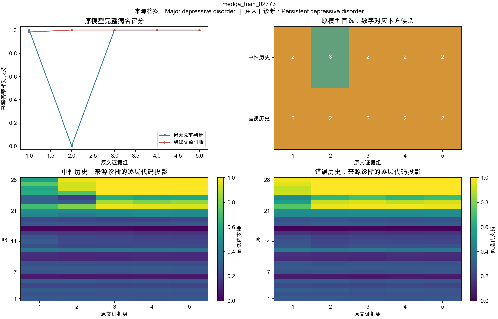

# medqa_train_02773

来源：MedQA，train，原始第2773行（零起始）。完整题目来源答案：**Major depressive disorder**；人为指定的错误旧诊断：**Persistent depressive disorder**。

候选：1 = Bipolar II disorder；2 = Major depressive disorder；3 = Acute grief；4 = Persistent depressive disorder。

上排分别显示两种历史下四种候选的病名支持；下排颜色为逐层代码首选，灰色表示两套代码没有指向同一疾病，不能稳定命名该层倾向。

上排是原模型病名评分，下面是未训练输出头的代码投影、两种映射平均；二者接口不同。来源标签只评价完整题目。

| 轮 | 新增原文证据组 | 中性历史首选 | 错误历史首选 |
|---:|---|---|---|
| 1 | A 61-year-old female presents to her primary care physician complaining of fatigue and feeling sad. | Major depressive disorder | Major depressive disorder |
| 2 | She reports that ever since her husband passed away 3 months ago, she has noticed a decrease in her energy level and reports frequently awaking at 2 in the morning and cannot fall back asleep. | Acute grief | Major depressive disorder |
| 3 | She sometimes wakes up and hears her husband's voice, constantly thinks about how much she misses him, and has recently thought about ways to kill herself including driving through a red light. | Major depressive disorder | Major depressive disorder |
| 4 | She used to be an active member of her neighborhood’s bridge club but has stopped playing. | Major depressive disorder | Major depressive disorder |
| 5 | She has lost 15 pounds and rarely feels hungry. | Major depressive disorder | Major depressive disorder |

## 关键层的投影读表

每格先检查两套答案代码是否指向同一候选；不一致就不命名。括号内为四个答案代码在全词表中的概率总量，接近0时说明输出头尚不适合在该层读取答案。映射一致本身不等于医学判断正确。

### 中性历史

| 轮 | 第7层 | 第14层 | 第21层 | 第28层 |
|---:|---|---|---|---|
| 1 | 映射不一致 | 映射不一致 | 映射不一致 | 映射不一致 |
| 2 | 映射不一致 | 映射不一致 | 映射不一致 | Major depressive disorder（代码总量 1） |
| 3 | 映射不一致 | 映射不一致 | 映射不一致 | Major depressive disorder（代码总量 1） |
| 4 | 映射不一致 | 映射不一致 | 映射不一致 | Major depressive disorder（代码总量 0.99） |
| 5 | 映射不一致 | 映射不一致 | 映射不一致 | Major depressive disorder（代码总量 1） |

### 错误历史

| 轮 | 第7层 | 第14层 | 第21层 | 第28层 |
|---:|---|---|---|---|
| 1 | 映射不一致 | 映射不一致 | 映射不一致 | Major depressive disorder（代码总量 0.91） |
| 2 | 映射不一致 | 映射不一致 | 映射不一致 | Major depressive disorder（代码总量 1） |
| 3 | 映射不一致 | 映射不一致 | 映射不一致 | Major depressive disorder（代码总量 1） |
| 4 | 映射不一致 | 映射不一致 | 映射不一致 | Major depressive disorder（代码总量 1） |
| 5 | 映射不一致 | 映射不一致 | 映射不一致 | Major depressive disorder（代码总量 1） |
