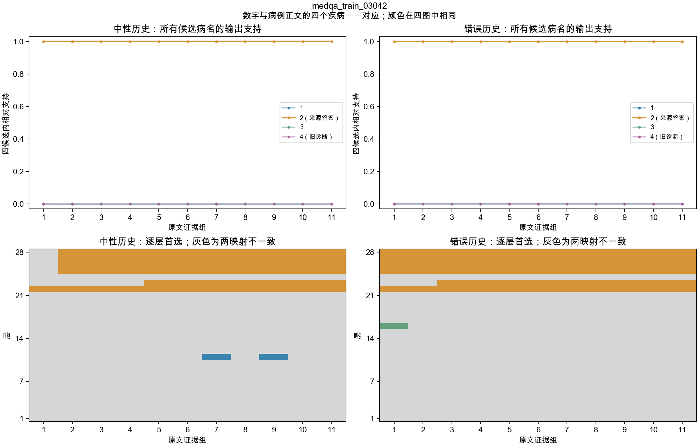
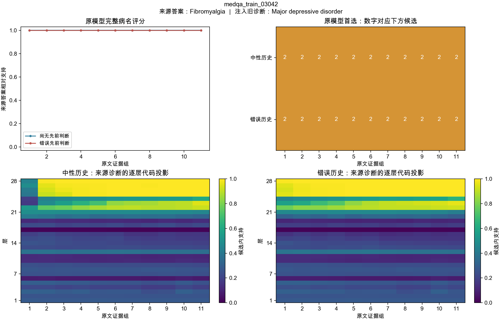

# medqa_train_03042

来源：MedQA，train，原始第3042行（零起始）。完整题目来源答案：**Fibromyalgia**；人为指定的错误旧诊断：**Major depressive disorder**。

候选：1 = Polymyalgia rheumatica；2 = Fibromyalgia；3 = Polymyositis；4 = Major depressive disorder。

上排分别显示两种历史下四种候选的病名支持；下排颜色为逐层代码首选，灰色表示两套代码没有指向同一疾病，不能稳定命名该层倾向。

上排是原模型病名评分，下面是未训练输出头的代码投影、两种映射平均；二者接口不同。来源标签只评价完整题目。

| 轮 | 新增原文证据组 | 中性历史首选 | 错误历史首选 |
|---:|---|---|---|
| 1 | A 39-year-old woman comes to the physician because of recurrent episodes of severe pain over her neck, back, and shoulders for the past year. | Fibromyalgia | Fibromyalgia |
| 2 | The pain worsens with exercise and lack of sleep. | Fibromyalgia | Fibromyalgia |
| 3 | Use of over-the-counter analgesics have not resolved her symptoms. | Fibromyalgia | Fibromyalgia |
| 4 | She also has stiffness of the shoulders and knees and tingling in her upper extremities that is worse in the morning. | Fibromyalgia | Fibromyalgia |
| 5 | She takes escitalopram for generalized anxiety disorder. | Fibromyalgia | Fibromyalgia |
| 6 | She also has tension headaches several times a month. | Fibromyalgia | Fibromyalgia |
| 7 | Her maternal uncle has ankylosing spondylitis. | Fibromyalgia | Fibromyalgia |
| 8 | Examination shows marked tenderness over the posterior neck, bilateral mid trapezius, and medial aspect of the left knee. | Fibromyalgia | Fibromyalgia |
| 9 | Muscle strength is normal. | Fibromyalgia | Fibromyalgia |
| 10 | Laboratory studies, including a complete blood count, erythrocyte sedimentation rate, and thyroid-stimulating hormone are within the reference ranges. | Fibromyalgia | Fibromyalgia |
| 11 | X-rays of her cervical and lumbar spine show no abnormalities. | Fibromyalgia | Fibromyalgia |

## 关键层的投影读表

每格先检查两套答案代码是否指向同一候选；不一致就不命名。括号内为四个答案代码在全词表中的概率总量，接近0时说明输出头尚不适合在该层读取答案。映射一致本身不等于医学判断正确。

### 中性历史

| 轮 | 第7层 | 第14层 | 第21层 | 第28层 |
|---:|---|---|---|---|
| 1 | 映射不一致 | 映射不一致 | 映射不一致 | 映射不一致 |
| 2 | 映射不一致 | 映射不一致 | 映射不一致 | Fibromyalgia（代码总量 0.99） |
| 3 | 映射不一致 | 映射不一致 | 映射不一致 | Fibromyalgia（代码总量 0.95） |
| 4 | 映射不一致 | 映射不一致 | 映射不一致 | Fibromyalgia（代码总量 1） |
| 5 | 映射不一致 | 映射不一致 | 映射不一致 | Fibromyalgia（代码总量 1） |
| 6 | 映射不一致 | 映射不一致 | 映射不一致 | Fibromyalgia（代码总量 1） |
| 7 | 映射不一致 | 映射不一致 | 映射不一致 | Fibromyalgia（代码总量 1） |
| 8 | 映射不一致 | 映射不一致 | 映射不一致 | Fibromyalgia（代码总量 1） |
| 9 | 映射不一致 | 映射不一致 | 映射不一致 | Fibromyalgia（代码总量 1） |
| 10 | 映射不一致 | 映射不一致 | 映射不一致 | Fibromyalgia（代码总量 1） |
| 11 | 映射不一致 | 映射不一致 | 映射不一致 | Fibromyalgia（代码总量 1） |

### 错误历史

| 轮 | 第7层 | 第14层 | 第21层 | 第28层 |
|---:|---|---|---|---|
| 1 | 映射不一致 | 映射不一致 | 映射不一致 | Fibromyalgia（代码总量 0.93） |
| 2 | 映射不一致 | 映射不一致 | 映射不一致 | Fibromyalgia（代码总量 0.96） |
| 3 | 映射不一致 | 映射不一致 | 映射不一致 | Fibromyalgia（代码总量 0.95） |
| 4 | 映射不一致 | 映射不一致 | 映射不一致 | Fibromyalgia（代码总量 0.98） |
| 5 | 映射不一致 | 映射不一致 | 映射不一致 | Fibromyalgia（代码总量 1） |
| 6 | 映射不一致 | 映射不一致 | 映射不一致 | Fibromyalgia（代码总量 1） |
| 7 | 映射不一致 | 映射不一致 | 映射不一致 | Fibromyalgia（代码总量 1） |
| 8 | 映射不一致 | 映射不一致 | 映射不一致 | Fibromyalgia（代码总量 1） |
| 9 | 映射不一致 | 映射不一致 | 映射不一致 | Fibromyalgia（代码总量 1） |
| 10 | 映射不一致 | 映射不一致 | 映射不一致 | Fibromyalgia（代码总量 1） |
| 11 | 映射不一致 | 映射不一致 | 映射不一致 | Fibromyalgia（代码总量 1） |
