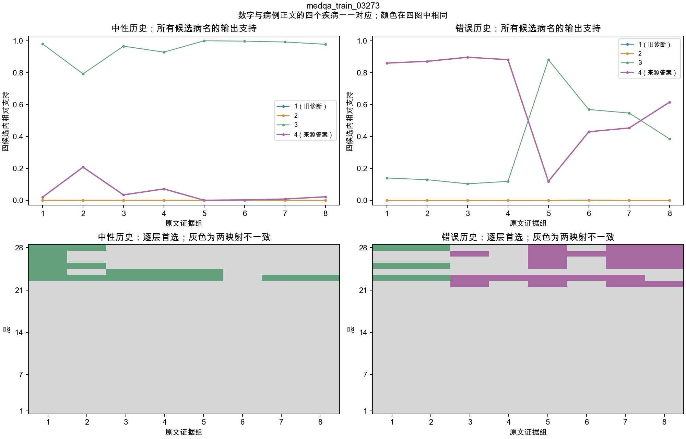
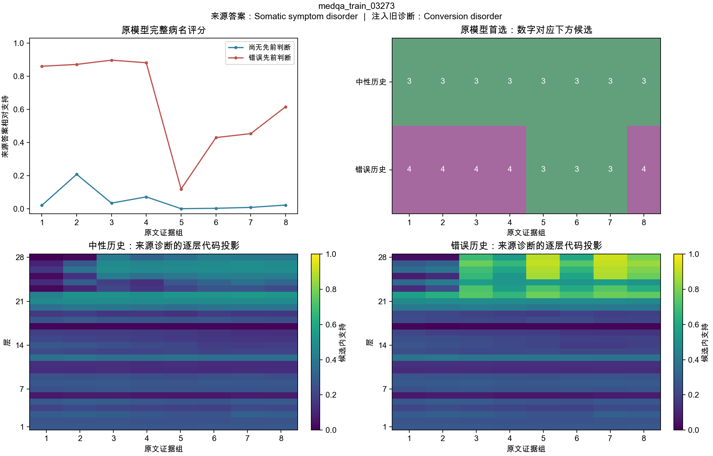

# medqa_train_03273

来源：MedQA，train，原始第3273行（零起始）。完整题目来源答案：**Somatic symptom disorder**；人为指定的错误旧诊断：**Conversion disorder**。

候选：1 = Conversion disorder；2 = Malingering disorder；3 = Illness anxiety disorder；4 = Somatic symptom disorder。

上排分别显示两种历史下四种候选的病名支持；下排颜色为逐层代码首选，灰色表示两套代码没有指向同一疾病，不能稳定命名该层倾向。

上排是原模型病名评分，下面是未训练输出头的代码投影、两种映射平均；二者接口不同。来源标签只评价完整题目。

| 轮 | 新增原文证据组 | 中性历史首选 | 错误历史首选 |
|---:|---|---|---|
| 1 | A 45-year-old woman repetitively visits the general surgery clinic worried that her inguinal hernia is incarcerated. | Illness anxiety disorder | Somatic symptom disorder |
| 2 | 2 months ago, she was seen in the emergency department where she presented with a left lower abdominal swelling. | Illness anxiety disorder | Somatic symptom disorder |
| 3 | The mass was easily reduced and the patient was referred to the general surgery clinic for elective surgical repair. | Illness anxiety disorder | Somatic symptom disorder |
| 4 | Because her condition was deemed not urgent, she was informed that she was down on the surgical waiting list. | Illness anxiety disorder | Somatic symptom disorder |
| 5 | Despite this, she continues to visit the clinic and the ED worried that her bowels are ‘trapped and dying.’ Each time she is reassured and any protrusion present is quickly reduced. | Illness anxiety disorder | Illness anxiety disorder |
| 6 | She has previously frequently visited her primary care physician for complaints of abdominal pain and inconsistent bowel habits, but no etiology could be identified. | Illness anxiety disorder | Illness anxiety disorder |
| 7 | She continues to intermittently have these symptoms and spends hours every day worrying about what may be going on. | Illness anxiety disorder | Illness anxiety disorder |
| 8 | She has no other significant past medical history. | Illness anxiety disorder | Somatic symptom disorder |

## 关键层的投影读表

每格先检查两套答案代码是否指向同一候选；不一致就不命名。括号内为四个答案代码在全词表中的概率总量，接近0时说明输出头尚不适合在该层读取答案。映射一致本身不等于医学判断正确。

### 中性历史

| 轮 | 第7层 | 第14层 | 第21层 | 第28层 |
|---:|---|---|---|---|
| 1 | 映射不一致 | 映射不一致 | 映射不一致 | Illness anxiety disorder（代码总量 0.95） |
| 2 | 映射不一致 | 映射不一致 | 映射不一致 | Illness anxiety disorder（代码总量 0.64） |
| 3 | 映射不一致 | 映射不一致 | 映射不一致 | 映射不一致 |
| 4 | 映射不一致 | 映射不一致 | 映射不一致 | 映射不一致 |
| 5 | 映射不一致 | 映射不一致 | 映射不一致 | 映射不一致 |
| 6 | 映射不一致 | 映射不一致 | 映射不一致 | 映射不一致 |
| 7 | 映射不一致 | 映射不一致 | 映射不一致 | 映射不一致 |
| 8 | 映射不一致 | 映射不一致 | 映射不一致 | 映射不一致 |

### 错误历史

| 轮 | 第7层 | 第14层 | 第21层 | 第28层 |
|---:|---|---|---|---|
| 1 | 映射不一致 | 映射不一致 | 映射不一致 | Illness anxiety disorder（代码总量 0.69） |
| 2 | 映射不一致 | 映射不一致 | 映射不一致 | Illness anxiety disorder（代码总量 0.62） |
| 3 | 映射不一致 | 映射不一致 | 映射不一致 | 映射不一致 |
| 4 | 映射不一致 | 映射不一致 | 映射不一致 | 映射不一致 |
| 5 | 映射不一致 | 映射不一致 | 映射不一致 | Somatic symptom disorder（代码总量 0.69） |
| 6 | 映射不一致 | 映射不一致 | 映射不一致 | 映射不一致 |
| 7 | 映射不一致 | 映射不一致 | 映射不一致 | Somatic symptom disorder（代码总量 0.63） |
| 8 | 映射不一致 | 映射不一致 | 映射不一致 | Somatic symptom disorder（代码总量 0.7） |
