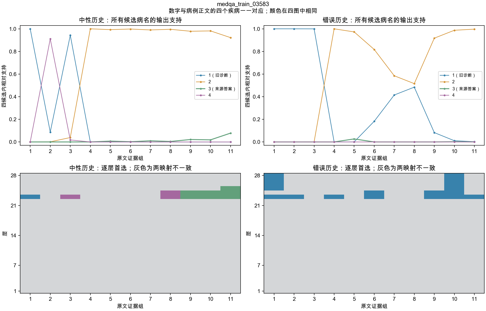
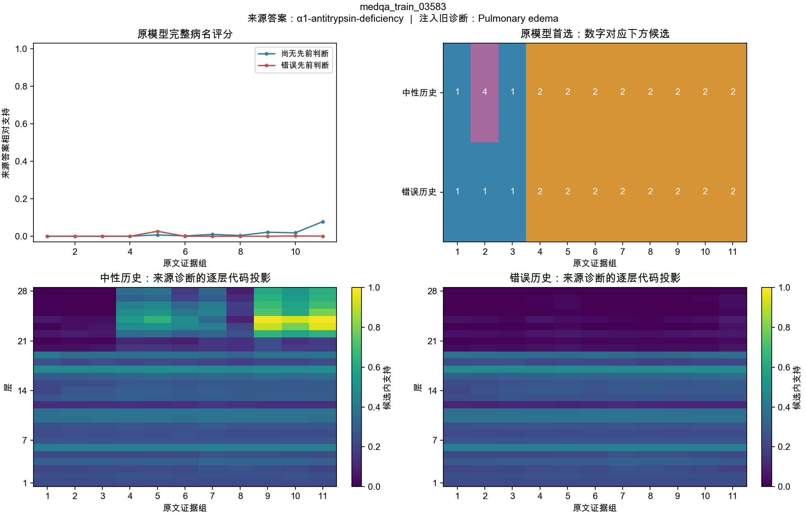

# medqa_train_03583

来源：MedQA，train，原始第3583行（零起始）。完整题目来源答案：**α1-antitrypsin-deficiency**；人为指定的错误旧诊断：**Pulmonary edema**。

候选：1 = Pulmonary edema；2 = Lung cancer；3 = α1-antitrypsin-deficiency；4 = Asthma。

上排分别显示两种历史下四种候选的病名支持；下排颜色为逐层代码首选，灰色表示两套代码没有指向同一疾病，不能稳定命名该层倾向。

上排是原模型病名评分，下面是未训练输出头的代码投影、两种映射平均；二者接口不同。来源标签只评价完整题目。

| 轮 | 新增原文证据组 | 中性历史首选 | 错误历史首选 |
|---:|---|---|---|
| 1 | A 32-year-old man comes to the emergency room because of severe breathlessness for the past few hours. | Pulmonary edema | Pulmonary edema |
| 2 | Over the course of a few years, he has been treated for asthma by several physicians, but his symptoms have continued to progress. | Asthma | Pulmonary edema |
| 3 | He doesn’t smoke and never did. | Pulmonary edema | Pulmonary edema |
| 4 | Both his father who died at the age of 40 years and his uncle (father’s brother), died with chronic obstructive pulmonary disorder. | Lung cancer | Lung cancer |
| 5 | He has never smoked in his life. | Lung cancer | Lung cancer |
| 6 | His respiratory rate is 19/min and temperature is 37.0°C (98.6°F). | Lung cancer | Lung cancer |
| 7 | On physical examination, the patient has significantly longer exhalation than inhalation. | Lung cancer | Lung cancer |
| 8 | His expiratory time is longer than 6 seconds. | Lung cancer | Lung cancer |
| 9 | Clubbing is present. | Lung cancer | Lung cancer |
| 10 | Chest auscultation reveals bilateral crackles. | Lung cancer | Lung cancer |
| 11 | Mild hepatomegaly is present. | Lung cancer | Lung cancer |

## 关键层的投影读表

每格先检查两套答案代码是否指向同一候选；不一致就不命名。括号内为四个答案代码在全词表中的概率总量，接近0时说明输出头尚不适合在该层读取答案。映射一致本身不等于医学判断正确。

### 中性历史

| 轮 | 第7层 | 第14层 | 第21层 | 第28层 |
|---:|---|---|---|---|
| 1 | 映射不一致 | 映射不一致 | 映射不一致 | 映射不一致 |
| 2 | 映射不一致 | 映射不一致 | 映射不一致 | 映射不一致 |
| 3 | 映射不一致 | 映射不一致 | 映射不一致 | 映射不一致 |
| 4 | 映射不一致 | 映射不一致 | 映射不一致 | 映射不一致 |
| 5 | 映射不一致 | 映射不一致 | 映射不一致 | 映射不一致 |
| 6 | 映射不一致 | 映射不一致 | 映射不一致 | 映射不一致 |
| 7 | 映射不一致 | 映射不一致 | 映射不一致 | 映射不一致 |
| 8 | 映射不一致 | 映射不一致 | 映射不一致 | 映射不一致 |
| 9 | 映射不一致 | 映射不一致 | 映射不一致 | 映射不一致 |
| 10 | 映射不一致 | 映射不一致 | 映射不一致 | 映射不一致 |
| 11 | 映射不一致 | 映射不一致 | 映射不一致 | 映射不一致 |

### 错误历史

| 轮 | 第7层 | 第14层 | 第21层 | 第28层 |
|---:|---|---|---|---|
| 1 | 映射不一致 | 映射不一致 | 映射不一致 | Pulmonary edema（代码总量 1） |
| 2 | 映射不一致 | 映射不一致 | 映射不一致 | 映射不一致 |
| 3 | 映射不一致 | 映射不一致 | 映射不一致 | 映射不一致 |
| 4 | 映射不一致 | 映射不一致 | 映射不一致 | 映射不一致 |
| 5 | 映射不一致 | 映射不一致 | 映射不一致 | 映射不一致 |
| 6 | 映射不一致 | 映射不一致 | 映射不一致 | 映射不一致 |
| 7 | 映射不一致 | 映射不一致 | 映射不一致 | 映射不一致 |
| 8 | 映射不一致 | 映射不一致 | 映射不一致 | 映射不一致 |
| 9 | 映射不一致 | 映射不一致 | 映射不一致 | 映射不一致 |
| 10 | 映射不一致 | 映射不一致 | 映射不一致 | Pulmonary edema（代码总量 1） |
| 11 | 映射不一致 | 映射不一致 | 映射不一致 | 映射不一致 |
