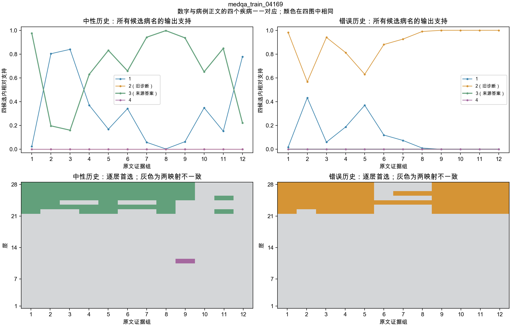
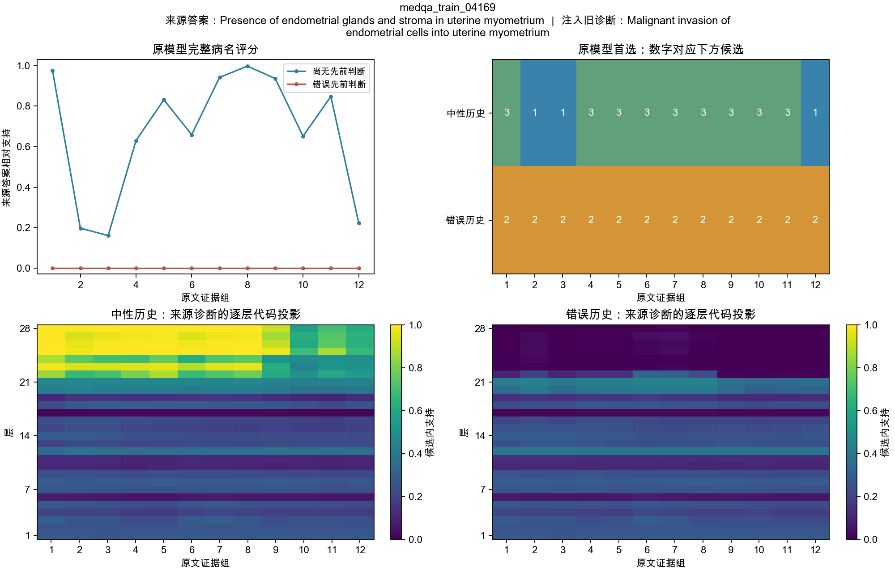

# medqa_train_04169

来源：MedQA，train，原始第4169行（零起始）。完整题目来源答案：**Presence of endometrial glands and stroma in uterine myometrium**；人为指定的错误旧诊断：**Malignant invasion of endometrial cells into uterine myometrium**。

候选：1 = Hyperplastic overgrowths of endometrial glands and stroma；2 = Malignant invasion of endometrial cells into uterine myometrium；3 = Presence of endometrial glands and stroma in uterine myometrium；4 = Presence of endometrial glands and stroma outside the uterus。

上排分别显示两种历史下四种候选的病名支持；下排颜色为逐层代码首选，灰色表示两套代码没有指向同一疾病，不能稳定命名该层倾向。

上排是原模型病名评分，下面是未训练输出头的代码投影、两种映射平均；二者接口不同。来源标签只评价完整题目。

| 轮 | 新增原文证据组 | 中性历史首选 | 错误历史首选 |
|---:|---|---|---|
| 1 | A 44-year-old G2P2 African American woman presents to her gynecologist for dysmenorrhea. | Presence of endometrial glands and stroma in uterine myometrium | Malignant invasion of endometrial cells into uterine myometrium |
| 2 | She reports that for the past few months, she has been having severe pain during her menses. | Hyperplastic overgrowths of endometrial glands and stroma | Malignant invasion of endometrial cells into uterine myometrium |
| 3 | She also endorses menstrual bleeding that has been heavier than usual. | Hyperplastic overgrowths of endometrial glands and stroma | Malignant invasion of endometrial cells into uterine myometrium |
| 4 | The patient reports that her cycles are regular and occur every 30 days, and she denies both dyspareunia and spotting between her periods. | Presence of endometrial glands and stroma in uterine myometrium | Malignant invasion of endometrial cells into uterine myometrium |
| 5 | Her last menstrual period was two weeks ago. | Presence of endometrial glands and stroma in uterine myometrium | Malignant invasion of endometrial cells into uterine myometrium |
| 6 | In terms of her obstetric history, the patient had two uncomplicated pregnancies, and she had no difficulty becoming pregnant. | Presence of endometrial glands and stroma in uterine myometrium | Malignant invasion of endometrial cells into uterine myometrium |
| 7 | She has never had an abnormal pap smear. | Presence of endometrial glands and stroma in uterine myometrium | Malignant invasion of endometrial cells into uterine myometrium |
| 8 | Her past medical history is otherwise significant for hyperlipidemia and asthma. | Presence of endometrial glands and stroma in uterine myometrium | Malignant invasion of endometrial cells into uterine myometrium |
| 9 | On physical exam, the patient’s uterus is tender, soft, and enlarged to the size of a pregnant uterus at 10 weeks of gestation. | Presence of endometrial glands and stroma in uterine myometrium | Malignant invasion of endometrial cells into uterine myometrium |
| 10 | She is non-tender during vaginal exam, without cervical motion tenderness or adnexal masses. | Presence of endometrial glands and stroma in uterine myometrium | Malignant invasion of endometrial cells into uterine myometrium |
| 11 | Her BMI is 24 kg/m2. | Presence of endometrial glands and stroma in uterine myometrium | Malignant invasion of endometrial cells into uterine myometrium |
| 12 | A urine pregnancy test is negative. | Hyperplastic overgrowths of endometrial glands and stroma | Malignant invasion of endometrial cells into uterine myometrium |

## 关键层的投影读表

每格先检查两套答案代码是否指向同一候选；不一致就不命名。括号内为四个答案代码在全词表中的概率总量，接近0时说明输出头尚不适合在该层读取答案。映射一致本身不等于医学判断正确。

### 中性历史

| 轮 | 第7层 | 第14层 | 第21层 | 第28层 |
|---:|---|---|---|---|
| 1 | 映射不一致 | 映射不一致 | 映射不一致 | Presence of endometrial glands and stroma in uterine myometrium（代码总量 1） |
| 2 | 映射不一致 | 映射不一致 | 映射不一致 | Presence of endometrial glands and stroma in uterine myometrium（代码总量 1） |
| 3 | 映射不一致 | 映射不一致 | 映射不一致 | Presence of endometrial glands and stroma in uterine myometrium（代码总量 1） |
| 4 | 映射不一致 | 映射不一致 | 映射不一致 | Presence of endometrial glands and stroma in uterine myometrium（代码总量 1） |
| 5 | 映射不一致 | 映射不一致 | 映射不一致 | Presence of endometrial glands and stroma in uterine myometrium（代码总量 1） |
| 6 | 映射不一致 | 映射不一致 | 映射不一致 | Presence of endometrial glands and stroma in uterine myometrium（代码总量 1） |
| 7 | 映射不一致 | 映射不一致 | 映射不一致 | Presence of endometrial glands and stroma in uterine myometrium（代码总量 1） |
| 8 | 映射不一致 | 映射不一致 | 映射不一致 | Presence of endometrial glands and stroma in uterine myometrium（代码总量 1） |
| 9 | 映射不一致 | 映射不一致 | 映射不一致 | Presence of endometrial glands and stroma in uterine myometrium（代码总量 1） |
| 10 | 映射不一致 | 映射不一致 | 映射不一致 | 映射不一致 |
| 11 | 映射不一致 | 映射不一致 | 映射不一致 | 映射不一致 |
| 12 | 映射不一致 | 映射不一致 | 映射不一致 | 映射不一致 |

### 错误历史

| 轮 | 第7层 | 第14层 | 第21层 | 第28层 |
|---:|---|---|---|---|
| 1 | 映射不一致 | 映射不一致 | 映射不一致 | Malignant invasion of endometrial cells into uterine myometrium（代码总量 1） |
| 2 | 映射不一致 | 映射不一致 | 映射不一致 | Malignant invasion of endometrial cells into uterine myometrium（代码总量 1） |
| 3 | 映射不一致 | 映射不一致 | 映射不一致 | Malignant invasion of endometrial cells into uterine myometrium（代码总量 1） |
| 4 | 映射不一致 | 映射不一致 | 映射不一致 | Malignant invasion of endometrial cells into uterine myometrium（代码总量 1） |
| 5 | 映射不一致 | 映射不一致 | 映射不一致 | Malignant invasion of endometrial cells into uterine myometrium（代码总量 1） |
| 6 | 映射不一致 | 映射不一致 | 映射不一致 | 映射不一致 |
| 7 | 映射不一致 | 映射不一致 | 映射不一致 | 映射不一致 |
| 8 | 映射不一致 | 映射不一致 | 映射不一致 | 映射不一致 |
| 9 | 映射不一致 | 映射不一致 | 映射不一致 | Malignant invasion of endometrial cells into uterine myometrium（代码总量 1） |
| 10 | 映射不一致 | 映射不一致 | 映射不一致 | Malignant invasion of endometrial cells into uterine myometrium（代码总量 1） |
| 11 | 映射不一致 | 映射不一致 | 映射不一致 | Malignant invasion of endometrial cells into uterine myometrium（代码总量 1） |
| 12 | 映射不一致 | 映射不一致 | 映射不一致 | Malignant invasion of endometrial cells into uterine myometrium（代码总量 1） |
