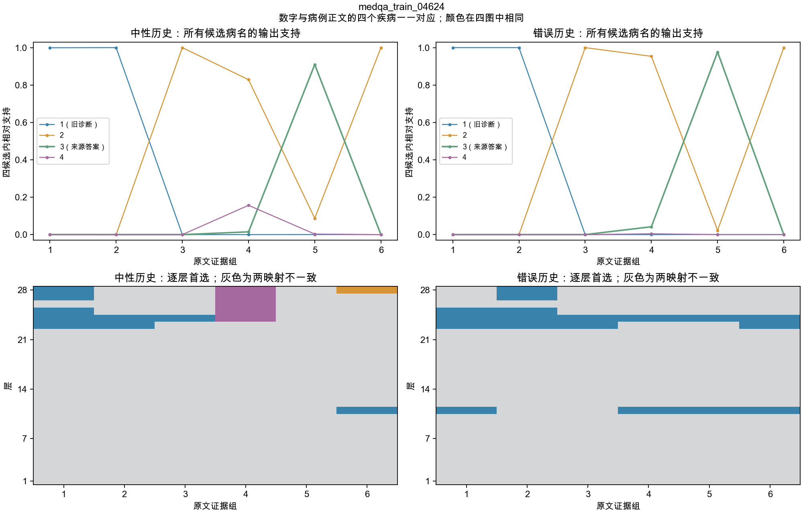
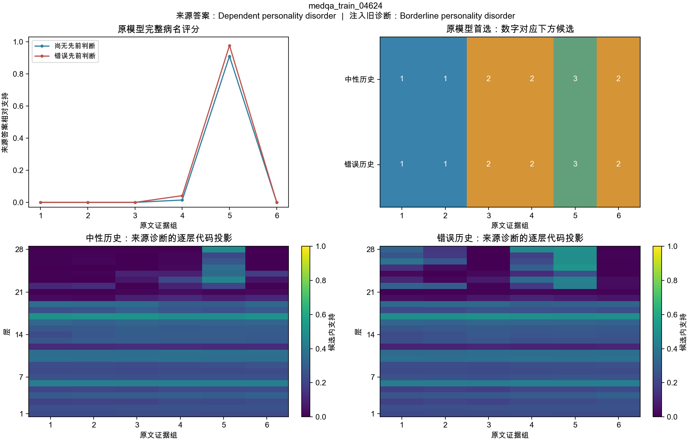

# medqa_train_04624

来源：MedQA，train，原始第4624行（零起始）。完整题目来源答案：**Dependent personality disorder**；人为指定的错误旧诊断：**Borderline personality disorder**。

候选：1 = Borderline personality disorder；2 = Separation anxiety disorder；3 = Dependent personality disorder；4 = Avoidant personality disorder。

上排分别显示两种历史下四种候选的病名支持；下排颜色为逐层代码首选，灰色表示两套代码没有指向同一疾病，不能稳定命名该层倾向。

上排是原模型病名评分，下面是未训练输出头的代码投影、两种映射平均；二者接口不同。来源标签只评价完整题目。

| 轮 | 新增原文证据组 | 中性历史首选 | 错误历史首选 |
|---:|---|---|---|
| 1 | A 28-year-old woman is brought to a counselor by her father after he found out that she is being physically abused by her husband. | Borderline personality disorder | Borderline personality disorder |
| 2 | The father reports that she refuses to end the relationship with her husband despite the physical abuse. | Borderline personality disorder | Borderline personality disorder |
| 3 | She says that she feels uneasy when her husband is not around. | Separation anxiety disorder | Separation anxiety disorder |
| 4 | She adds, “I'm worried that if I leave him, my life will only get worse.” She has never been employed since they got married because she is convinced that nobody would hire her. | Separation anxiety disorder | Separation anxiety disorder |
| 5 | Her husband takes care of most household errands and pays all of the bills. | Dependent personality disorder | Dependent personality disorder |
| 6 | Physical examination shows several bruises on the thighs and back. | Separation anxiety disorder | Separation anxiety disorder |

## 关键层的投影读表

每格先检查两套答案代码是否指向同一候选；不一致就不命名。括号内为四个答案代码在全词表中的概率总量，接近0时说明输出头尚不适合在该层读取答案。映射一致本身不等于医学判断正确。

### 中性历史

| 轮 | 第7层 | 第14层 | 第21层 | 第28层 |
|---:|---|---|---|---|
| 1 | 映射不一致 | 映射不一致 | 映射不一致 | Borderline personality disorder（代码总量 1） |
| 2 | 映射不一致 | 映射不一致 | 映射不一致 | 映射不一致 |
| 3 | 映射不一致 | 映射不一致 | 映射不一致 | 映射不一致 |
| 4 | 映射不一致 | 映射不一致 | 映射不一致 | Avoidant personality disorder（代码总量 1） |
| 5 | 映射不一致 | 映射不一致 | 映射不一致 | 映射不一致 |
| 6 | 映射不一致 | 映射不一致 | 映射不一致 | Separation anxiety disorder（代码总量 1） |

### 错误历史

| 轮 | 第7层 | 第14层 | 第21层 | 第28层 |
|---:|---|---|---|---|
| 1 | 映射不一致 | 映射不一致 | 映射不一致 | 映射不一致 |
| 2 | 映射不一致 | 映射不一致 | 映射不一致 | Borderline personality disorder（代码总量 0.96） |
| 3 | 映射不一致 | 映射不一致 | 映射不一致 | 映射不一致 |
| 4 | 映射不一致 | 映射不一致 | 映射不一致 | 映射不一致 |
| 5 | 映射不一致 | 映射不一致 | 映射不一致 | 映射不一致 |
| 6 | 映射不一致 | 映射不一致 | 映射不一致 | 映射不一致 |
