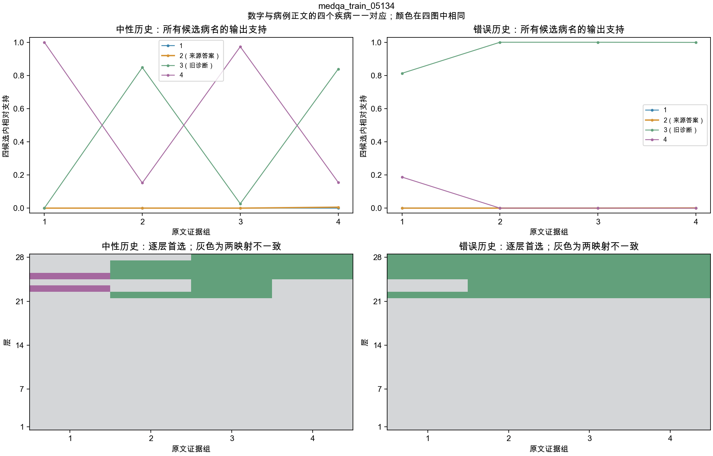
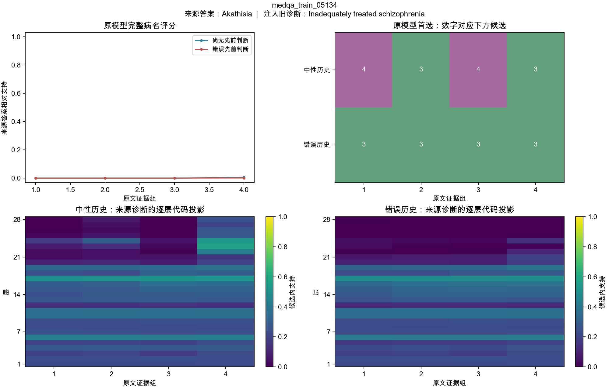

# medqa_train_05134

来源：MedQA，train，原始第5134行（零起始）。完整题目来源答案：**Akathisia**；人为指定的错误旧诊断：**Inadequately treated schizophrenia**。

候选：1 = Restless legs syndrome；2 = Akathisia；3 = Inadequately treated schizophrenia；4 = Drug-induced mania。

上排分别显示两种历史下四种候选的病名支持；下排颜色为逐层代码首选，灰色表示两套代码没有指向同一疾病，不能稳定命名该层倾向。

上排是原模型病名评分，下面是未训练输出头的代码投影、两种映射平均；二者接口不同。来源标签只评价完整题目。

| 轮 | 新增原文证据组 | 中性历史首选 | 错误历史首选 |
|---:|---|---|---|
| 1 | A 25-year-old woman is brought to the physician by her husband because she has appeared increasingly agitated over the last week. | Drug-induced mania | Inadequately treated schizophrenia |
| 2 | She feels restless, has not been able to sleep well, and has been pacing around her house continuously in an attempt to relieve her symptoms. | Inadequately treated schizophrenia | Inadequately treated schizophrenia |
| 3 | Two weeks ago, she was diagnosed with schizophrenia and treatment with fluphenazine was initiated. | Drug-induced mania | Inadequately treated schizophrenia |
| 4 | Today, physical examination is interrupted multiple times because she is unable to sit or stand still for more than a couple minutes. | Inadequately treated schizophrenia | Inadequately treated schizophrenia |

## 关键层的投影读表

每格先检查两套答案代码是否指向同一候选；不一致就不命名。括号内为四个答案代码在全词表中的概率总量，接近0时说明输出头尚不适合在该层读取答案。映射一致本身不等于医学判断正确。

### 中性历史

| 轮 | 第7层 | 第14层 | 第21层 | 第28层 |
|---:|---|---|---|---|
| 1 | 映射不一致 | 映射不一致 | 映射不一致 | 映射不一致 |
| 2 | 映射不一致 | 映射不一致 | 映射不一致 | 映射不一致 |
| 3 | 映射不一致 | 映射不一致 | 映射不一致 | Inadequately treated schizophrenia（代码总量 1） |
| 4 | 映射不一致 | 映射不一致 | 映射不一致 | Inadequately treated schizophrenia（代码总量 1） |

### 错误历史

| 轮 | 第7层 | 第14层 | 第21层 | 第28层 |
|---:|---|---|---|---|
| 1 | 映射不一致 | 映射不一致 | 映射不一致 | Inadequately treated schizophrenia（代码总量 0.98） |
| 2 | 映射不一致 | 映射不一致 | 映射不一致 | Inadequately treated schizophrenia（代码总量 1） |
| 3 | 映射不一致 | 映射不一致 | 映射不一致 | Inadequately treated schizophrenia（代码总量 1） |
| 4 | 映射不一致 | 映射不一致 | 映射不一致 | Inadequately treated schizophrenia（代码总量 1） |
