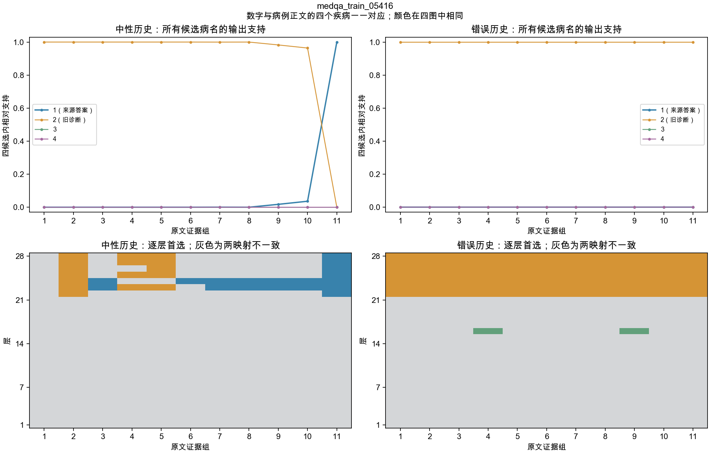
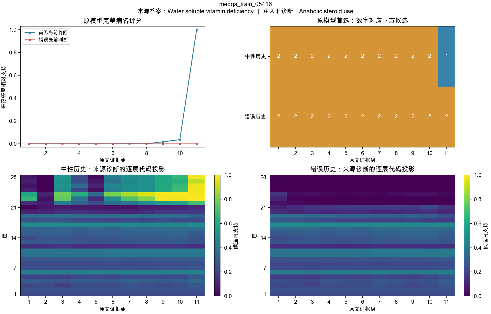

# medqa_train_05416

来源：MedQA，train，原始第5416行（零起始）。完整题目来源答案：**Water soluble vitamin deficiency**；人为指定的错误旧诊断：**Anabolic steroid use**。

候选：1 = Water soluble vitamin deficiency；2 = Anabolic steroid use；3 = Dermatologic fungal infection；4 = Viral infection。

上排分别显示两种历史下四种候选的病名支持；下排颜色为逐层代码首选，灰色表示两套代码没有指向同一疾病，不能稳定命名该层倾向。

上排是原模型病名评分，下面是未训练输出头的代码投影、两种映射平均；二者接口不同。来源标签只评价完整题目。

| 轮 | 新增原文证据组 | 中性历史首选 | 错误历史首选 |
|---:|---|---|---|
| 1 | A 17-year-old high school student presents to your office for recent mood and skin changes. | Anabolic steroid use | Anabolic steroid use |
| 2 | The patient is a high school senior who is competing on the wrestling team and recently has lost weight to drop two weight classes over the past several months. | Anabolic steroid use | Anabolic steroid use |
| 3 | He states he has dry, cracking, and irritated skin, as well as a sensation of tingling in his hands and feet. | Anabolic steroid use | Anabolic steroid use |
| 4 | The patient also states that he has not been feeling himself lately. | Anabolic steroid use | Anabolic steroid use |
| 5 | He finds himself more irritable and no longer enjoys many of the activities he once enjoyed. | Anabolic steroid use | Anabolic steroid use |
| 6 | He finds that he often feels fatigued and has trouble concentrating. | Anabolic steroid use | Anabolic steroid use |
| 7 | The patient does not have a significant past medical history and is not on any current medications. | Anabolic steroid use | Anabolic steroid use |
| 8 | The patient admits to drinking alcohol and smoking marijuana on special occasions. | Anabolic steroid use | Anabolic steroid use |
| 9 | He states that he uses supplements that his other team members use. | Anabolic steroid use | Anabolic steroid use |
| 10 | Physical exam is significant for acne, dry, cracked skin around the patient's mouth in particular, and decreased sensation in his lower extremities. | Anabolic steroid use | Anabolic steroid use |
| 11 | Laboratory values are as follows:  Serum: Na+: 137 mEq/L Cl-: 101 mEq/L K+: 4.1 mEq/L HCO3-: 24 mEq/L BUN: 15 mg/dL Glucose: 79 mg/dL Creatinine: 0.9 mg/dL Ca2+: 9.2 mg/dL Mg2+: 1.5 mEq/L Homocysteine: 11.2 µmol/L (normal: 4.6 to 8.1 µmol/L) AST: 11 U/L ALT: 11 U/L Alkaline phosphatase: 27 U/L Albumin: 4.5 g/dL Total protein: 6.9 g/dL Total bilirubin: 0.5 mg/dL Direct bilirubin: 0.3 mg/dL | Water soluble vitamin deficiency | Anabolic steroid use |

## 关键层的投影读表

每格先检查两套答案代码是否指向同一候选；不一致就不命名。括号内为四个答案代码在全词表中的概率总量，接近0时说明输出头尚不适合在该层读取答案。映射一致本身不等于医学判断正确。

### 中性历史

| 轮 | 第7层 | 第14层 | 第21层 | 第28层 |
|---:|---|---|---|---|
| 1 | 映射不一致 | 映射不一致 | 映射不一致 | 映射不一致 |
| 2 | 映射不一致 | 映射不一致 | 映射不一致 | Anabolic steroid use（代码总量 1） |
| 3 | 映射不一致 | 映射不一致 | 映射不一致 | 映射不一致 |
| 4 | 映射不一致 | 映射不一致 | 映射不一致 | Anabolic steroid use（代码总量 1） |
| 5 | 映射不一致 | 映射不一致 | 映射不一致 | Anabolic steroid use（代码总量 1） |
| 6 | 映射不一致 | 映射不一致 | 映射不一致 | 映射不一致 |
| 7 | 映射不一致 | 映射不一致 | 映射不一致 | 映射不一致 |
| 8 | 映射不一致 | 映射不一致 | 映射不一致 | 映射不一致 |
| 9 | 映射不一致 | 映射不一致 | 映射不一致 | 映射不一致 |
| 10 | 映射不一致 | 映射不一致 | 映射不一致 | 映射不一致 |
| 11 | 映射不一致 | 映射不一致 | 映射不一致 | Water soluble vitamin deficiency（代码总量 1） |

### 错误历史

| 轮 | 第7层 | 第14层 | 第21层 | 第28层 |
|---:|---|---|---|---|
| 1 | 映射不一致 | 映射不一致 | 映射不一致 | Anabolic steroid use（代码总量 1） |
| 2 | 映射不一致 | 映射不一致 | 映射不一致 | Anabolic steroid use（代码总量 1） |
| 3 | 映射不一致 | 映射不一致 | 映射不一致 | Anabolic steroid use（代码总量 1） |
| 4 | 映射不一致 | 映射不一致 | 映射不一致 | Anabolic steroid use（代码总量 1） |
| 5 | 映射不一致 | 映射不一致 | 映射不一致 | Anabolic steroid use（代码总量 1） |
| 6 | 映射不一致 | 映射不一致 | 映射不一致 | Anabolic steroid use（代码总量 1） |
| 7 | 映射不一致 | 映射不一致 | 映射不一致 | Anabolic steroid use（代码总量 1） |
| 8 | 映射不一致 | 映射不一致 | 映射不一致 | Anabolic steroid use（代码总量 1） |
| 9 | 映射不一致 | 映射不一致 | 映射不一致 | Anabolic steroid use（代码总量 1） |
| 10 | 映射不一致 | 映射不一致 | 映射不一致 | Anabolic steroid use（代码总量 1） |
| 11 | 映射不一致 | 映射不一致 | 映射不一致 | Anabolic steroid use（代码总量 1） |
