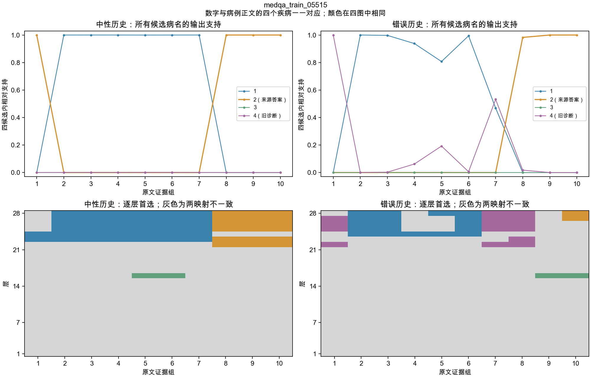
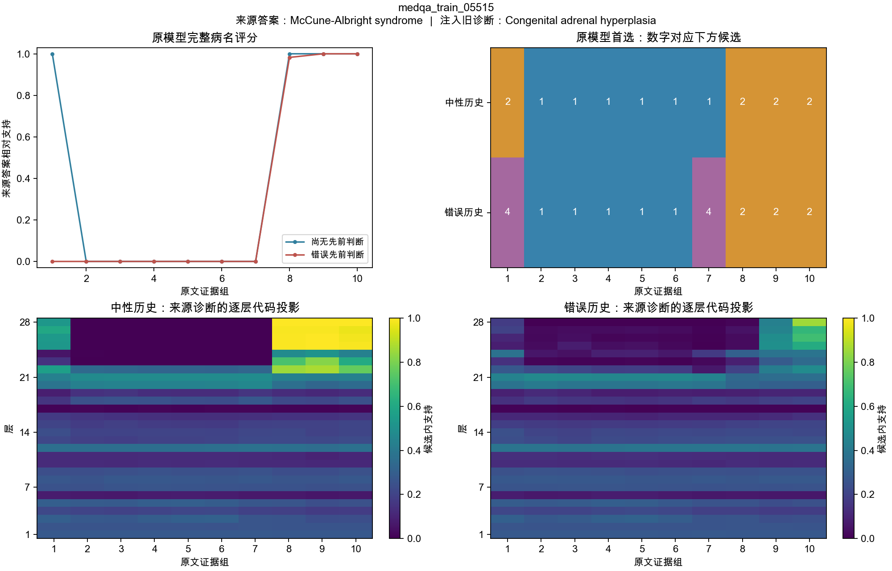

# medqa_train_05515

来源：MedQA，train，原始第5515行（零起始）。完整题目来源答案：**McCune-Albright syndrome**；人为指定的错误旧诊断：**Congenital adrenal hyperplasia**。

候选：1 = Osteogenesis imperfecta；2 = McCune-Albright syndrome；3 = Neurofibromatosis type I；4 = Congenital adrenal hyperplasia。

上排分别显示两种历史下四种候选的病名支持；下排颜色为逐层代码首选，灰色表示两套代码没有指向同一疾病，不能稳定命名该层倾向。

上排是原模型病名评分，下面是未训练输出头的代码投影、两种映射平均；二者接口不同。来源标签只评价完整题目。

| 轮 | 新增原文证据组 | 中性历史首选 | 错误历史首选 |
|---:|---|---|---|
| 1 | A 7-year-old girl is brought to the physician by her parents for the evaluation of pubic hair development. | McCune-Albright syndrome | Congenital adrenal hyperplasia |
| 2 | She has a history of a fracture in each leg and one fracture in her right arm. | Osteogenesis imperfecta | Osteogenesis imperfecta |
| 3 | Her performance at school is good. | Osteogenesis imperfecta | Osteogenesis imperfecta |
| 4 | There is no family history of serious illness. | Osteogenesis imperfecta | Osteogenesis imperfecta |
| 5 | She takes no medications. | Osteogenesis imperfecta | Osteogenesis imperfecta |
| 6 | Vital signs are within normal limits. | Osteogenesis imperfecta | Osteogenesis imperfecta |
| 7 | Genital examination shows coarse, dark hair along the labia. | Osteogenesis imperfecta | Congenital adrenal hyperplasia |
| 8 | The breast glands are enlarged and the breast bud extends beyond the areolar diameter. | McCune-Albright syndrome | McCune-Albright syndrome |
| 9 | There are several hyperpigmented macules with rough, serpiginous borders of different sizes on the lower and upper extremities. | McCune-Albright syndrome | McCune-Albright syndrome |
| 10 | The remainder of the examination shows no abnormalities. | McCune-Albright syndrome | McCune-Albright syndrome |

## 关键层的投影读表

每格先检查两套答案代码是否指向同一候选；不一致就不命名。括号内为四个答案代码在全词表中的概率总量，接近0时说明输出头尚不适合在该层读取答案。映射一致本身不等于医学判断正确。

### 中性历史

| 轮 | 第7层 | 第14层 | 第21层 | 第28层 |
|---:|---|---|---|---|
| 1 | 映射不一致 | 映射不一致 | 映射不一致 | 映射不一致 |
| 2 | 映射不一致 | 映射不一致 | 映射不一致 | Osteogenesis imperfecta（代码总量 1） |
| 3 | 映射不一致 | 映射不一致 | 映射不一致 | Osteogenesis imperfecta（代码总量 1） |
| 4 | 映射不一致 | 映射不一致 | 映射不一致 | Osteogenesis imperfecta（代码总量 1） |
| 5 | 映射不一致 | 映射不一致 | 映射不一致 | Osteogenesis imperfecta（代码总量 1） |
| 6 | 映射不一致 | 映射不一致 | 映射不一致 | Osteogenesis imperfecta（代码总量 1） |
| 7 | 映射不一致 | 映射不一致 | 映射不一致 | Osteogenesis imperfecta（代码总量 1） |
| 8 | 映射不一致 | 映射不一致 | 映射不一致 | McCune-Albright syndrome（代码总量 1） |
| 9 | 映射不一致 | 映射不一致 | 映射不一致 | McCune-Albright syndrome（代码总量 1） |
| 10 | 映射不一致 | 映射不一致 | 映射不一致 | McCune-Albright syndrome（代码总量 1） |

### 错误历史

| 轮 | 第7层 | 第14层 | 第21层 | 第28层 |
|---:|---|---|---|---|
| 1 | 映射不一致 | 映射不一致 | 映射不一致 | 映射不一致 |
| 2 | 映射不一致 | 映射不一致 | 映射不一致 | Osteogenesis imperfecta（代码总量 1） |
| 3 | 映射不一致 | 映射不一致 | 映射不一致 | Osteogenesis imperfecta（代码总量 1） |
| 4 | 映射不一致 | 映射不一致 | 映射不一致 | 映射不一致 |
| 5 | 映射不一致 | 映射不一致 | 映射不一致 | Osteogenesis imperfecta（代码总量 1） |
| 6 | 映射不一致 | 映射不一致 | 映射不一致 | Osteogenesis imperfecta（代码总量 1） |
| 7 | 映射不一致 | 映射不一致 | 映射不一致 | Congenital adrenal hyperplasia（代码总量 1） |
| 8 | 映射不一致 | 映射不一致 | 映射不一致 | Congenital adrenal hyperplasia（代码总量 1） |
| 9 | 映射不一致 | 映射不一致 | 映射不一致 | 映射不一致 |
| 10 | 映射不一致 | 映射不一致 | 映射不一致 | McCune-Albright syndrome（代码总量 1） |
