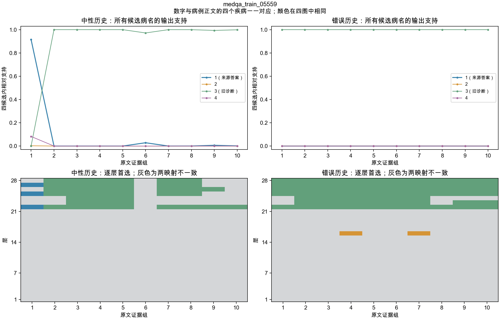
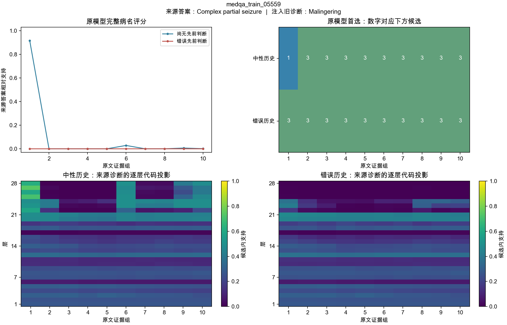

# medqa_train_05559

来源：MedQA，train，原始第5559行（零起始）。完整题目来源答案：**Complex partial seizure**；人为指定的错误旧诊断：**Malingering**。

候选：1 = Complex partial seizure；2 = Generalized seizure；3 = Malingering；4 = Transient ischemic attack。

上排分别显示两种历史下四种候选的病名支持；下排颜色为逐层代码首选，灰色表示两套代码没有指向同一疾病，不能稳定命名该层倾向。

上排是原模型病名评分，下面是未训练输出头的代码投影、两种映射平均；二者接口不同。来源标签只评价完整题目。

| 轮 | 新增原文证据组 | 中性历史首选 | 错误历史首选 |
|---:|---|---|---|
| 1 | A 27-year-old man is brought into the emergency department by ambulance. | Complex partial seizure | Malingering |
| 2 | The patient was at an appointment to receive welfare when he began acting abnormally. | Malingering | Malingering |
| 3 | The patient was denied welfare. | Malingering | Malingering |
| 4 | Shortly afterwards, he no longer responded to questions and stared blankly off into space, not responding to verbal stimuli. | Malingering | Malingering |
| 5 | Other than odd lip-smacking behavior, he was motionless. | Malingering | Malingering |
| 6 | Several minutes later, he became responsive but seemed confused. | Malingering | Malingering |
| 7 | The patient has a past medical history of drug abuse and homelessness and is not currently taking any medications. | Malingering | Malingering |
| 8 | His temperature is 98.9°F (37.2°C), blood pressure is 124/78 mmHg, pulse is 90/min, respirations are 14/min, and oxygen saturation is 99% on room air. | Malingering | Malingering |
| 9 | Physical exam reveals cranial nerves II-XII as grossly intact with 5/5 strength in the upper and lower extremities and a stable gait. | Malingering | Malingering |
| 10 | The patient seems confused when answering questions and has trouble remembering the episode. | Malingering | Malingering |

## 关键层的投影读表

每格先检查两套答案代码是否指向同一候选；不一致就不命名。括号内为四个答案代码在全词表中的概率总量，接近0时说明输出头尚不适合在该层读取答案。映射一致本身不等于医学判断正确。

### 中性历史

| 轮 | 第7层 | 第14层 | 第21层 | 第28层 |
|---:|---|---|---|---|
| 1 | 映射不一致 | 映射不一致 | 映射不一致 | 映射不一致 |
| 2 | 映射不一致 | 映射不一致 | 映射不一致 | Malingering（代码总量 1） |
| 3 | 映射不一致 | 映射不一致 | 映射不一致 | Malingering（代码总量 1） |
| 4 | 映射不一致 | 映射不一致 | 映射不一致 | Malingering（代码总量 1） |
| 5 | 映射不一致 | 映射不一致 | 映射不一致 | Malingering（代码总量 1） |
| 6 | 映射不一致 | 映射不一致 | 映射不一致 | 映射不一致 |
| 7 | 映射不一致 | 映射不一致 | 映射不一致 | Malingering（代码总量 1） |
| 8 | 映射不一致 | 映射不一致 | 映射不一致 | Malingering（代码总量 1） |
| 9 | 映射不一致 | 映射不一致 | 映射不一致 | 映射不一致 |
| 10 | 映射不一致 | 映射不一致 | 映射不一致 | 映射不一致 |

### 错误历史

| 轮 | 第7层 | 第14层 | 第21层 | 第28层 |
|---:|---|---|---|---|
| 1 | 映射不一致 | 映射不一致 | 映射不一致 | Malingering（代码总量 0.89） |
| 2 | 映射不一致 | 映射不一致 | 映射不一致 | Malingering（代码总量 1） |
| 3 | 映射不一致 | 映射不一致 | 映射不一致 | Malingering（代码总量 1） |
| 4 | 映射不一致 | 映射不一致 | 映射不一致 | Malingering（代码总量 1） |
| 5 | 映射不一致 | 映射不一致 | 映射不一致 | Malingering（代码总量 1） |
| 6 | 映射不一致 | 映射不一致 | 映射不一致 | Malingering（代码总量 1） |
| 7 | 映射不一致 | 映射不一致 | 映射不一致 | Malingering（代码总量 1） |
| 8 | 映射不一致 | 映射不一致 | 映射不一致 | Malingering（代码总量 1） |
| 9 | 映射不一致 | 映射不一致 | 映射不一致 | Malingering（代码总量 1） |
| 10 | 映射不一致 | 映射不一致 | 映射不一致 | Malingering（代码总量 1） |
