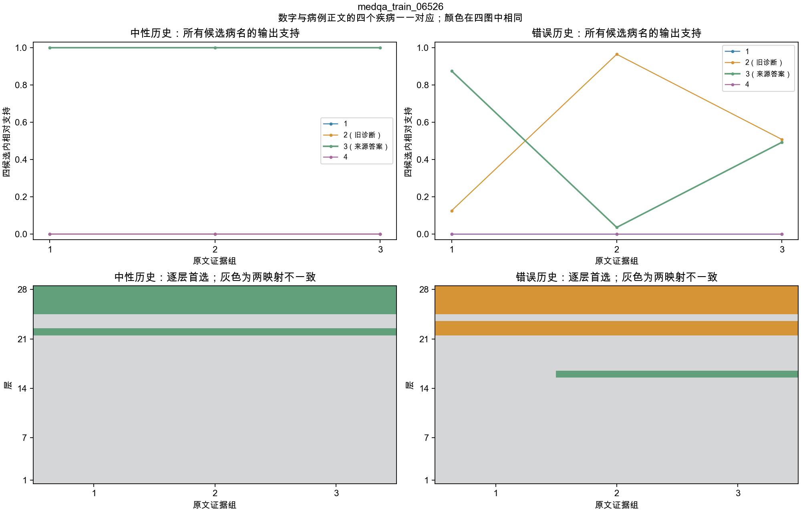
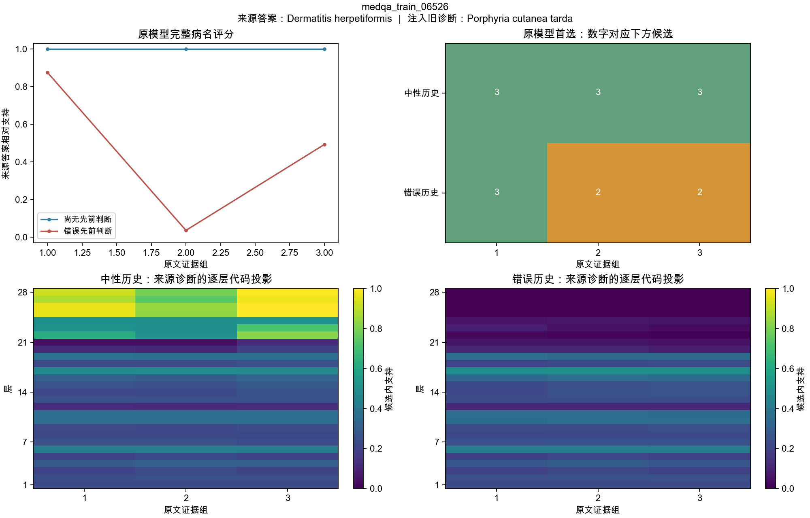

# medqa_train_06526

来源：MedQA，train，原始第6526行（零起始）。完整题目来源答案：**Dermatitis herpetiformis**；人为指定的错误旧诊断：**Porphyria cutanea tarda**。

候选：1 = Candida intertrigo；2 = Porphyria cutanea tarda；3 = Dermatitis herpetiformis；4 = Leprosy。

上排分别显示两种历史下四种候选的病名支持；下排颜色为逐层代码首选，灰色表示两套代码没有指向同一疾病，不能稳定命名该层倾向。

上排是原模型病名评分，下面是未训练输出头的代码投影、两种映射平均；二者接口不同。来源标签只评价完整题目。

| 轮 | 新增原文证据组 | 中性历史首选 | 错误历史首选 |
|---:|---|---|---|
| 1 | A 22-year-old woman presents to her primary care physician complaining of a red, itchy rash on her elbows and shoulders for 2 months. | Dermatitis herpetiformis | Dermatitis herpetiformis |
| 2 | She has no history of medical problems, and review of systems is positive only for occasional loose stools. | Dermatitis herpetiformis | Porphyria cutanea tarda |
| 3 | She is appropriately prescribed dapsone, which relieves the rash within hours. | Dermatitis herpetiformis | Porphyria cutanea tarda |

## 关键层的投影读表

每格先检查两套答案代码是否指向同一候选；不一致就不命名。括号内为四个答案代码在全词表中的概率总量，接近0时说明输出头尚不适合在该层读取答案。映射一致本身不等于医学判断正确。

### 中性历史

| 轮 | 第7层 | 第14层 | 第21层 | 第28层 |
|---:|---|---|---|---|
| 1 | 映射不一致 | 映射不一致 | 映射不一致 | Dermatitis herpetiformis（代码总量 1） |
| 2 | 映射不一致 | 映射不一致 | 映射不一致 | Dermatitis herpetiformis（代码总量 1） |
| 3 | 映射不一致 | 映射不一致 | 映射不一致 | Dermatitis herpetiformis（代码总量 1） |

### 错误历史

| 轮 | 第7层 | 第14层 | 第21层 | 第28层 |
|---:|---|---|---|---|
| 1 | 映射不一致 | 映射不一致 | 映射不一致 | Porphyria cutanea tarda（代码总量 1） |
| 2 | 映射不一致 | 映射不一致 | 映射不一致 | Porphyria cutanea tarda（代码总量 1） |
| 3 | 映射不一致 | 映射不一致 | 映射不一致 | Porphyria cutanea tarda（代码总量 1） |
