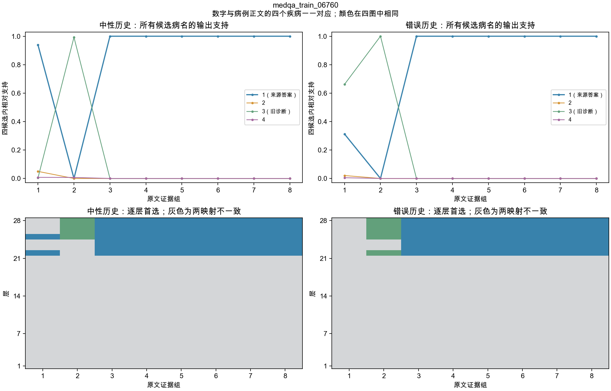
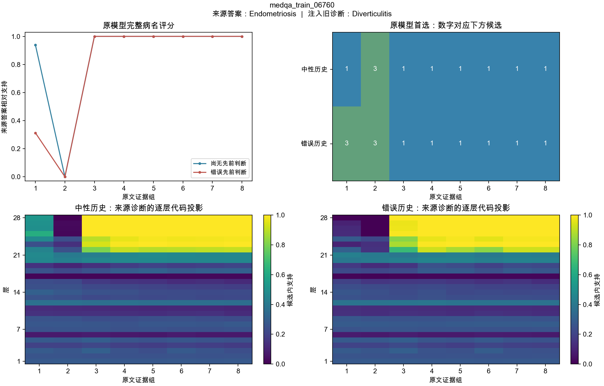

# medqa_train_06760

来源：MedQA，train，原始第6760行（零起始）。完整题目来源答案：**Endometriosis**；人为指定的错误旧诊断：**Diverticulitis**。

候选：1 = Endometriosis；2 = Ovarian cyst；3 = Diverticulitis；4 = Pelvic inflammatory disease (PID)。

上排分别显示两种历史下四种候选的病名支持；下排颜色为逐层代码首选，灰色表示两套代码没有指向同一疾病，不能稳定命名该层倾向。

上排是原模型病名评分，下面是未训练输出头的代码投影、两种映射平均；二者接口不同。来源标签只评价完整题目。

| 轮 | 新增原文证据组 | 中性历史首选 | 错误历史首选 |
|---:|---|---|---|
| 1 | A 32-year-old woman visits her family physician for a routine health check-up. | Endometriosis | Diverticulitis |
| 2 | During the consult, she complains about recent-onset constipation, painful defecation, and occasional pain with micturition for the past few months. | Diverticulitis | Diverticulitis |
| 3 | Her menstrual cycles have always been regular with moderate pelvic pain during menses, which is relieved with pain medication. | Endometriosis | Endometriosis |
| 4 | However, in the last 6 months, she has noticed that her menses are “heavier” with severe lower abdominal cramps that linger for 4–5 days after the last day of menstruation. | Endometriosis | Endometriosis |
| 5 | She and her husband are trying to conceive a second child, but lately, she has been unable to have sexual intercourse due to pain during sexual intercourse. | Endometriosis | Endometriosis |
| 6 | During the physical examination, she has tenderness in the lower abdomen with no palpable mass. | Endometriosis | Endometriosis |
| 7 | Pelvic examination reveals a left-deviated tender cervix, a tender retroverted uterus, and a left adnexal mass. | Endometriosis | Endometriosis |
| 8 | During the rectovaginal examination, nodules are noted. | Endometriosis | Endometriosis |

## 关键层的投影读表

每格先检查两套答案代码是否指向同一候选；不一致就不命名。括号内为四个答案代码在全词表中的概率总量，接近0时说明输出头尚不适合在该层读取答案。映射一致本身不等于医学判断正确。

### 中性历史

| 轮 | 第7层 | 第14层 | 第21层 | 第28层 |
|---:|---|---|---|---|
| 1 | 映射不一致 | 映射不一致 | 映射不一致 | 映射不一致 |
| 2 | 映射不一致 | 映射不一致 | 映射不一致 | Diverticulitis（代码总量 1） |
| 3 | 映射不一致 | 映射不一致 | 映射不一致 | Endometriosis（代码总量 1） |
| 4 | 映射不一致 | 映射不一致 | 映射不一致 | Endometriosis（代码总量 1） |
| 5 | 映射不一致 | 映射不一致 | 映射不一致 | Endometriosis（代码总量 1） |
| 6 | 映射不一致 | 映射不一致 | 映射不一致 | Endometriosis（代码总量 1） |
| 7 | 映射不一致 | 映射不一致 | 映射不一致 | Endometriosis（代码总量 1） |
| 8 | 映射不一致 | 映射不一致 | 映射不一致 | Endometriosis（代码总量 1） |

### 错误历史

| 轮 | 第7层 | 第14层 | 第21层 | 第28层 |
|---:|---|---|---|---|
| 1 | 映射不一致 | 映射不一致 | 映射不一致 | 映射不一致 |
| 2 | 映射不一致 | 映射不一致 | 映射不一致 | Diverticulitis（代码总量 1） |
| 3 | 映射不一致 | 映射不一致 | 映射不一致 | Endometriosis（代码总量 1） |
| 4 | 映射不一致 | 映射不一致 | 映射不一致 | Endometriosis（代码总量 1） |
| 5 | 映射不一致 | 映射不一致 | 映射不一致 | Endometriosis（代码总量 1） |
| 6 | 映射不一致 | 映射不一致 | 映射不一致 | Endometriosis（代码总量 1） |
| 7 | 映射不一致 | 映射不一致 | 映射不一致 | Endometriosis（代码总量 1） |
| 8 | 映射不一致 | 映射不一致 | 映射不一致 | Endometriosis（代码总量 1） |
