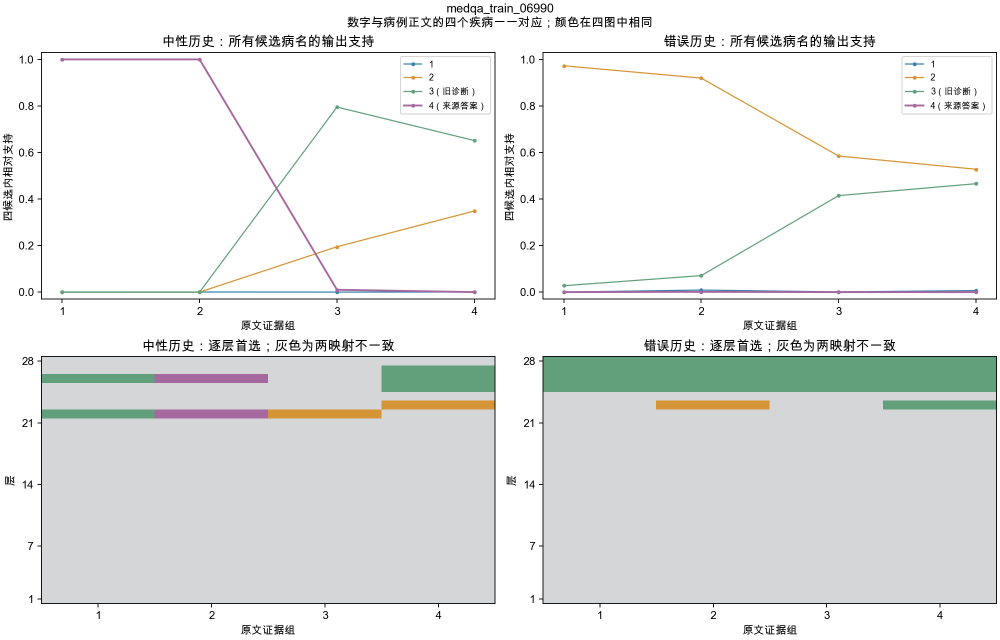
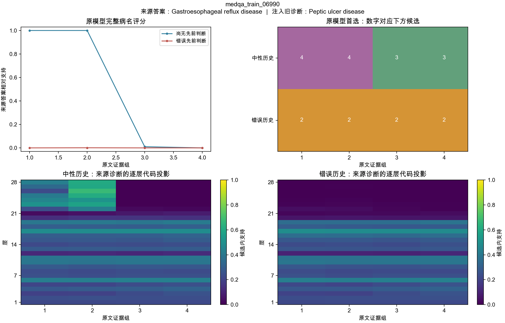

# medqa_train_06990

来源：MedQA，train，原始第6990行（零起始）。完整题目来源答案：**Gastroesophageal reflux disease**；人为指定的错误旧诊断：**Peptic ulcer disease**。

候选：1 = Gastric MALT (mucosa-associated lymphoid tissue) lymphoma；2 = Duodenal ulcer disease；3 = Peptic ulcer disease；4 = Gastroesophageal reflux disease。

上排分别显示两种历史下四种候选的病名支持；下排颜色为逐层代码首选，灰色表示两套代码没有指向同一疾病，不能稳定命名该层倾向。

上排是原模型病名评分，下面是未训练输出头的代码投影、两种映射平均；二者接口不同。来源标签只评价完整题目。

| 轮 | 新增原文证据组 | 中性历史首选 | 错误历史首选 |
|---:|---|---|---|
| 1 | A 30-year-old man who recently emigrated from Southeast Asia presents with heartburn and a bad taste in his mouth. | Gastroesophageal reflux disease | Duodenal ulcer disease |
| 2 | He says the symptoms have been present for the last 6 months and are much worse at night. | Gastroesophageal reflux disease | Duodenal ulcer disease |
| 3 | He describes the pain as moderate to severe, burning in character, and localized to the epigastric region. | Peptic ulcer disease | Duodenal ulcer disease |
| 4 | He mentions that 1 month ago, he was tested for Helicobacter pylori back in his country and completed a course of multiple antibiotics, but there has been no improvement in his symptoms. | Peptic ulcer disease | Duodenal ulcer disease |

## 关键层的投影读表

每格先检查两套答案代码是否指向同一候选；不一致就不命名。括号内为四个答案代码在全词表中的概率总量，接近0时说明输出头尚不适合在该层读取答案。映射一致本身不等于医学判断正确。

### 中性历史

| 轮 | 第7层 | 第14层 | 第21层 | 第28层 |
|---:|---|---|---|---|
| 1 | 映射不一致 | 映射不一致 | 映射不一致 | 映射不一致 |
| 2 | 映射不一致 | 映射不一致 | 映射不一致 | 映射不一致 |
| 3 | 映射不一致 | 映射不一致 | 映射不一致 | 映射不一致 |
| 4 | 映射不一致 | 映射不一致 | 映射不一致 | 映射不一致 |

### 错误历史

| 轮 | 第7层 | 第14层 | 第21层 | 第28层 |
|---:|---|---|---|---|
| 1 | 映射不一致 | 映射不一致 | 映射不一致 | Peptic ulcer disease（代码总量 1） |
| 2 | 映射不一致 | 映射不一致 | 映射不一致 | Peptic ulcer disease（代码总量 1） |
| 3 | 映射不一致 | 映射不一致 | 映射不一致 | Peptic ulcer disease（代码总量 1） |
| 4 | 映射不一致 | 映射不一致 | 映射不一致 | Peptic ulcer disease（代码总量 1） |
