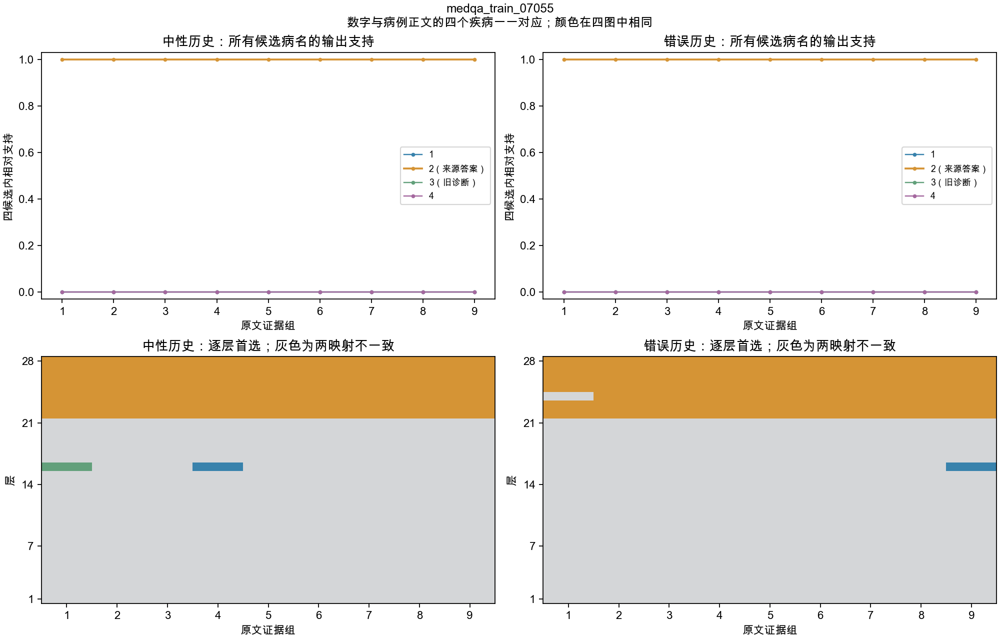
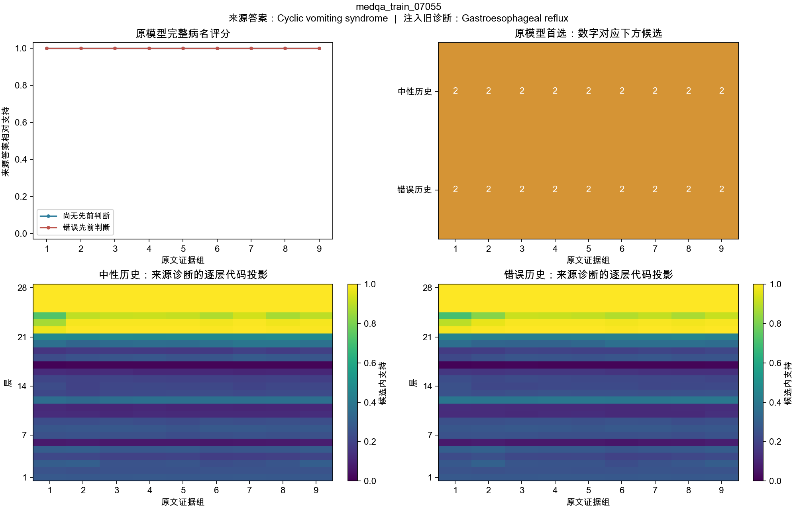

# medqa_train_07055

来源：MedQA，train，原始第7055行（零起始）。完整题目来源答案：**Cyclic vomiting syndrome**；人为指定的错误旧诊断：**Gastroesophageal reflux**。

候选：1 = Intracranial mass；2 = Cyclic vomiting syndrome；3 = Gastroesophageal reflux；4 = Intussusception。

上排分别显示两种历史下四种候选的病名支持；下排颜色为逐层代码首选，灰色表示两套代码没有指向同一疾病，不能稳定命名该层倾向。

上排是原模型病名评分，下面是未训练输出头的代码投影、两种映射平均；二者接口不同。来源标签只评价完整题目。

| 轮 | 新增原文证据组 | 中性历史首选 | 错误历史首选 |
|---:|---|---|---|
| 1 | A 5-year-old male is brought to the pediatrician by his mother, who relates a primary complaint of a recent history of five independent episodes of vomiting over the last 10 months, most recently 3 weeks ago. | Cyclic vomiting syndrome | Cyclic vomiting syndrome |
| 2 | Each time, he has awoken early in the morning appearing pale, feverish, lethargic, and complaining of severe nausea. | Cyclic vomiting syndrome | Cyclic vomiting syndrome |
| 3 | This is followed by 8-12 episodes of non-bilious vomiting over the next 24 hours. | Cyclic vomiting syndrome | Cyclic vomiting syndrome |
| 4 | Between these episodes he returns to normal activity. | Cyclic vomiting syndrome | Cyclic vomiting syndrome |
| 5 | He has no significant past medical history and takes no other medications. | Cyclic vomiting syndrome | Cyclic vomiting syndrome |
| 6 | Review of systems is negative for changes in vision, gait disturbance, or blood in his stool. | Cyclic vomiting syndrome | Cyclic vomiting syndrome |
| 7 | His family history is significant only for migraine headaches. | Cyclic vomiting syndrome | Cyclic vomiting syndrome |
| 8 | Vital signs and physical examination are within normal limits. | Cyclic vomiting syndrome | Cyclic vomiting syndrome |
| 9 | Initial complete blood count, comprehensive metabolic panel, and abdominal radiograph were unremarkable. | Cyclic vomiting syndrome | Cyclic vomiting syndrome |

## 关键层的投影读表

每格先检查两套答案代码是否指向同一候选；不一致就不命名。括号内为四个答案代码在全词表中的概率总量，接近0时说明输出头尚不适合在该层读取答案。映射一致本身不等于医学判断正确。

### 中性历史

| 轮 | 第7层 | 第14层 | 第21层 | 第28层 |
|---:|---|---|---|---|
| 1 | 映射不一致 | 映射不一致 | 映射不一致 | Cyclic vomiting syndrome（代码总量 1） |
| 2 | 映射不一致 | 映射不一致 | 映射不一致 | Cyclic vomiting syndrome（代码总量 1） |
| 3 | 映射不一致 | 映射不一致 | 映射不一致 | Cyclic vomiting syndrome（代码总量 1） |
| 4 | 映射不一致 | 映射不一致 | 映射不一致 | Cyclic vomiting syndrome（代码总量 1） |
| 5 | 映射不一致 | 映射不一致 | 映射不一致 | Cyclic vomiting syndrome（代码总量 1） |
| 6 | 映射不一致 | 映射不一致 | 映射不一致 | Cyclic vomiting syndrome（代码总量 1） |
| 7 | 映射不一致 | 映射不一致 | 映射不一致 | Cyclic vomiting syndrome（代码总量 1） |
| 8 | 映射不一致 | 映射不一致 | 映射不一致 | Cyclic vomiting syndrome（代码总量 1） |
| 9 | 映射不一致 | 映射不一致 | 映射不一致 | Cyclic vomiting syndrome（代码总量 1） |

### 错误历史

| 轮 | 第7层 | 第14层 | 第21层 | 第28层 |
|---:|---|---|---|---|
| 1 | 映射不一致 | 映射不一致 | 映射不一致 | Cyclic vomiting syndrome（代码总量 1） |
| 2 | 映射不一致 | 映射不一致 | 映射不一致 | Cyclic vomiting syndrome（代码总量 1） |
| 3 | 映射不一致 | 映射不一致 | 映射不一致 | Cyclic vomiting syndrome（代码总量 1） |
| 4 | 映射不一致 | 映射不一致 | 映射不一致 | Cyclic vomiting syndrome（代码总量 1） |
| 5 | 映射不一致 | 映射不一致 | 映射不一致 | Cyclic vomiting syndrome（代码总量 1） |
| 6 | 映射不一致 | 映射不一致 | 映射不一致 | Cyclic vomiting syndrome（代码总量 1） |
| 7 | 映射不一致 | 映射不一致 | 映射不一致 | Cyclic vomiting syndrome（代码总量 1） |
| 8 | 映射不一致 | 映射不一致 | 映射不一致 | Cyclic vomiting syndrome（代码总量 1） |
| 9 | 映射不一致 | 映射不一致 | 映射不一致 | Cyclic vomiting syndrome（代码总量 1） |
