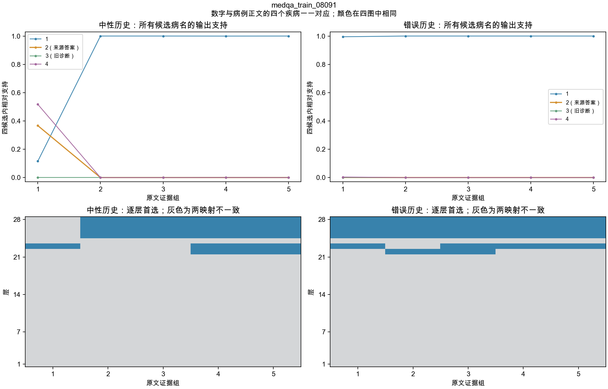
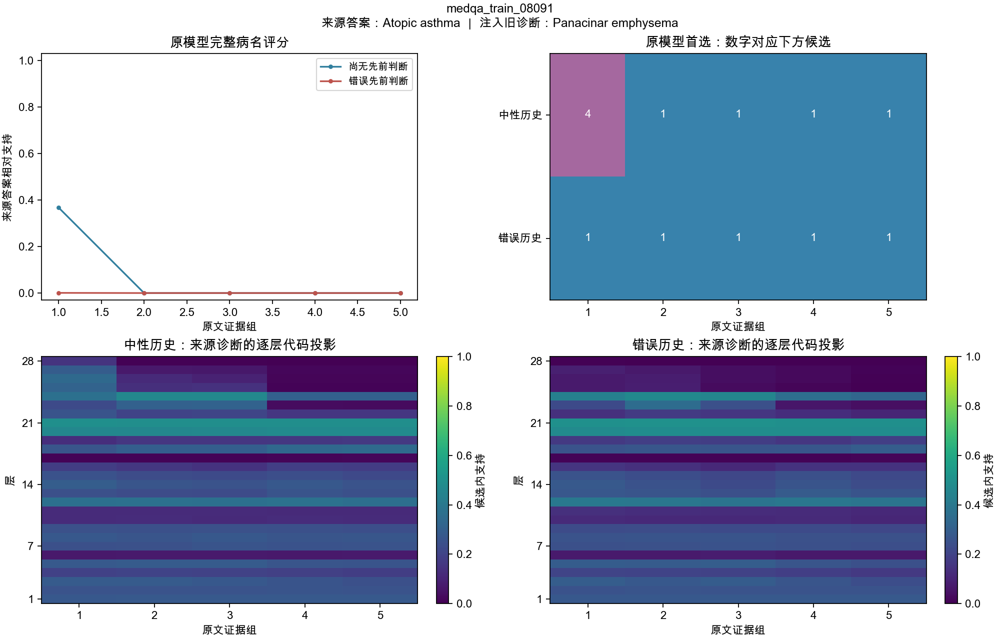

# medqa_train_08091

来源：MedQA，train，原始第8091行（零起始）。完整题目来源答案：**Atopic asthma**；人为指定的错误旧诊断：**Panacinar emphysema**。

候选：1 = Chronic obstructive pulmonary disease；2 = Atopic asthma；3 = Panacinar emphysema；4 = Pneumonia。

上排分别显示两种历史下四种候选的病名支持；下排颜色为逐层代码首选，灰色表示两套代码没有指向同一疾病，不能稳定命名该层倾向。

上排是原模型病名评分，下面是未训练输出头的代码投影、两种映射平均；二者接口不同。来源标签只评价完整题目。

| 轮 | 新增原文证据组 | 中性历史首选 | 错误历史首选 |
|---:|---|---|---|
| 1 | A 34-year-old man presents to his primary care provider for evaluation of nocturnal cough and dyspnea. | Pneumonia | Chronic obstructive pulmonary disease |
| 2 | He has been a smoker for the past 15 years with a 7.5-pack-year smoking history. | Chronic obstructive pulmonary disease | Chronic obstructive pulmonary disease |
| 3 | He has no significant medical history and takes no medications. | Chronic obstructive pulmonary disease | Chronic obstructive pulmonary disease |
| 4 | His blood pressure is 118/76 mm Hg, the heart rate is 84/min, the respiratory rate is 15/min, and the temperature is 37.0°C (98.6°F). | Chronic obstructive pulmonary disease | Chronic obstructive pulmonary disease |
| 5 | A sputum sample shows Charcot-Leyden crystals and Curschmann spirals. | Chronic obstructive pulmonary disease | Chronic obstructive pulmonary disease |

## 关键层的投影读表

每格先检查两套答案代码是否指向同一候选；不一致就不命名。括号内为四个答案代码在全词表中的概率总量，接近0时说明输出头尚不适合在该层读取答案。映射一致本身不等于医学判断正确。

### 中性历史

| 轮 | 第7层 | 第14层 | 第21层 | 第28层 |
|---:|---|---|---|---|
| 1 | 映射不一致 | 映射不一致 | 映射不一致 | 映射不一致 |
| 2 | 映射不一致 | 映射不一致 | 映射不一致 | Chronic obstructive pulmonary disease（代码总量 0.91） |
| 3 | 映射不一致 | 映射不一致 | 映射不一致 | Chronic obstructive pulmonary disease（代码总量 0.94） |
| 4 | 映射不一致 | 映射不一致 | 映射不一致 | Chronic obstructive pulmonary disease（代码总量 1） |
| 5 | 映射不一致 | 映射不一致 | 映射不一致 | Chronic obstructive pulmonary disease（代码总量 1） |

### 错误历史

| 轮 | 第7层 | 第14层 | 第21层 | 第28层 |
|---:|---|---|---|---|
| 1 | 映射不一致 | 映射不一致 | 映射不一致 | Chronic obstructive pulmonary disease（代码总量 1） |
| 2 | 映射不一致 | 映射不一致 | 映射不一致 | Chronic obstructive pulmonary disease（代码总量 0.97） |
| 3 | 映射不一致 | 映射不一致 | 映射不一致 | Chronic obstructive pulmonary disease（代码总量 1） |
| 4 | 映射不一致 | 映射不一致 | 映射不一致 | Chronic obstructive pulmonary disease（代码总量 1） |
| 5 | 映射不一致 | 映射不一致 | 映射不一致 | Chronic obstructive pulmonary disease（代码总量 1） |
