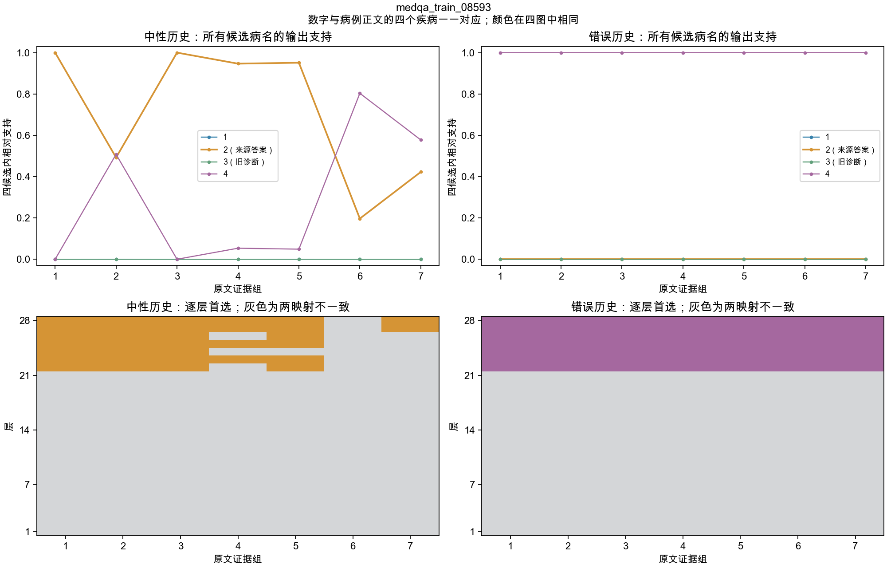
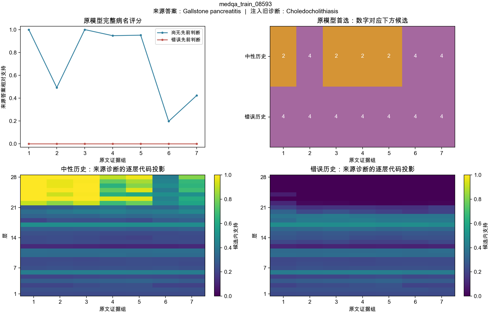

# medqa_train_08593

来源：MedQA，train，原始第8593行（零起始）。完整题目来源答案：**Gallstone pancreatitis**；人为指定的错误旧诊断：**Choledocholithiasis**。

**文本审计标记：本例末尾含任务引导语；原始分组完整保留，不将该轮解释为新增医学事实。严格敏感性分析排除此例。**

候选：1 = Cholelithiasis；2 = Gallstone pancreatitis；3 = Choledocholithiasis；4 = Ascending cholangitis。

上排分别显示两种历史下四种候选的病名支持；下排颜色为逐层代码首选，灰色表示两套代码没有指向同一疾病，不能稳定命名该层倾向。

上排是原模型病名评分，下面是未训练输出头的代码投影、两种映射平均；二者接口不同。来源标签只评价完整题目。

| 轮 | 新增原文证据组 | 中性历史首选 | 错误历史首选 |
|---:|---|---|---|
| 1 | A 52-year-old woman presents to the urgent care center with several hours of worsening abdominal discomfort that radiates to the back. | Gallstone pancreatitis | Ascending cholangitis |
| 2 | The patient also complains of malaise, chills, nausea, and vomiting. | Ascending cholangitis | Ascending cholangitis |
| 3 | Social history is notable for alcoholism. | Gallstone pancreatitis | Ascending cholangitis |
| 4 | On physical exam, she is febrile to 39.5°C (103.1℉), and she is diffusely tender on abdominal palpation. | Gallstone pancreatitis | Ascending cholangitis |
| 5 | Other vital signs include a blood pressure of 126/74 mm Hg, heart rate of 74/min, and respiratory rate of 14/min. | Gallstone pancreatitis | Ascending cholangitis |
| 6 | Complete blood count is notable for 13,500 white blood cells (WBCs), and her complete metabolic panel shows bilirubin of 2.1 and amylase of 3210. | Ascending cholangitis | Ascending cholangitis |
| 7 | Given the following options, | Ascending cholangitis | Ascending cholangitis |

## 关键层的投影读表

每格先检查两套答案代码是否指向同一候选；不一致就不命名。括号内为四个答案代码在全词表中的概率总量，接近0时说明输出头尚不适合在该层读取答案。映射一致本身不等于医学判断正确。

### 中性历史

| 轮 | 第7层 | 第14层 | 第21层 | 第28层 |
|---:|---|---|---|---|
| 1 | 映射不一致 | 映射不一致 | 映射不一致 | Gallstone pancreatitis（代码总量 1） |
| 2 | 映射不一致 | 映射不一致 | 映射不一致 | Gallstone pancreatitis（代码总量 1） |
| 3 | 映射不一致 | 映射不一致 | 映射不一致 | Gallstone pancreatitis（代码总量 1） |
| 4 | 映射不一致 | 映射不一致 | 映射不一致 | Gallstone pancreatitis（代码总量 1） |
| 5 | 映射不一致 | 映射不一致 | 映射不一致 | Gallstone pancreatitis（代码总量 1） |
| 6 | 映射不一致 | 映射不一致 | 映射不一致 | 映射不一致 |
| 7 | 映射不一致 | 映射不一致 | 映射不一致 | Gallstone pancreatitis（代码总量 1） |

### 错误历史

| 轮 | 第7层 | 第14层 | 第21层 | 第28层 |
|---:|---|---|---|---|
| 1 | 映射不一致 | 映射不一致 | 映射不一致 | Ascending cholangitis（代码总量 1） |
| 2 | 映射不一致 | 映射不一致 | 映射不一致 | Ascending cholangitis（代码总量 1） |
| 3 | 映射不一致 | 映射不一致 | 映射不一致 | Ascending cholangitis（代码总量 1） |
| 4 | 映射不一致 | 映射不一致 | 映射不一致 | Ascending cholangitis（代码总量 1） |
| 5 | 映射不一致 | 映射不一致 | 映射不一致 | Ascending cholangitis（代码总量 1） |
| 6 | 映射不一致 | 映射不一致 | 映射不一致 | Ascending cholangitis（代码总量 1） |
| 7 | 映射不一致 | 映射不一致 | 映射不一致 | Ascending cholangitis（代码总量 1） |
