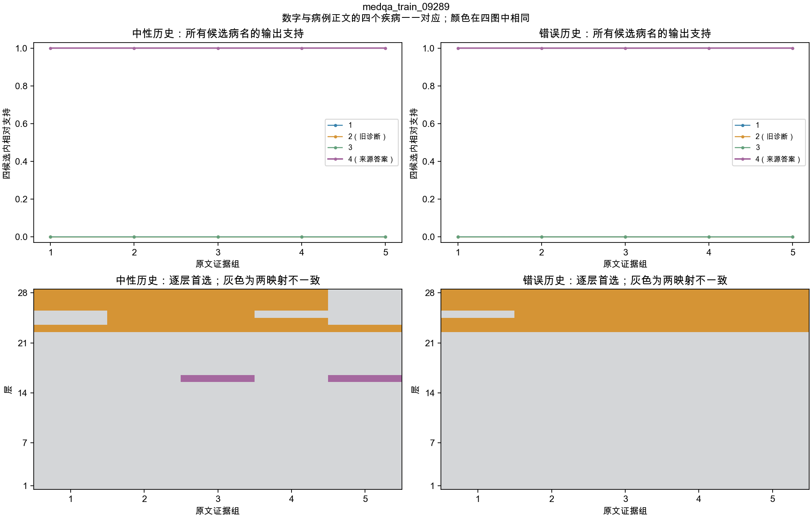
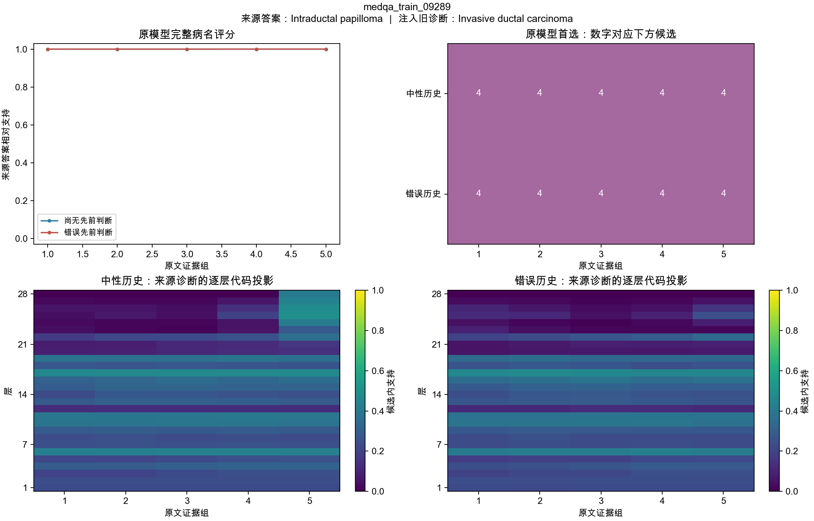

# medqa_train_09289

来源：MedQA，train，原始第9289行（零起始）。完整题目来源答案：**Intraductal papilloma**；人为指定的错误旧诊断：**Invasive ductal carcinoma**。

候选：1 = Breast lipoma；2 = Invasive ductal carcinoma；3 = Paget disease of the breast；4 = Intraductal papilloma。

上排分别显示两种历史下四种候选的病名支持；下排颜色为逐层代码首选，灰色表示两套代码没有指向同一疾病，不能稳定命名该层倾向。

上排是原模型病名评分，下面是未训练输出头的代码投影、两种映射平均；二者接口不同。来源标签只评价完整题目。

| 轮 | 新增原文证据组 | 中性历史首选 | 错误历史首选 |
|---:|---|---|---|
| 1 | A 38-year-old woman comes to the physician for a 3-month history of bloody discharge from the right nipple. | Intraductal papilloma | Intraductal papilloma |
| 2 | Her mother died of breast cancer at the age of 69 years. | Intraductal papilloma | Intraductal papilloma |
| 3 | Mammography 6 months ago did not show any abnormalities. | Intraductal papilloma | Intraductal papilloma |
| 4 | Examination of the breast shows expression of a small amount of serosanguinous fluid from the right nipple; there are no palpable breast masses or axillary lymphadenopathy. | Intraductal papilloma | Intraductal papilloma |
| 5 | Ultrasonography of the right breast shows a single dilated duct. | Intraductal papilloma | Intraductal papilloma |

## 关键层的投影读表

每格先检查两套答案代码是否指向同一候选；不一致就不命名。括号内为四个答案代码在全词表中的概率总量，接近0时说明输出头尚不适合在该层读取答案。映射一致本身不等于医学判断正确。

### 中性历史

| 轮 | 第7层 | 第14层 | 第21层 | 第28层 |
|---:|---|---|---|---|
| 1 | 映射不一致 | 映射不一致 | 映射不一致 | Invasive ductal carcinoma（代码总量 1） |
| 2 | 映射不一致 | 映射不一致 | 映射不一致 | Invasive ductal carcinoma（代码总量 1） |
| 3 | 映射不一致 | 映射不一致 | 映射不一致 | Invasive ductal carcinoma（代码总量 1） |
| 4 | 映射不一致 | 映射不一致 | 映射不一致 | Invasive ductal carcinoma（代码总量 1） |
| 5 | 映射不一致 | 映射不一致 | 映射不一致 | 映射不一致 |

### 错误历史

| 轮 | 第7层 | 第14层 | 第21层 | 第28层 |
|---:|---|---|---|---|
| 1 | 映射不一致 | 映射不一致 | 映射不一致 | Invasive ductal carcinoma（代码总量 1） |
| 2 | 映射不一致 | 映射不一致 | 映射不一致 | Invasive ductal carcinoma（代码总量 1） |
| 3 | 映射不一致 | 映射不一致 | 映射不一致 | Invasive ductal carcinoma（代码总量 1） |
| 4 | 映射不一致 | 映射不一致 | 映射不一致 | Invasive ductal carcinoma（代码总量 1） |
| 5 | 映射不一致 | 映射不一致 | 映射不一致 | Invasive ductal carcinoma（代码总量 1） |
