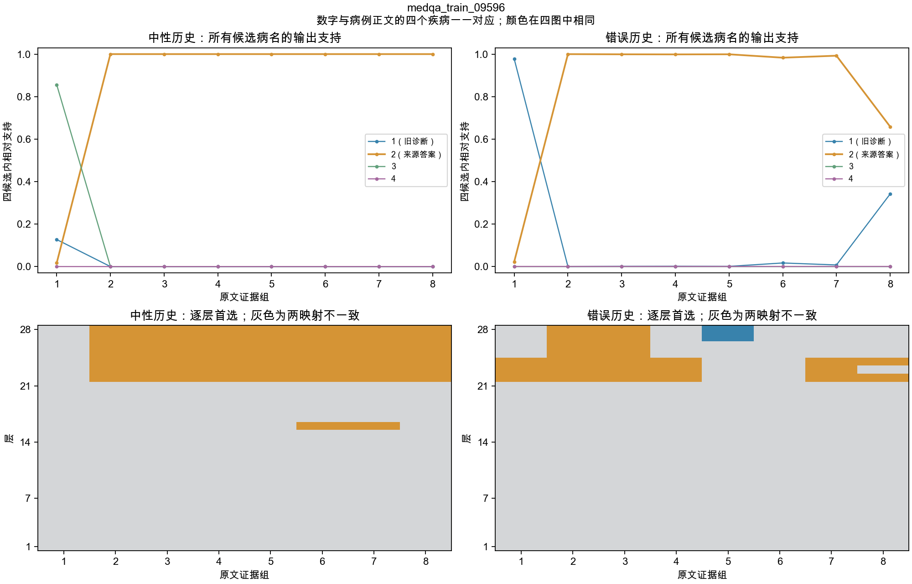
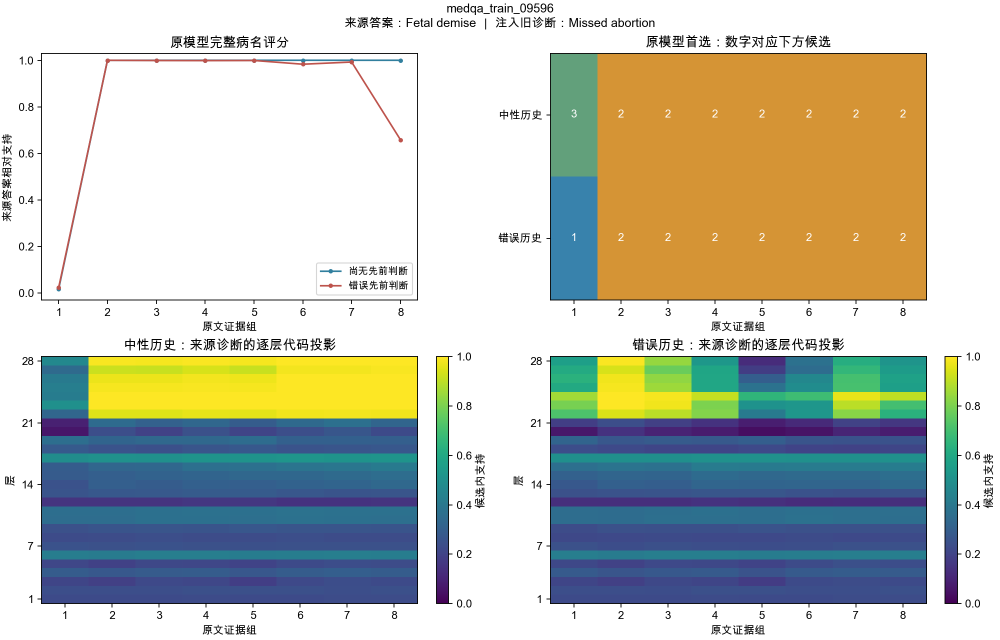

# medqa_train_09596

来源：MedQA，train，原始第9596行（零起始）。完整题目来源答案：**Fetal demise**；人为指定的错误旧诊断：**Missed abortion**。

候选：1 = Missed abortion；2 = Fetal demise；3 = Incomplete abortion；4 = Ectopic pregnancy。

上排分别显示两种历史下四种候选的病名支持；下排颜色为逐层代码首选，灰色表示两套代码没有指向同一疾病，不能稳定命名该层倾向。

上排是原模型病名评分，下面是未训练输出头的代码投影、两种映射平均；二者接口不同。来源标签只评价完整题目。

| 轮 | 新增原文证据组 | 中性历史首选 | 错误历史首选 |
|---:|---|---|---|
| 1 | A 30-year-old primigravida schedules an appointment with her obstetrician for a regular check-up. | Incomplete abortion | Missed abortion |
| 2 | She says that everything is fine, although she reports that her baby has stopped moving as much as previously. | Fetal demise | Fetal demise |
| 3 | She is 22 weeks gestation. | Fetal demise | Fetal demise |
| 4 | She denies any pain or vaginal bleeding. | Fetal demise | Fetal demise |
| 5 | The obstetrician performs an ultrasound and also orders routine blood and urine tests. | Fetal demise | Fetal demise |
| 6 | On ultrasound, there is no fetal cardiac activity or movement. | Fetal demise | Fetal demise |
| 7 | The patient is asked to wait for 1 hour, after which the scan is to be repeated. | Fetal demise | Fetal demise |
| 8 | The second scan shows the same findings. | Fetal demise | Fetal demise |

## 关键层的投影读表

每格先检查两套答案代码是否指向同一候选；不一致就不命名。括号内为四个答案代码在全词表中的概率总量，接近0时说明输出头尚不适合在该层读取答案。映射一致本身不等于医学判断正确。

### 中性历史

| 轮 | 第7层 | 第14层 | 第21层 | 第28层 |
|---:|---|---|---|---|
| 1 | 映射不一致 | 映射不一致 | 映射不一致 | 映射不一致 |
| 2 | 映射不一致 | 映射不一致 | 映射不一致 | Fetal demise（代码总量 1） |
| 3 | 映射不一致 | 映射不一致 | 映射不一致 | Fetal demise（代码总量 1） |
| 4 | 映射不一致 | 映射不一致 | 映射不一致 | Fetal demise（代码总量 1） |
| 5 | 映射不一致 | 映射不一致 | 映射不一致 | Fetal demise（代码总量 1） |
| 6 | 映射不一致 | 映射不一致 | 映射不一致 | Fetal demise（代码总量 1） |
| 7 | 映射不一致 | 映射不一致 | 映射不一致 | Fetal demise（代码总量 1） |
| 8 | 映射不一致 | 映射不一致 | 映射不一致 | Fetal demise（代码总量 1） |

### 错误历史

| 轮 | 第7层 | 第14层 | 第21层 | 第28层 |
|---:|---|---|---|---|
| 1 | 映射不一致 | 映射不一致 | 映射不一致 | 映射不一致 |
| 2 | 映射不一致 | 映射不一致 | 映射不一致 | Fetal demise（代码总量 1） |
| 3 | 映射不一致 | 映射不一致 | 映射不一致 | Fetal demise（代码总量 1） |
| 4 | 映射不一致 | 映射不一致 | 映射不一致 | 映射不一致 |
| 5 | 映射不一致 | 映射不一致 | 映射不一致 | Missed abortion（代码总量 1） |
| 6 | 映射不一致 | 映射不一致 | 映射不一致 | 映射不一致 |
| 7 | 映射不一致 | 映射不一致 | 映射不一致 | 映射不一致 |
| 8 | 映射不一致 | 映射不一致 | 映射不一致 | 映射不一致 |
