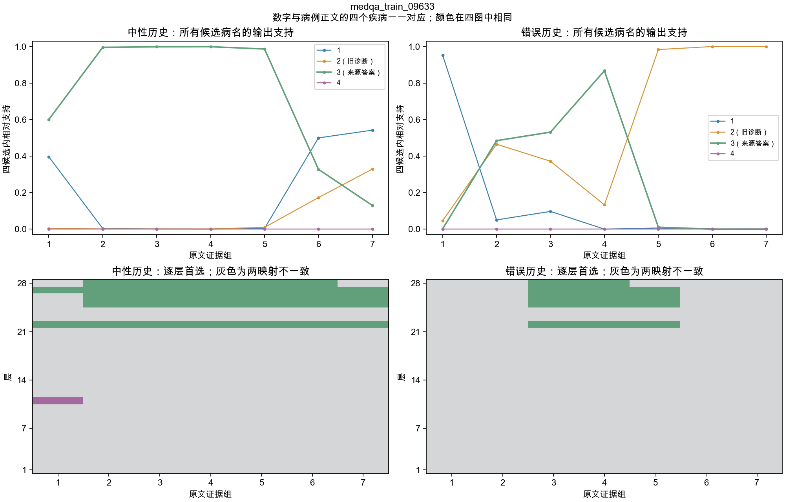
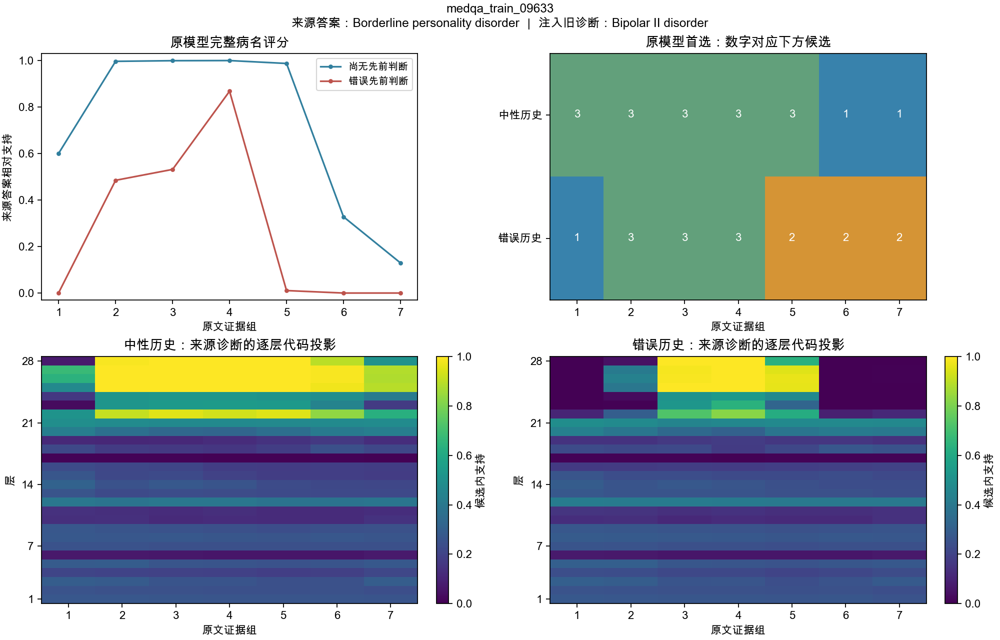

# medqa_train_09633

来源：MedQA，train，原始第9633行（零起始）。完整题目来源答案：**Borderline personality disorder**；人为指定的错误旧诊断：**Bipolar II disorder**。

候选：1 = Bipolar I disorder；2 = Bipolar II disorder；3 = Borderline personality disorder；4 = Histrionic personality disorder。

上排分别显示两种历史下四种候选的病名支持；下排颜色为逐层代码首选，灰色表示两套代码没有指向同一疾病，不能稳定命名该层倾向。

上排是原模型病名评分，下面是未训练输出头的代码投影、两种映射平均；二者接口不同。来源标签只评价完整题目。

| 轮 | 新增原文证据组 | 中性历史首选 | 错误历史首选 |
|---:|---|---|---|
| 1 | A 19-year-old man presents to the emergency room after a suicidal gesture following a fight with his new girlfriend. | Borderline personality disorder | Bipolar I disorder |
| 2 | He tearfully tells you that she is “definitely the one," unlike his numerous previous girlfriends, who were "all mean and selfish” and with whom he frequently fought. | Borderline personality disorder | Borderline personality disorder |
| 3 | During this fight, his current girlfriend suggested that they spend time apart, so he opened a window and threatened to jump unless she promised to never leave him. | Borderline personality disorder | Borderline personality disorder |
| 4 | You gather that his other relationships have ended in similar ways. | Borderline personality disorder | Borderline personality disorder |
| 5 | He endorses impulsive behaviors and describes his moods as “intense” and rapidly changing in response to people around him. | Borderline personality disorder | Bipolar II disorder |
| 6 | He often feels “depressed” for one day and then elated the next. | Bipolar I disorder | Bipolar II disorder |
| 7 | You notice several superficial cuts and scars on the patient’s arms and wrists, and he admits to cutting his wrists in order to “feel something other than my emptiness.” | Bipolar I disorder | Bipolar II disorder |

## 关键层的投影读表

每格先检查两套答案代码是否指向同一候选；不一致就不命名。括号内为四个答案代码在全词表中的概率总量，接近0时说明输出头尚不适合在该层读取答案。映射一致本身不等于医学判断正确。

### 中性历史

| 轮 | 第7层 | 第14层 | 第21层 | 第28层 |
|---:|---|---|---|---|
| 1 | 映射不一致 | 映射不一致 | 映射不一致 | 映射不一致 |
| 2 | 映射不一致 | 映射不一致 | 映射不一致 | Borderline personality disorder（代码总量 1） |
| 3 | 映射不一致 | 映射不一致 | 映射不一致 | Borderline personality disorder（代码总量 1） |
| 4 | 映射不一致 | 映射不一致 | 映射不一致 | Borderline personality disorder（代码总量 1） |
| 5 | 映射不一致 | 映射不一致 | 映射不一致 | Borderline personality disorder（代码总量 1） |
| 6 | 映射不一致 | 映射不一致 | 映射不一致 | Borderline personality disorder（代码总量 1） |
| 7 | 映射不一致 | 映射不一致 | 映射不一致 | 映射不一致 |

### 错误历史

| 轮 | 第7层 | 第14层 | 第21层 | 第28层 |
|---:|---|---|---|---|
| 1 | 映射不一致 | 映射不一致 | 映射不一致 | 映射不一致 |
| 2 | 映射不一致 | 映射不一致 | 映射不一致 | 映射不一致 |
| 3 | 映射不一致 | 映射不一致 | 映射不一致 | Borderline personality disorder（代码总量 1） |
| 4 | 映射不一致 | 映射不一致 | 映射不一致 | Borderline personality disorder（代码总量 1） |
| 5 | 映射不一致 | 映射不一致 | 映射不一致 | 映射不一致 |
| 6 | 映射不一致 | 映射不一致 | 映射不一致 | 映射不一致 |
| 7 | 映射不一致 | 映射不一致 | 映射不一致 | 映射不一致 |
