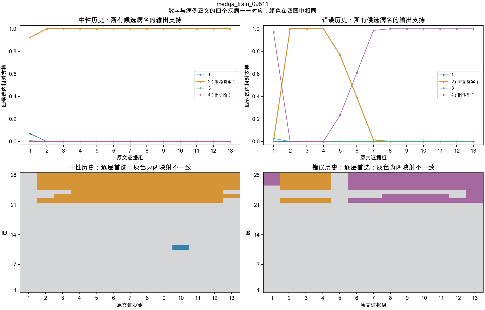
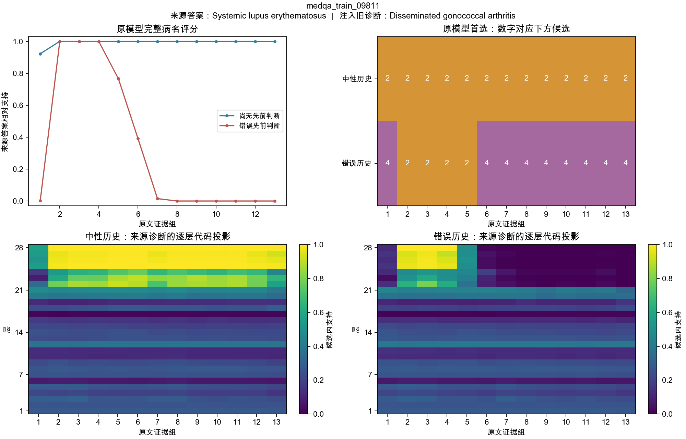

# medqa_train_09811

来源：MedQA，train，原始第9811行（零起始）。完整题目来源答案：**Systemic lupus erythematosus**；人为指定的错误旧诊断：**Disseminated gonococcal arthritis**。

候选：1 = Parvovirus B19 infection；2 = Systemic lupus erythematosus；3 = Behcet disease；4 = Disseminated gonococcal arthritis。

上排分别显示两种历史下四种候选的病名支持；下排颜色为逐层代码首选，灰色表示两套代码没有指向同一疾病，不能稳定命名该层倾向。

上排是原模型病名评分，下面是未训练输出头的代码投影、两种映射平均；二者接口不同。来源标签只评价完整题目。

| 轮 | 新增原文证据组 | 中性历史首选 | 错误历史首选 |
|---:|---|---|---|
| 1 | A 33-year-old African American woman presents to the clinic complaining of pain and swelling of her hands and wrists for the past 5 months. | Systemic lupus erythematosus | Disseminated gonococcal arthritis |
| 2 | The symptoms are worse in the morning and are associated with stiffness that lasts about 15 minutes. | Systemic lupus erythematosus | Systemic lupus erythematosus |
| 3 | She also complains of profound fatigue and decreased appetite. | Systemic lupus erythematosus | Systemic lupus erythematosus |
| 4 | She is sexually active with one partner in a monogamous relationship. | Systemic lupus erythematosus | Systemic lupus erythematosus |
| 5 | Past medical history is unremarkable and she is taking oral contraceptives. | Systemic lupus erythematosus | Systemic lupus erythematosus |
| 6 | She smokes 1–2 cigarettes per day and drinks alcohol socially on the weekends. | Systemic lupus erythematosus | Disseminated gonococcal arthritis |
| 7 | Temperature is 37.2°C (99.1°F), blood pressure is 130/82 mm Hg, pulse is 76/min, and respirations are 12/min. | Systemic lupus erythematosus | Disseminated gonococcal arthritis |
| 8 | Physical examination reveals wrists that are tender to palpation, warm, and mildly swollen. | Systemic lupus erythematosus | Disseminated gonococcal arthritis |
| 9 | Several metacarpophalangeal and proximal interphalangeal joints on both hands are also tender. | Systemic lupus erythematosus | Disseminated gonococcal arthritis |
| 10 | Hand and wrist strength is 5/5 bilaterally. | Systemic lupus erythematosus | Disseminated gonococcal arthritis |
| 11 | A non-tender ulcer on the buccal mucosa is also noted. | Systemic lupus erythematosus | Disseminated gonococcal arthritis |
| 12 | When asked about it, the patient reports that it has been there for several months and does not bother her. | Systemic lupus erythematosus | Disseminated gonococcal arthritis |
| 13 | Laboratory results are as follows: Complete blood count Hemoglobin 10.3 g/dL Platelets 90,000/mm3 Leukocytes 6,700/mm3 Blood urea nitrogen 16 mg/dL Creatinine 2.1 mg/dL Urinalysis Blood 10–20 red blood cells/hpf Protein 2+ protein B-HCG Negative | Systemic lupus erythematosus | Disseminated gonococcal arthritis |

## 关键层的投影读表

每格先检查两套答案代码是否指向同一候选；不一致就不命名。括号内为四个答案代码在全词表中的概率总量，接近0时说明输出头尚不适合在该层读取答案。映射一致本身不等于医学判断正确。

### 中性历史

| 轮 | 第7层 | 第14层 | 第21层 | 第28层 |
|---:|---|---|---|---|
| 1 | 映射不一致 | 映射不一致 | 映射不一致 | 映射不一致 |
| 2 | 映射不一致 | 映射不一致 | 映射不一致 | Systemic lupus erythematosus（代码总量 0.99） |
| 3 | 映射不一致 | 映射不一致 | 映射不一致 | Systemic lupus erythematosus（代码总量 1） |
| 4 | 映射不一致 | 映射不一致 | 映射不一致 | Systemic lupus erythematosus（代码总量 1） |
| 5 | 映射不一致 | 映射不一致 | 映射不一致 | Systemic lupus erythematosus（代码总量 1） |
| 6 | 映射不一致 | 映射不一致 | 映射不一致 | Systemic lupus erythematosus（代码总量 1） |
| 7 | 映射不一致 | 映射不一致 | 映射不一致 | Systemic lupus erythematosus（代码总量 1） |
| 8 | 映射不一致 | 映射不一致 | 映射不一致 | Systemic lupus erythematosus（代码总量 1） |
| 9 | 映射不一致 | 映射不一致 | 映射不一致 | Systemic lupus erythematosus（代码总量 1） |
| 10 | 映射不一致 | 映射不一致 | 映射不一致 | Systemic lupus erythematosus（代码总量 1） |
| 11 | 映射不一致 | 映射不一致 | 映射不一致 | Systemic lupus erythematosus（代码总量 1） |
| 12 | 映射不一致 | 映射不一致 | 映射不一致 | Systemic lupus erythematosus（代码总量 1） |
| 13 | 映射不一致 | 映射不一致 | 映射不一致 | Systemic lupus erythematosus（代码总量 1） |

### 错误历史

| 轮 | 第7层 | 第14层 | 第21层 | 第28层 |
|---:|---|---|---|---|
| 1 | 映射不一致 | 映射不一致 | 映射不一致 | Disseminated gonococcal arthritis（代码总量 1） |
| 2 | 映射不一致 | 映射不一致 | 映射不一致 | Systemic lupus erythematosus（代码总量 1） |
| 3 | 映射不一致 | 映射不一致 | 映射不一致 | Systemic lupus erythematosus（代码总量 1） |
| 4 | 映射不一致 | 映射不一致 | 映射不一致 | Systemic lupus erythematosus（代码总量 1） |
| 5 | 映射不一致 | 映射不一致 | 映射不一致 | 映射不一致 |
| 6 | 映射不一致 | 映射不一致 | 映射不一致 | Disseminated gonococcal arthritis（代码总量 1） |
| 7 | 映射不一致 | 映射不一致 | 映射不一致 | Disseminated gonococcal arthritis（代码总量 1） |
| 8 | 映射不一致 | 映射不一致 | 映射不一致 | Disseminated gonococcal arthritis（代码总量 1） |
| 9 | 映射不一致 | 映射不一致 | 映射不一致 | Disseminated gonococcal arthritis（代码总量 1） |
| 10 | 映射不一致 | 映射不一致 | 映射不一致 | Disseminated gonococcal arthritis（代码总量 1） |
| 11 | 映射不一致 | 映射不一致 | 映射不一致 | Disseminated gonococcal arthritis（代码总量 1） |
| 12 | 映射不一致 | 映射不一致 | 映射不一致 | Disseminated gonococcal arthritis（代码总量 1） |
| 13 | 映射不一致 | 映射不一致 | 映射不一致 | Disseminated gonococcal arthritis（代码总量 1） |
