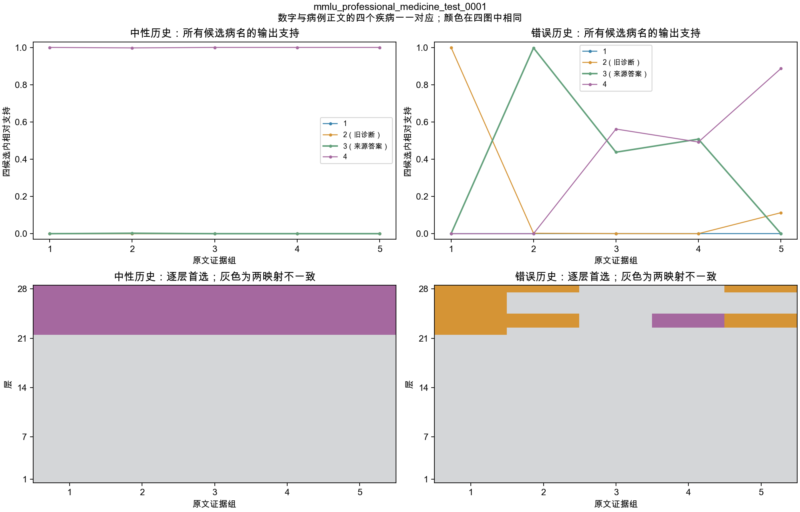
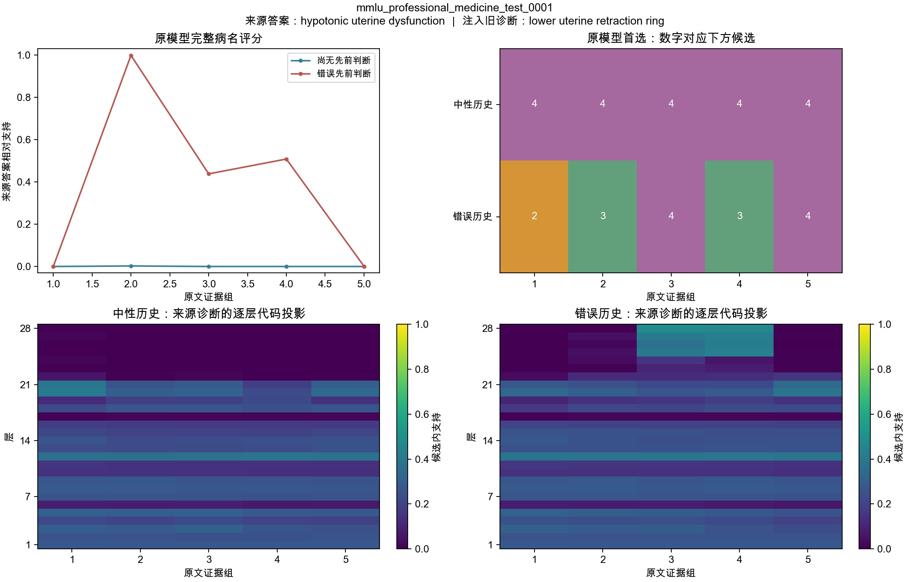

# mmlu_professional_medicine_test_0001

来源：MMLU，test，原始第1行（零起始）。完整题目来源答案：**hypotonic uterine dysfunction**；人为指定的错误旧诊断：**lower uterine retraction ring**。

候选：1 = Braxton Hicks contractions；2 = lower uterine retraction ring；3 = hypotonic uterine dysfunction；4 = primary dysfunctional labor。

上排分别显示两种历史下四种候选的病名支持；下排颜色为逐层代码首选，灰色表示两套代码没有指向同一疾病，不能稳定命名该层倾向。

上排是原模型病名评分，下面是未训练输出头的代码投影、两种映射平均；二者接口不同。来源标签只评价完整题目。

| 轮 | 新增原文证据组 | 中性历史首选 | 错误历史首选 |
|---:|---|---|---|
| 1 | A 25-year-old gravida 3 para 2 female is admitted to the hospital at 39 weeks' gestation in active labor. | primary dysfunctional labor | lower uterine retraction ring |
| 2 | She had been having regular contractions every 4 minutes, but is now having only a few intermittent, weak contractions. | primary dysfunctional labor | hypotonic uterine dysfunction |
| 3 | She has received medication for pain twice in the past 6 hours. | primary dysfunctional labor | primary dysfunctional labor |
| 4 | Examination shows no reason for obstructed labor. | primary dysfunctional labor | hypotonic uterine dysfunction |
| 5 | The fetal head is engaged, the membranes are intact, the fetal heart tones are normal, and the cervix is 100% effaced and 7 cm dilated. | primary dysfunctional labor | primary dysfunctional labor |

## 关键层的投影读表

每格先检查两套答案代码是否指向同一候选；不一致就不命名。括号内为四个答案代码在全词表中的概率总量，接近0时说明输出头尚不适合在该层读取答案。映射一致本身不等于医学判断正确。

### 中性历史

| 轮 | 第7层 | 第14层 | 第21层 | 第28层 |
|---:|---|---|---|---|
| 1 | 映射不一致 | 映射不一致 | 映射不一致 | primary dysfunctional labor（代码总量 1） |
| 2 | 映射不一致 | 映射不一致 | 映射不一致 | primary dysfunctional labor（代码总量 1） |
| 3 | 映射不一致 | 映射不一致 | 映射不一致 | primary dysfunctional labor（代码总量 1） |
| 4 | 映射不一致 | 映射不一致 | 映射不一致 | primary dysfunctional labor（代码总量 1） |
| 5 | 映射不一致 | 映射不一致 | 映射不一致 | primary dysfunctional labor（代码总量 1） |

### 错误历史

| 轮 | 第7层 | 第14层 | 第21层 | 第28层 |
|---:|---|---|---|---|
| 1 | 映射不一致 | 映射不一致 | 映射不一致 | lower uterine retraction ring（代码总量 1） |
| 2 | 映射不一致 | 映射不一致 | 映射不一致 | lower uterine retraction ring（代码总量 1） |
| 3 | 映射不一致 | 映射不一致 | 映射不一致 | 映射不一致 |
| 4 | 映射不一致 | 映射不一致 | 映射不一致 | 映射不一致 |
| 5 | 映射不一致 | 映射不一致 | 映射不一致 | lower uterine retraction ring（代码总量 1） |
