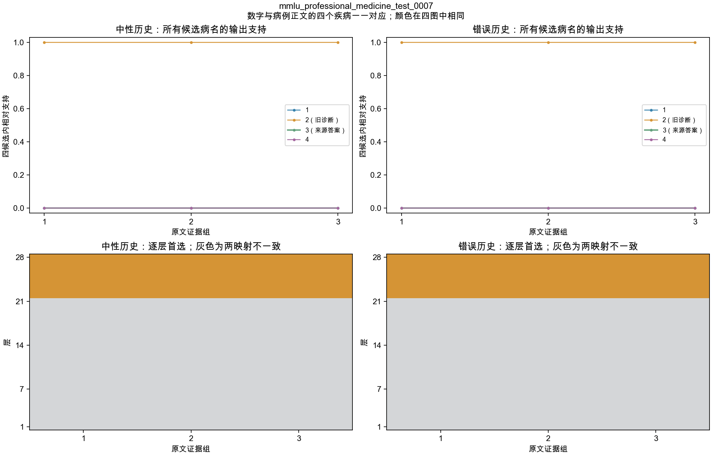
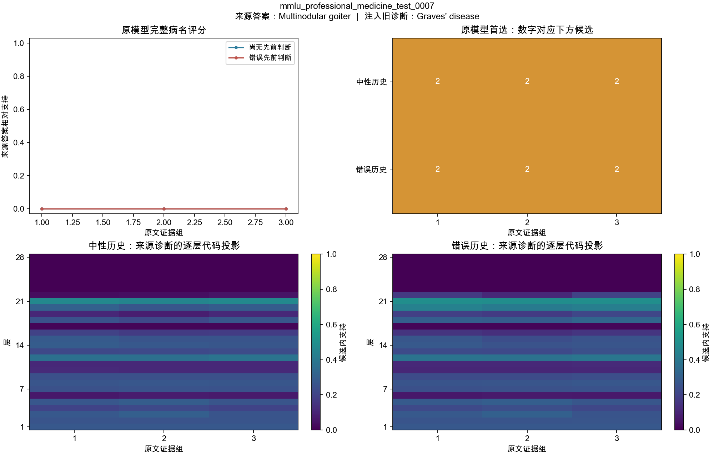

# mmlu_professional_medicine_test_0007

来源：MMLU，test，原始第7行（零起始）。完整题目来源答案：**Multinodular goiter**；人为指定的错误旧诊断：**Graves' disease**。

候选：1 = Defect in thyroxine (T4) biosynthesis；2 = Graves' disease；3 = Multinodular goiter；4 = Riedel's thyroiditis。

上排分别显示两种历史下四种候选的病名支持；下排颜色为逐层代码首选，灰色表示两套代码没有指向同一疾病，不能稳定命名该层倾向。

上排是原模型病名评分，下面是未训练输出头的代码投影、两种映射平均；二者接口不同。来源标签只评价完整题目。

| 轮 | 新增原文证据组 | 中性历史首选 | 错误历史首选 |
|---:|---|---|---|
| 1 | A 65-year-old woman has a 6-month history of progressive irritability, palpitations, heat intolerance, frequent bowel movements, and a 6.8-kg (15-lb) weight loss. | Graves' disease | Graves' disease |
| 2 | She has had a neck mass for more than 10 years. | Graves' disease | Graves' disease |
| 3 | 131I scan shows an enlarged thyroid gland with multiple areas of increased and decreased uptake. | Graves' disease | Graves' disease |

## 关键层的投影读表

每格先检查两套答案代码是否指向同一候选；不一致就不命名。括号内为四个答案代码在全词表中的概率总量，接近0时说明输出头尚不适合在该层读取答案。映射一致本身不等于医学判断正确。

### 中性历史

| 轮 | 第7层 | 第14层 | 第21层 | 第28层 |
|---:|---|---|---|---|
| 1 | 映射不一致 | 映射不一致 | 映射不一致 | Graves' disease（代码总量 1） |
| 2 | 映射不一致 | 映射不一致 | 映射不一致 | Graves' disease（代码总量 1） |
| 3 | 映射不一致 | 映射不一致 | 映射不一致 | Graves' disease（代码总量 1） |

### 错误历史

| 轮 | 第7层 | 第14层 | 第21层 | 第28层 |
|---:|---|---|---|---|
| 1 | 映射不一致 | 映射不一致 | 映射不一致 | Graves' disease（代码总量 1） |
| 2 | 映射不一致 | 映射不一致 | 映射不一致 | Graves' disease（代码总量 1） |
| 3 | 映射不一致 | 映射不一致 | 映射不一致 | Graves' disease（代码总量 1） |
