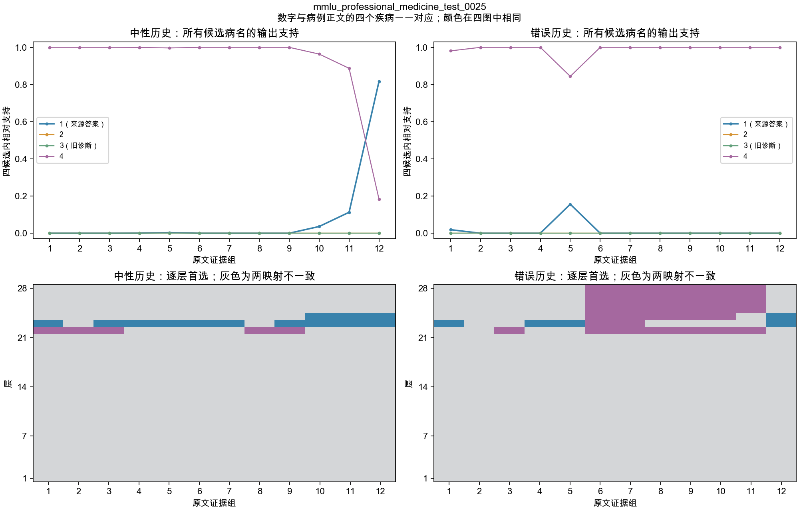
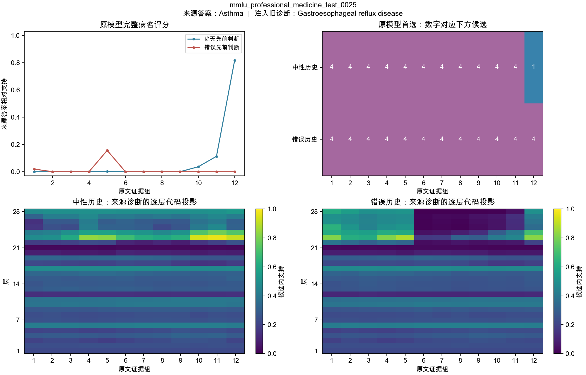

# mmlu_professional_medicine_test_0025

来源：MMLU，test，原始第25行（零起始）。完整题目来源答案：**Asthma**；人为指定的错误旧诊断：**Gastroesophageal reflux disease**。

候选：1 = Asthma；2 = Chronic bronchitis；3 = Gastroesophageal reflux disease；4 = Postnasal drip syndrome。

上排分别显示两种历史下四种候选的病名支持；下排颜色为逐层代码首选，灰色表示两套代码没有指向同一疾病，不能稳定命名该层倾向。

上排是原模型病名评分，下面是未训练输出头的代码投影、两种映射平均；二者接口不同。来源标签只评价完整题目。

| 轮 | 新增原文证据组 | 中性历史首选 | 错误历史首选 |
|---:|---|---|---|
| 1 | A previously healthy 17-year-old girl comes to the physician because of a 2-month history of exercise-induced cough and nasal congestion. | Postnasal drip syndrome | Postnasal drip syndrome |
| 2 | She plays field hockey and has noticed she coughs when running up and down the field. | Postnasal drip syndrome | Postnasal drip syndrome |
| 3 | The cough is nonproductive and resolves with rest. | Postnasal drip syndrome | Postnasal drip syndrome |
| 4 | She has not had chest pain or palpitations. | Postnasal drip syndrome | Postnasal drip syndrome |
| 5 | She takes no medications and does not smoke. | Postnasal drip syndrome | Postnasal drip syndrome |
| 6 | Her sister has asthma. | Postnasal drip syndrome | Postnasal drip syndrome |
| 7 | The patient appears well. | Postnasal drip syndrome | Postnasal drip syndrome |
| 8 | Her pulse is 68/min, respirations are 16/min, and blood pressure is 100/75 mm Hg. | Postnasal drip syndrome | Postnasal drip syndrome |
| 9 | Pulse oximetry on room air shows an oxygen saturation of 99%. | Postnasal drip syndrome | Postnasal drip syndrome |
| 10 | Cardiopulmonary examination shows no abnormalities. | Postnasal drip syndrome | Postnasal drip syndrome |
| 11 | An x-ray of the chest shows no abnormalities. | Postnasal drip syndrome | Postnasal drip syndrome |
| 12 | Spirometry shows an FEV1:FVC ratio of 90% and an FEV1 of 90% of predicted. | Asthma | Postnasal drip syndrome |

## 关键层的投影读表

每格先检查两套答案代码是否指向同一候选；不一致就不命名。括号内为四个答案代码在全词表中的概率总量，接近0时说明输出头尚不适合在该层读取答案。映射一致本身不等于医学判断正确。

### 中性历史

| 轮 | 第7层 | 第14层 | 第21层 | 第28层 |
|---:|---|---|---|---|
| 1 | 映射不一致 | 映射不一致 | 映射不一致 | 映射不一致 |
| 2 | 映射不一致 | 映射不一致 | 映射不一致 | 映射不一致 |
| 3 | 映射不一致 | 映射不一致 | 映射不一致 | 映射不一致 |
| 4 | 映射不一致 | 映射不一致 | 映射不一致 | 映射不一致 |
| 5 | 映射不一致 | 映射不一致 | 映射不一致 | 映射不一致 |
| 6 | 映射不一致 | 映射不一致 | 映射不一致 | 映射不一致 |
| 7 | 映射不一致 | 映射不一致 | 映射不一致 | 映射不一致 |
| 8 | 映射不一致 | 映射不一致 | 映射不一致 | 映射不一致 |
| 9 | 映射不一致 | 映射不一致 | 映射不一致 | 映射不一致 |
| 10 | 映射不一致 | 映射不一致 | 映射不一致 | 映射不一致 |
| 11 | 映射不一致 | 映射不一致 | 映射不一致 | 映射不一致 |
| 12 | 映射不一致 | 映射不一致 | 映射不一致 | 映射不一致 |

### 错误历史

| 轮 | 第7层 | 第14层 | 第21层 | 第28层 |
|---:|---|---|---|---|
| 1 | 映射不一致 | 映射不一致 | 映射不一致 | 映射不一致 |
| 2 | 映射不一致 | 映射不一致 | 映射不一致 | 映射不一致 |
| 3 | 映射不一致 | 映射不一致 | 映射不一致 | 映射不一致 |
| 4 | 映射不一致 | 映射不一致 | 映射不一致 | 映射不一致 |
| 5 | 映射不一致 | 映射不一致 | 映射不一致 | 映射不一致 |
| 6 | 映射不一致 | 映射不一致 | 映射不一致 | Postnasal drip syndrome（代码总量 1） |
| 7 | 映射不一致 | 映射不一致 | 映射不一致 | Postnasal drip syndrome（代码总量 1） |
| 8 | 映射不一致 | 映射不一致 | 映射不一致 | Postnasal drip syndrome（代码总量 1） |
| 9 | 映射不一致 | 映射不一致 | 映射不一致 | Postnasal drip syndrome（代码总量 1） |
| 10 | 映射不一致 | 映射不一致 | 映射不一致 | Postnasal drip syndrome（代码总量 1） |
| 11 | 映射不一致 | 映射不一致 | 映射不一致 | Postnasal drip syndrome（代码总量 1） |
| 12 | 映射不一致 | 映射不一致 | 映射不一致 | 映射不一致 |
