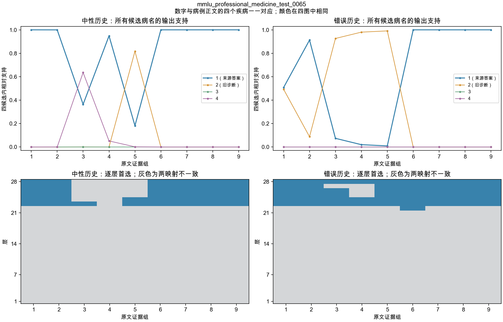
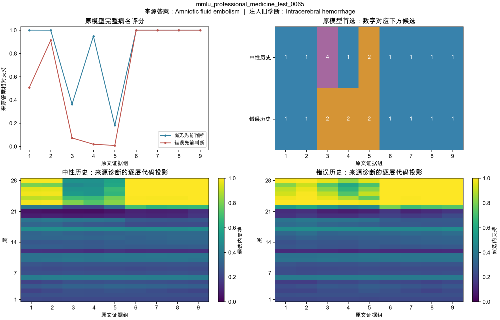

# mmlu_professional_medicine_test_0065

来源：MMLU，test，原始第65行（零起始）。完整题目来源答案：**Amniotic fluid embolism**；人为指定的错误旧诊断：**Intracerebral hemorrhage**。

候选：1 = Amniotic fluid embolism；2 = Intracerebral hemorrhage；3 = Myocardial infarction；4 = Status asmaticus。

上排分别显示两种历史下四种候选的病名支持；下排颜色为逐层代码首选，灰色表示两套代码没有指向同一疾病，不能稳定命名该层倾向。

上排是原模型病名评分，下面是未训练输出头的代码投影、两种映射平均；二者接口不同。来源标签只评价完整题目。

| 轮 | 新增原文证据组 | 中性历史首选 | 错误历史首选 |
|---:|---|---|---|
| 1 | A 32-year-old woman, gravida 3, para 2, at 41 weeks' gestation is admitted to the hospital in active labor. | Amniotic fluid embolism | Amniotic fluid embolism |
| 2 | Pregnancy has been complicated by mild asthma treated with inhaled bronchodilators. | Amniotic fluid embolism | Amniotic fluid embolism |
| 3 | At the beginning of the second stage of labor, the cervix is 100% effaced and 10 cm dilated; the vertex is at -1 station. | Status asmaticus | Intracerebral hemorrhage |
| 4 | The fetal heart rate is reactive with no decelerations. | Amniotic fluid embolism | Intracerebral hemorrhage |
| 5 | After 10 minutes of pushing, there is a prolonged deceleration to 60/min. | Intracerebral hemorrhage | Intracerebral hemorrhage |
| 6 | The patient has the acute onset of shortness of breath, rapidly develops cyanosis, and becomes unresponsive. | Amniotic fluid embolism | Amniotic fluid embolism |
| 7 | Her pulse and blood pressure cannot be detected. | Amniotic fluid embolism | Amniotic fluid embolism |
| 8 | Immediate resuscitation is started. | Amniotic fluid embolism | Amniotic fluid embolism |
| 9 | Five minutes later, there is bleeding from the nose, mouth, and intravenous sites. | Amniotic fluid embolism | Amniotic fluid embolism |

## 关键层的投影读表

每格先检查两套答案代码是否指向同一候选；不一致就不命名。括号内为四个答案代码在全词表中的概率总量，接近0时说明输出头尚不适合在该层读取答案。映射一致本身不等于医学判断正确。

### 中性历史

| 轮 | 第7层 | 第14层 | 第21层 | 第28层 |
|---:|---|---|---|---|
| 1 | 映射不一致 | 映射不一致 | 映射不一致 | Amniotic fluid embolism（代码总量 1） |
| 2 | 映射不一致 | 映射不一致 | 映射不一致 | Amniotic fluid embolism（代码总量 1） |
| 3 | 映射不一致 | 映射不一致 | 映射不一致 | 映射不一致 |
| 4 | 映射不一致 | 映射不一致 | 映射不一致 | 映射不一致 |
| 5 | 映射不一致 | 映射不一致 | 映射不一致 | 映射不一致 |
| 6 | 映射不一致 | 映射不一致 | 映射不一致 | Amniotic fluid embolism（代码总量 1） |
| 7 | 映射不一致 | 映射不一致 | 映射不一致 | Amniotic fluid embolism（代码总量 1） |
| 8 | 映射不一致 | 映射不一致 | 映射不一致 | Amniotic fluid embolism（代码总量 1） |
| 9 | 映射不一致 | 映射不一致 | 映射不一致 | Amniotic fluid embolism（代码总量 1） |

### 错误历史

| 轮 | 第7层 | 第14层 | 第21层 | 第28层 |
|---:|---|---|---|---|
| 1 | 映射不一致 | 映射不一致 | 映射不一致 | Amniotic fluid embolism（代码总量 1） |
| 2 | 映射不一致 | 映射不一致 | 映射不一致 | Amniotic fluid embolism（代码总量 1） |
| 3 | 映射不一致 | 映射不一致 | 映射不一致 | Amniotic fluid embolism（代码总量 1） |
| 4 | 映射不一致 | 映射不一致 | 映射不一致 | Amniotic fluid embolism（代码总量 1） |
| 5 | 映射不一致 | 映射不一致 | 映射不一致 | Amniotic fluid embolism（代码总量 1） |
| 6 | 映射不一致 | 映射不一致 | 映射不一致 | Amniotic fluid embolism（代码总量 1） |
| 7 | 映射不一致 | 映射不一致 | 映射不一致 | Amniotic fluid embolism（代码总量 1） |
| 8 | 映射不一致 | 映射不一致 | 映射不一致 | Amniotic fluid embolism（代码总量 1） |
| 9 | 映射不一致 | 映射不一致 | 映射不一致 | Amniotic fluid embolism（代码总量 1） |
