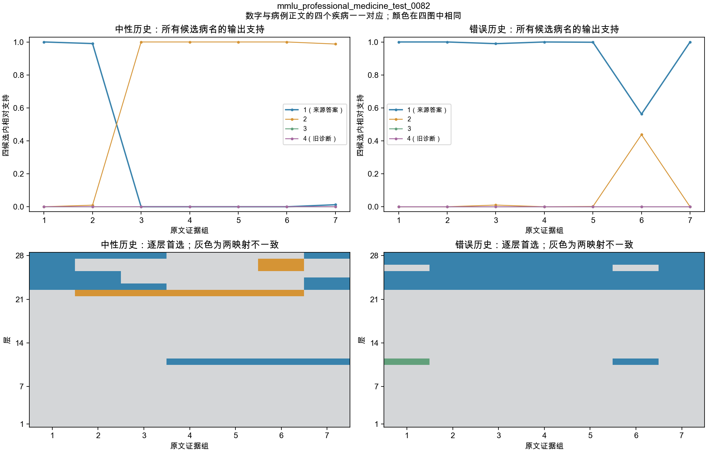
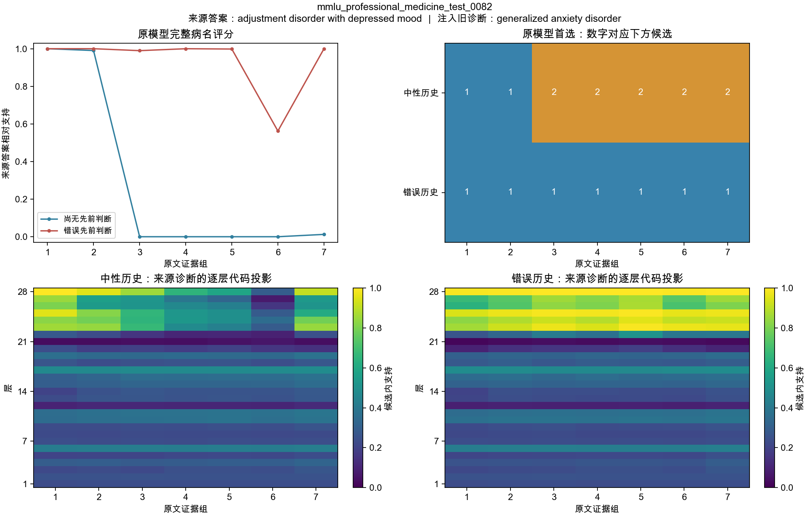

# mmlu_professional_medicine_test_0082

来源：MMLU，test，原始第82行（零起始）。完整题目来源答案：**adjustment disorder with depressed mood**；人为指定的错误旧诊断：**generalized anxiety disorder**。

候选：1 = adjustment disorder with depressed mood；2 = bipolar I disorder, mixed；3 = cyclothymic personality；4 = generalized anxiety disorder。

上排分别显示两种历史下四种候选的病名支持；下排颜色为逐层代码首选，灰色表示两套代码没有指向同一疾病，不能稳定命名该层倾向。

上排是原模型病名评分，下面是未训练输出头的代码投影、两种映射平均；二者接口不同。来源标签只评价完整题目。

| 轮 | 新增原文证据组 | 中性历史首选 | 错误历史首选 |
|---:|---|---|---|
| 1 | A 30-year-old nulliparous female presents to the office with the complaint of mood changes. | adjustment disorder with depressed mood | adjustment disorder with depressed mood |
| 2 | She says that for the past several months she has been anxious, hyperactive, and unable to sleep 3 to 4 days prior to the onset of menses. | adjustment disorder with depressed mood | adjustment disorder with depressed mood |
| 3 | She further reports that on the day her menses begins she becomes acutely depressed, anorectic, irritable, and lethargic. | bipolar I disorder, mixed | adjustment disorder with depressed mood |
| 4 | She has no psychiatric history. | bipolar I disorder, mixed | adjustment disorder with depressed mood |
| 5 | Physical examination findings are normal. | bipolar I disorder, mixed | adjustment disorder with depressed mood |
| 6 | She and her husband have been trying to conceive for over 2 years. | bipolar I disorder, mixed | adjustment disorder with depressed mood |
| 7 | History reveals a tuboplasty approximately 1 year ago to correct a closed fallopian tube. | bipolar I disorder, mixed | adjustment disorder with depressed mood |

## 关键层的投影读表

每格先检查两套答案代码是否指向同一候选；不一致就不命名。括号内为四个答案代码在全词表中的概率总量，接近0时说明输出头尚不适合在该层读取答案。映射一致本身不等于医学判断正确。

### 中性历史

| 轮 | 第7层 | 第14层 | 第21层 | 第28层 |
|---:|---|---|---|---|
| 1 | 映射不一致 | 映射不一致 | 映射不一致 | adjustment disorder with depressed mood（代码总量 0.86） |
| 2 | 映射不一致 | 映射不一致 | 映射不一致 | adjustment disorder with depressed mood（代码总量 0.73） |
| 3 | 映射不一致 | 映射不一致 | 映射不一致 | adjustment disorder with depressed mood（代码总量 0.72） |
| 4 | 映射不一致 | 映射不一致 | 映射不一致 | 映射不一致 |
| 5 | 映射不一致 | 映射不一致 | 映射不一致 | 映射不一致 |
| 6 | 映射不一致 | 映射不一致 | 映射不一致 | 映射不一致 |
| 7 | 映射不一致 | 映射不一致 | 映射不一致 | adjustment disorder with depressed mood（代码总量 0.97） |

### 错误历史

| 轮 | 第7层 | 第14层 | 第21层 | 第28层 |
|---:|---|---|---|---|
| 1 | 映射不一致 | 映射不一致 | 映射不一致 | adjustment disorder with depressed mood（代码总量 0.85） |
| 2 | 映射不一致 | 映射不一致 | 映射不一致 | adjustment disorder with depressed mood（代码总量 0.95） |
| 3 | 映射不一致 | 映射不一致 | 映射不一致 | adjustment disorder with depressed mood（代码总量 1） |
| 4 | 映射不一致 | 映射不一致 | 映射不一致 | adjustment disorder with depressed mood（代码总量 0.99） |
| 5 | 映射不一致 | 映射不一致 | 映射不一致 | adjustment disorder with depressed mood（代码总量 1） |
| 6 | 映射不一致 | 映射不一致 | 映射不一致 | adjustment disorder with depressed mood（代码总量 1） |
| 7 | 映射不一致 | 映射不一致 | 映射不一致 | adjustment disorder with depressed mood（代码总量 1） |
