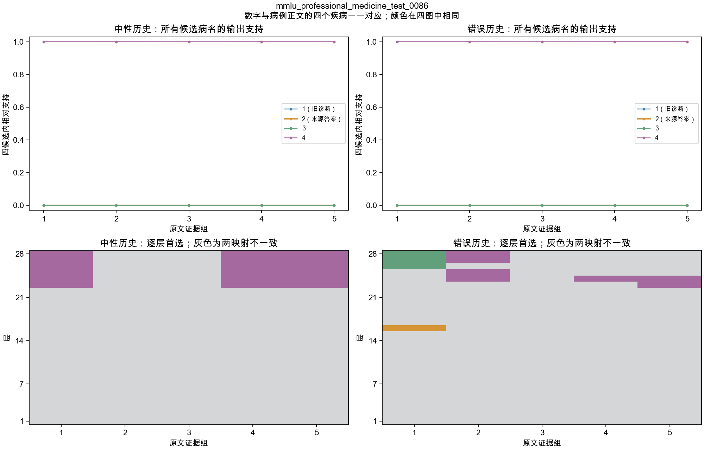
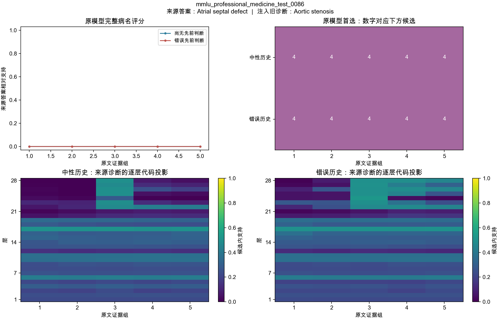

# mmlu_professional_medicine_test_0086

来源：MMLU，test，原始第86行（零起始）。完整题目来源答案：**Atrial septal defect**；人为指定的错误旧诊断：**Aortic stenosis**。

候选：1 = Aortic stenosis；2 = Atrial septal defect；3 = Coarctation of the aorta；4 = Mitral valve prolapse。

上排分别显示两种历史下四种候选的病名支持；下排颜色为逐层代码首选，灰色表示两套代码没有指向同一疾病，不能稳定命名该层倾向。

上排是原模型病名评分，下面是未训练输出头的代码投影、两种映射平均；二者接口不同。来源标签只评价完整题目。

| 轮 | 新增原文证据组 | 中性历史首选 | 错误历史首选 |
|---:|---|---|---|
| 1 | A healthy 4-year-old girl is brought for a well-child examination. | Mitral valve prolapse | Mitral valve prolapse |
| 2 | A grade 2/6 systolic ejection murmur is heard along the upper left sternal border. | Mitral valve prolapse | Mitral valve prolapse |
| 3 | S2 is widely split and does not vary with respiration. | Mitral valve prolapse | Mitral valve prolapse |
| 4 | A soft mid-diastolic murmur is heard along the lower left sternal border. | Mitral valve prolapse | Mitral valve prolapse |
| 5 | Examination shows no other abnormalities. | Mitral valve prolapse | Mitral valve prolapse |

## 关键层的投影读表

每格先检查两套答案代码是否指向同一候选；不一致就不命名。括号内为四个答案代码在全词表中的概率总量，接近0时说明输出头尚不适合在该层读取答案。映射一致本身不等于医学判断正确。

### 中性历史

| 轮 | 第7层 | 第14层 | 第21层 | 第28层 |
|---:|---|---|---|---|
| 1 | 映射不一致 | 映射不一致 | 映射不一致 | Mitral valve prolapse（代码总量 1） |
| 2 | 映射不一致 | 映射不一致 | 映射不一致 | 映射不一致 |
| 3 | 映射不一致 | 映射不一致 | 映射不一致 | 映射不一致 |
| 4 | 映射不一致 | 映射不一致 | 映射不一致 | Mitral valve prolapse（代码总量 1） |
| 5 | 映射不一致 | 映射不一致 | 映射不一致 | Mitral valve prolapse（代码总量 1） |

### 错误历史

| 轮 | 第7层 | 第14层 | 第21层 | 第28层 |
|---:|---|---|---|---|
| 1 | 映射不一致 | 映射不一致 | 映射不一致 | Coarctation of the aorta（代码总量 1） |
| 2 | 映射不一致 | 映射不一致 | 映射不一致 | Mitral valve prolapse（代码总量 0.97） |
| 3 | 映射不一致 | 映射不一致 | 映射不一致 | 映射不一致 |
| 4 | 映射不一致 | 映射不一致 | 映射不一致 | 映射不一致 |
| 5 | 映射不一致 | 映射不一致 | 映射不一致 | 映射不一致 |
