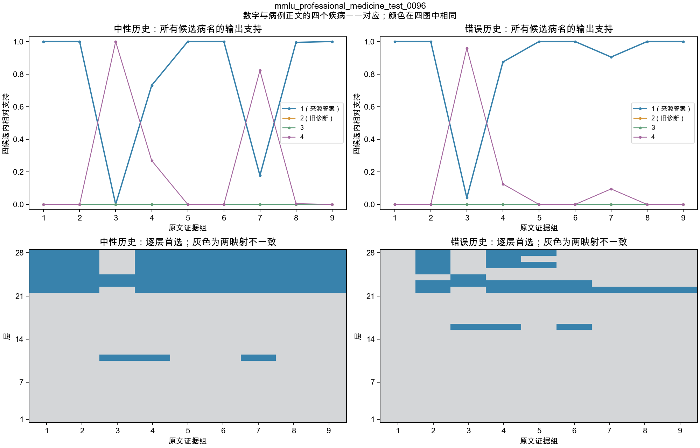
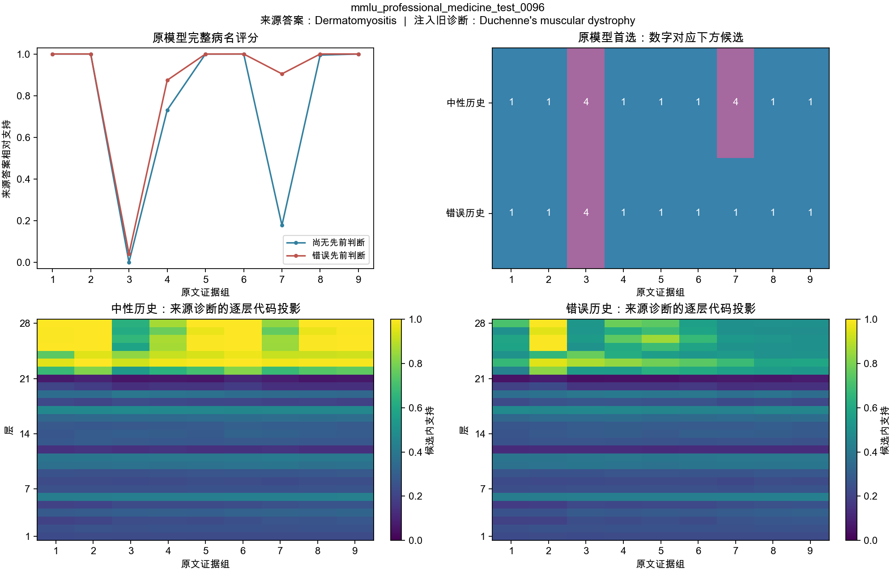

# mmlu_professional_medicine_test_0096

来源：MMLU，test，原始第96行（零起始）。完整题目来源答案：**Dermatomyositis**；人为指定的错误旧诊断：**Duchenne's muscular dystrophy**。

候选：1 = Dermatomyositis；2 = Duchenne's muscular dystrophy；3 = Eczema；4 = Lyme disease。

上排分别显示两种历史下四种候选的病名支持；下排颜色为逐层代码首选，灰色表示两套代码没有指向同一疾病，不能稳定命名该层倾向。

上排是原模型病名评分，下面是未训练输出头的代码投影、两种映射平均；二者接口不同。来源标签只评价完整题目。

| 轮 | 新增原文证据组 | 中性历史首选 | 错误历史首选 |
|---:|---|---|---|
| 1 | A 9-year-old boy is brought to the physician because of progressive weakness and a purple-red discoloration over his cheeks and upper eyelids over the past 8 weeks. | Dermatomyositis | Dermatomyositis |
| 2 | His symptoms began shortly after a camping trip, and he now is unable to climb stairs, walk long distances, comb his hair, or dress himself. | Dermatomyositis | Dermatomyositis |
| 3 | His mother says that she was careful to apply his sunscreen on the trip and can recall no tick bites or exposure to poisonous plants. | Lyme disease | Lyme disease |
| 4 | His only medication is a topical corticosteroid for several dry, scaly patches of the skin. | Dermatomyositis | Dermatomyositis |
| 5 | He appears weak and lethargic. | Dermatomyositis | Dermatomyositis |
| 6 | He is at the 75th percentile for height and 25th percentile for weight; he has had no change in his weight since his last examination 9 months ago. | Dermatomyositis | Dermatomyositis |
| 7 | His temperature is 37.7°C (99.8°F), blood pressure is 110/68 mm Hg, pulse is 105/min, and respirations are 28/min. | Lyme disease | Dermatomyositis |
| 8 | Examination of the skin shows a purple-red discoloration over the cheeks and eyelids, periorbital edema, erythematous plaques and scales over the elbows and knees, and flat-topped red papules over all knuckles. | Dermatomyositis | Dermatomyositis |
| 9 | There is generalized weakness and atrophy of the proximal muscles. | Dermatomyositis | Dermatomyositis |

## 关键层的投影读表

每格先检查两套答案代码是否指向同一候选；不一致就不命名。括号内为四个答案代码在全词表中的概率总量，接近0时说明输出头尚不适合在该层读取答案。映射一致本身不等于医学判断正确。

### 中性历史

| 轮 | 第7层 | 第14层 | 第21层 | 第28层 |
|---:|---|---|---|---|
| 1 | 映射不一致 | 映射不一致 | 映射不一致 | Dermatomyositis（代码总量 1） |
| 2 | 映射不一致 | 映射不一致 | 映射不一致 | Dermatomyositis（代码总量 1） |
| 3 | 映射不一致 | 映射不一致 | 映射不一致 | 映射不一致 |
| 4 | 映射不一致 | 映射不一致 | 映射不一致 | Dermatomyositis（代码总量 1） |
| 5 | 映射不一致 | 映射不一致 | 映射不一致 | Dermatomyositis（代码总量 1） |
| 6 | 映射不一致 | 映射不一致 | 映射不一致 | Dermatomyositis（代码总量 1） |
| 7 | 映射不一致 | 映射不一致 | 映射不一致 | Dermatomyositis（代码总量 1） |
| 8 | 映射不一致 | 映射不一致 | 映射不一致 | Dermatomyositis（代码总量 1） |
| 9 | 映射不一致 | 映射不一致 | 映射不一致 | Dermatomyositis（代码总量 1） |

### 错误历史

| 轮 | 第7层 | 第14层 | 第21层 | 第28层 |
|---:|---|---|---|---|
| 1 | 映射不一致 | 映射不一致 | 映射不一致 | 映射不一致 |
| 2 | 映射不一致 | 映射不一致 | 映射不一致 | Dermatomyositis（代码总量 1） |
| 3 | 映射不一致 | 映射不一致 | 映射不一致 | 映射不一致 |
| 4 | 映射不一致 | 映射不一致 | 映射不一致 | Dermatomyositis（代码总量 1） |
| 5 | 映射不一致 | 映射不一致 | 映射不一致 | Dermatomyositis（代码总量 1） |
| 6 | 映射不一致 | 映射不一致 | 映射不一致 | 映射不一致 |
| 7 | 映射不一致 | 映射不一致 | 映射不一致 | 映射不一致 |
| 8 | 映射不一致 | 映射不一致 | 映射不一致 | 映射不一致 |
| 9 | 映射不一致 | 映射不一致 | 映射不一致 | 映射不一致 |
