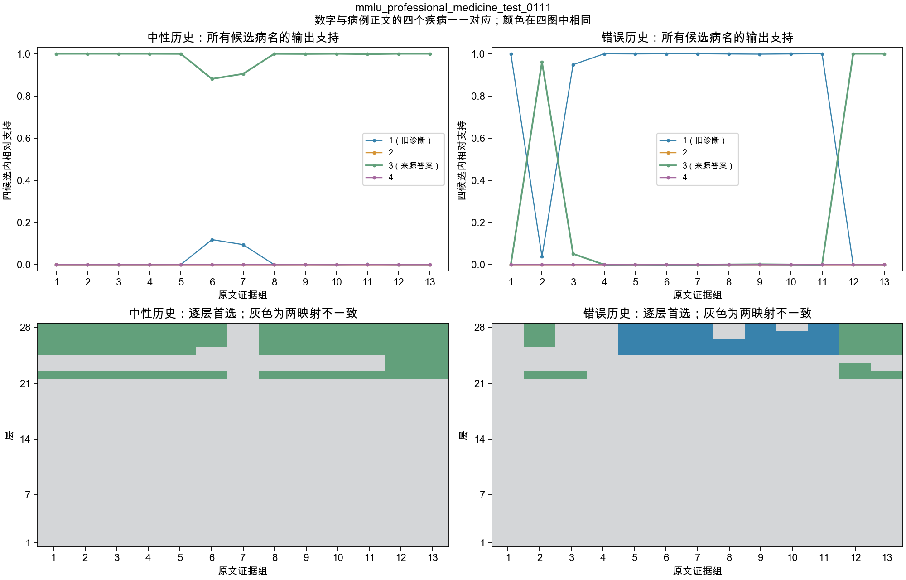
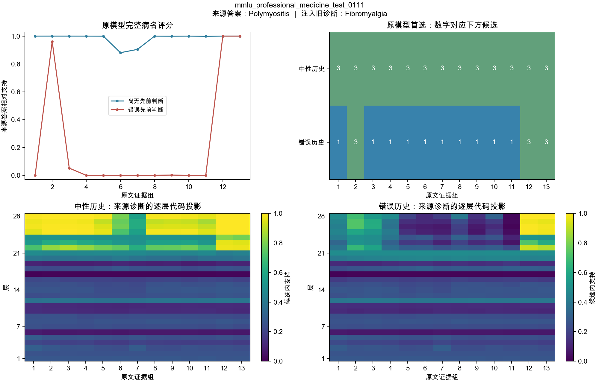

# mmlu_professional_medicine_test_0111

来源：MMLU，test，原始第111行（零起始）。完整题目来源答案：**Polymyositis**；人为指定的错误旧诊断：**Fibromyalgia**。

候选：1 = Fibromyalgia；2 = Myasthenia gravis；3 = Polymyositis；4 = Scleroderma。

上排分别显示两种历史下四种候选的病名支持；下排颜色为逐层代码首选，灰色表示两套代码没有指向同一疾病，不能稳定命名该层倾向。

上排是原模型病名评分，下面是未训练输出头的代码投影、两种映射平均；二者接口不同。来源标签只评价完整题目。

| 轮 | 新增原文证据组 | 中性历史首选 | 错误历史首选 |
|---:|---|---|---|
| 1 | A 40-year-old female secretary comes to the office because of a 2-month history of fatigue, and generalized aching and weakness of the proximal muscles of all four extremities. | Polymyositis | Fibromyalgia |
| 2 | The patient initially noticed the weakness only while she was getting in and out of her car, but during the past 2 weeks, the weakness has progressed, so that she now has difficulty combing her hair. | Polymyositis | Polymyositis |
| 3 | Since the symptoms began, she also has had aching of the joints in her hands that has responded partially to ibuprofen. | Polymyositis | Fibromyalgia |
| 4 | She was adopted and family history is unknown. | Polymyositis | Fibromyalgia |
| 5 | She has two teenaged children who are well. | Polymyositis | Fibromyalgia |
| 6 | She appears uncomfortable. | Polymyositis | Fibromyalgia |
| 7 | She is 170 cm (5 ft 7 in) tall and weighs 68 kg(150 lb); BMI is 24 kg/m2 . | Polymyositis | Fibromyalgia |
| 8 | Vital signs are temperature 37.7°C (99.8°F), pulse 90/min, respirations 20/min, and blood pressure 110/70 mm Hg. | Polymyositis | Fibromyalgia |
| 9 | The patient is alert and fully oriented. | Polymyositis | Fibromyalgia |
| 10 | Physical examination discloses cracking of the skin of both hands that involves the tips and lateral sides of several fingers. | Polymyositis | Fibromyalgia |
| 11 | The muscles of the upper arms and legs are somewhat tender to pressure. | Polymyositis | Fibromyalgia |
| 12 | Results of serum laboratory studies show a creatine kinase concentration of 600 U/L and a lactate dehydrogenase concentration of 800 U/L. | Polymyositis | Polymyositis |
| 13 | Results of complete blood count are within the reference ranges. | Polymyositis | Polymyositis |

## 关键层的投影读表

每格先检查两套答案代码是否指向同一候选；不一致就不命名。括号内为四个答案代码在全词表中的概率总量，接近0时说明输出头尚不适合在该层读取答案。映射一致本身不等于医学判断正确。

### 中性历史

| 轮 | 第7层 | 第14层 | 第21层 | 第28层 |
|---:|---|---|---|---|
| 1 | 映射不一致 | 映射不一致 | 映射不一致 | Polymyositis（代码总量 1） |
| 2 | 映射不一致 | 映射不一致 | 映射不一致 | Polymyositis（代码总量 1） |
| 3 | 映射不一致 | 映射不一致 | 映射不一致 | Polymyositis（代码总量 1） |
| 4 | 映射不一致 | 映射不一致 | 映射不一致 | Polymyositis（代码总量 1） |
| 5 | 映射不一致 | 映射不一致 | 映射不一致 | Polymyositis（代码总量 1） |
| 6 | 映射不一致 | 映射不一致 | 映射不一致 | Polymyositis（代码总量 1） |
| 7 | 映射不一致 | 映射不一致 | 映射不一致 | 映射不一致 |
| 8 | 映射不一致 | 映射不一致 | 映射不一致 | Polymyositis（代码总量 1） |
| 9 | 映射不一致 | 映射不一致 | 映射不一致 | Polymyositis（代码总量 1） |
| 10 | 映射不一致 | 映射不一致 | 映射不一致 | Polymyositis（代码总量 1） |
| 11 | 映射不一致 | 映射不一致 | 映射不一致 | Polymyositis（代码总量 1） |
| 12 | 映射不一致 | 映射不一致 | 映射不一致 | Polymyositis（代码总量 1） |
| 13 | 映射不一致 | 映射不一致 | 映射不一致 | Polymyositis（代码总量 1） |

### 错误历史

| 轮 | 第7层 | 第14层 | 第21层 | 第28层 |
|---:|---|---|---|---|
| 1 | 映射不一致 | 映射不一致 | 映射不一致 | 映射不一致 |
| 2 | 映射不一致 | 映射不一致 | 映射不一致 | Polymyositis（代码总量 0.57） |
| 3 | 映射不一致 | 映射不一致 | 映射不一致 | 映射不一致 |
| 4 | 映射不一致 | 映射不一致 | 映射不一致 | 映射不一致 |
| 5 | 映射不一致 | 映射不一致 | 映射不一致 | Fibromyalgia（代码总量 0.28） |
| 6 | 映射不一致 | 映射不一致 | 映射不一致 | Fibromyalgia（代码总量 0.47） |
| 7 | 映射不一致 | 映射不一致 | 映射不一致 | Fibromyalgia（代码总量 0.43） |
| 8 | 映射不一致 | 映射不一致 | 映射不一致 | 映射不一致 |
| 9 | 映射不一致 | 映射不一致 | 映射不一致 | Fibromyalgia（代码总量 0.43） |
| 10 | 映射不一致 | 映射不一致 | 映射不一致 | 映射不一致 |
| 11 | 映射不一致 | 映射不一致 | 映射不一致 | Fibromyalgia（代码总量 0.028） |
| 12 | 映射不一致 | 映射不一致 | 映射不一致 | Polymyositis（代码总量 1） |
| 13 | 映射不一致 | 映射不一致 | 映射不一致 | Polymyositis（代码总量 1） |
