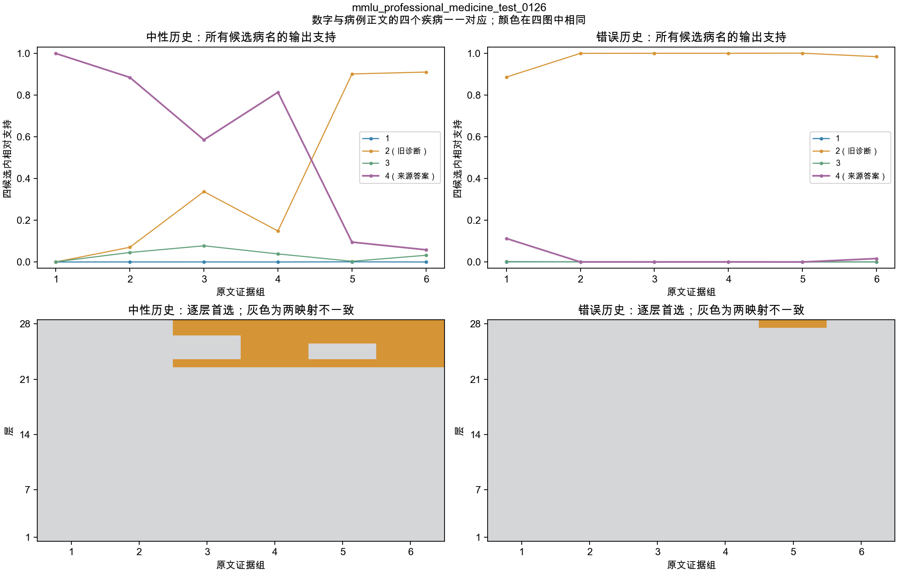
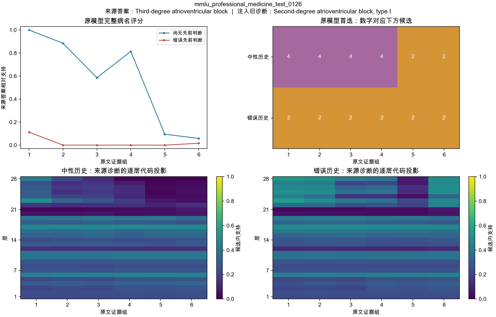

# mmlu_professional_medicine_test_0126

来源：MMLU，test，原始第126行（零起始）。完整题目来源答案：**Third-degree atrioventricular block**；人为指定的错误旧诊断：**Second-degree atrioventricular block, type I**。

候选：1 = Right bundle branch block；2 = Second-degree atrioventricular block, type I；3 = Second-degree atrioventricular block, type II；4 = Third-degree atrioventricular block。

上排分别显示两种历史下四种候选的病名支持；下排颜色为逐层代码首选，灰色表示两套代码没有指向同一疾病，不能稳定命名该层倾向。

上排是原模型病名评分，下面是未训练输出头的代码投影、两种映射平均；二者接口不同。来源标签只评价完整题目。

| 轮 | 新增原文证据组 | 中性历史首选 | 错误历史首选 |
|---:|---|---|---|
| 1 | A 54-year-old man comes to the physician because of episodes of fainting for 3 months. | Third-degree atrioventricular block | Second-degree atrioventricular block, type I |
| 2 | He also has had difficulty performing daily tasks because he is easily fatigued. | Third-degree atrioventricular block | Second-degree atrioventricular block, type I |
| 3 | He had a myocardial infarction 12 years ago. | Third-degree atrioventricular block | Second-degree atrioventricular block, type I |
| 4 | His pulse is 40/min, respirations are 18/min, and blood pressure is 138/85 mm Hg. | Third-degree atrioventricular block | Second-degree atrioventricular block, type I |
| 5 | Physical examination shows evidence of cannon a waves. | Second-degree atrioventricular block, type I | Second-degree atrioventricular block, type I |
| 6 | An ECG shows a P-wave rate of 90/min, and an R-wave rate of 40/min, with no apparent relation between the two. | Second-degree atrioventricular block, type I | Second-degree atrioventricular block, type I |

## 关键层的投影读表

每格先检查两套答案代码是否指向同一候选；不一致就不命名。括号内为四个答案代码在全词表中的概率总量，接近0时说明输出头尚不适合在该层读取答案。映射一致本身不等于医学判断正确。

### 中性历史

| 轮 | 第7层 | 第14层 | 第21层 | 第28层 |
|---:|---|---|---|---|
| 1 | 映射不一致 | 映射不一致 | 映射不一致 | 映射不一致 |
| 2 | 映射不一致 | 映射不一致 | 映射不一致 | 映射不一致 |
| 3 | 映射不一致 | 映射不一致 | 映射不一致 | Second-degree atrioventricular block, type I（代码总量 0.75） |
| 4 | 映射不一致 | 映射不一致 | 映射不一致 | Second-degree atrioventricular block, type I（代码总量 1） |
| 5 | 映射不一致 | 映射不一致 | 映射不一致 | Second-degree atrioventricular block, type I（代码总量 1） |
| 6 | 映射不一致 | 映射不一致 | 映射不一致 | Second-degree atrioventricular block, type I（代码总量 1） |

### 错误历史

| 轮 | 第7层 | 第14层 | 第21层 | 第28层 |
|---:|---|---|---|---|
| 1 | 映射不一致 | 映射不一致 | 映射不一致 | 映射不一致 |
| 2 | 映射不一致 | 映射不一致 | 映射不一致 | 映射不一致 |
| 3 | 映射不一致 | 映射不一致 | 映射不一致 | 映射不一致 |
| 4 | 映射不一致 | 映射不一致 | 映射不一致 | 映射不一致 |
| 5 | 映射不一致 | 映射不一致 | 映射不一致 | Second-degree atrioventricular block, type I（代码总量 0.6） |
| 6 | 映射不一致 | 映射不一致 | 映射不一致 | 映射不一致 |
