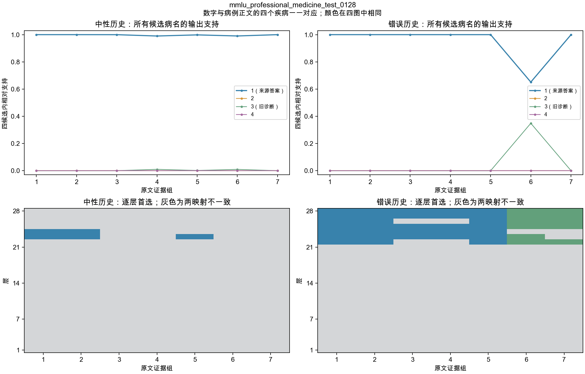
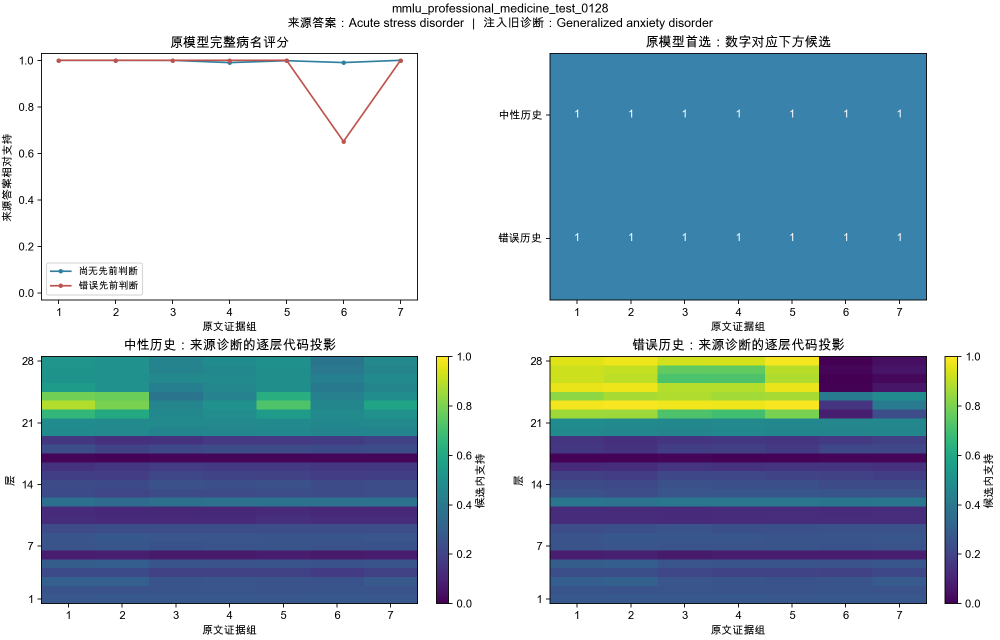

# mmlu_professional_medicine_test_0128

来源：MMLU，test，原始第128行（零起始）。完整题目来源答案：**Acute stress disorder**；人为指定的错误旧诊断：**Generalized anxiety disorder**。

候选：1 = Acute stress disorder；2 = Agoraphobia；3 = Generalized anxiety disorder；4 = Hypothyroidism。

上排分别显示两种历史下四种候选的病名支持；下排颜色为逐层代码首选，灰色表示两套代码没有指向同一疾病，不能稳定命名该层倾向。

上排是原模型病名评分，下面是未训练输出头的代码投影、两种映射平均；二者接口不同。来源标签只评价完整题目。

| 轮 | 新增原文证据组 | 中性历史首选 | 错误历史首选 |
|---:|---|---|---|
| 1 | A 45-year-old woman has a 2-week history of increased anxiety, abdominal discomfort, irritability, and difficulty concentrating; she was robbed at knifepoint in a parking lot 3 weeks ago. | Acute stress disorder | Acute stress disorder |
| 2 | She takes levothyroxine for hypothyroidism and uses an over-the-counter inhaler as needed for exercise-induced asthma. | Acute stress disorder | Acute stress disorder |
| 3 | Her blood pressure is 140/80 mm Hg, and pulse is 100/min. | Acute stress disorder | Acute stress disorder |
| 4 | Examination shows dry skin and hair. | Acute stress disorder | Acute stress disorder |
| 5 | She is cooperative but appears anxious, glancing around quickly when a loud noise is heard outside the office. | Acute stress disorder | Acute stress disorder |
| 6 | Leukocyte count is 12,000/mm3 , and serum thyroid-stimulating hormone concentration is 5.0 μU/mL. | Acute stress disorder | Acute stress disorder |
| 7 | An ECG shows sinus tachycardia. | Acute stress disorder | Acute stress disorder |

## 关键层的投影读表

每格先检查两套答案代码是否指向同一候选；不一致就不命名。括号内为四个答案代码在全词表中的概率总量，接近0时说明输出头尚不适合在该层读取答案。映射一致本身不等于医学判断正确。

### 中性历史

| 轮 | 第7层 | 第14层 | 第21层 | 第28层 |
|---:|---|---|---|---|
| 1 | 映射不一致 | 映射不一致 | 映射不一致 | 映射不一致 |
| 2 | 映射不一致 | 映射不一致 | 映射不一致 | 映射不一致 |
| 3 | 映射不一致 | 映射不一致 | 映射不一致 | 映射不一致 |
| 4 | 映射不一致 | 映射不一致 | 映射不一致 | 映射不一致 |
| 5 | 映射不一致 | 映射不一致 | 映射不一致 | 映射不一致 |
| 6 | 映射不一致 | 映射不一致 | 映射不一致 | 映射不一致 |
| 7 | 映射不一致 | 映射不一致 | 映射不一致 | 映射不一致 |

### 错误历史

| 轮 | 第7层 | 第14层 | 第21层 | 第28层 |
|---:|---|---|---|---|
| 1 | 映射不一致 | 映射不一致 | 映射不一致 | Acute stress disorder（代码总量 0.9） |
| 2 | 映射不一致 | 映射不一致 | 映射不一致 | Acute stress disorder（代码总量 0.98） |
| 3 | 映射不一致 | 映射不一致 | 映射不一致 | Acute stress disorder（代码总量 1） |
| 4 | 映射不一致 | 映射不一致 | 映射不一致 | Acute stress disorder（代码总量 1） |
| 5 | 映射不一致 | 映射不一致 | 映射不一致 | Acute stress disorder（代码总量 1） |
| 6 | 映射不一致 | 映射不一致 | 映射不一致 | Generalized anxiety disorder（代码总量 1） |
| 7 | 映射不一致 | 映射不一致 | 映射不一致 | Generalized anxiety disorder（代码总量 0.99） |
