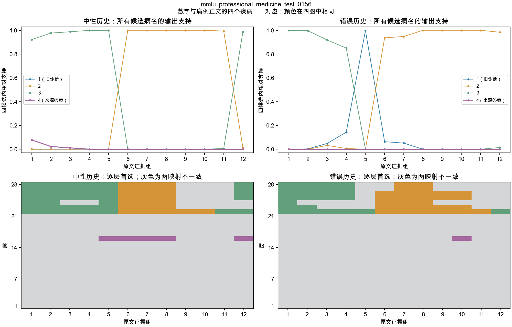
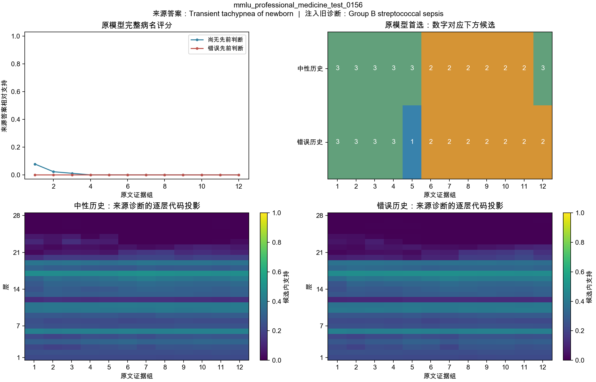

# mmlu_professional_medicine_test_0156

来源：MMLU，test，原始第156行（零起始）。完整题目来源答案：**Transient tachypnea of newborn**；人为指定的错误旧诊断：**Group B streptococcal sepsis**。

候选：1 = Group B streptococcal sepsis；2 = Meconium aspiration syndrome；3 = Respiratory distress syndrome；4 = Transient tachypnea of newborn。

上排分别显示两种历史下四种候选的病名支持；下排颜色为逐层代码首选，灰色表示两套代码没有指向同一疾病，不能稳定命名该层倾向。

上排是原模型病名评分，下面是未训练输出头的代码投影、两种映射平均；二者接口不同。来源标签只评价完整题目。

| 轮 | 新增原文证据组 | 中性历史首选 | 错误历史首选 |
|---:|---|---|---|
| 1 | A male neonate, who was born at 36 weeks' gestation 2 hours ago in the labor and delivery unit of the hospital, now shows signs of respiratory difficulty. | Respiratory distress syndrome | Respiratory distress syndrome |
| 2 | The mother, an 18-year-old primigravid woman, smoked one pack of cigarettes daily throughout her pregnancy. | Respiratory distress syndrome | Respiratory distress syndrome |
| 3 | She received prenatal care during most of the pregnancy. | Respiratory distress syndrome | Respiratory distress syndrome |
| 4 | One episode of chlamydial cervicitis was detected during the last trimester and treated with azithromycin. | Respiratory distress syndrome | Respiratory distress syndrome |
| 5 | The neonate was born via cesarean delivery due to fetal heart rate decelerations. | Respiratory distress syndrome | Group B streptococcal sepsis |
| 6 | The amniotic fluid was stained with light particulate meconium. | Meconium aspiration syndrome | Meconium aspiration syndrome |
| 7 | Apgar scores were 9 and 9 at 1 and 5 minutes, respectively. | Meconium aspiration syndrome | Meconium aspiration syndrome |
| 8 | The patient is 50 cm (20 in; 50th percentile) long and weighs 3005 g (6 lb 10 oz; 50th percentile); head circumference is 35 cm (14 in; 50th percentile). | Meconium aspiration syndrome | Meconium aspiration syndrome |
| 9 | The infant's vital signs now are temperature 36.6°C (97.8°F), pulse 150/min, and respirations 70/min. | Meconium aspiration syndrome | Meconium aspiration syndrome |
| 10 | Pulse oximetry on room air shows an oxygen saturation of 95%. | Meconium aspiration syndrome | Meconium aspiration syndrome |
| 11 | Physical examination discloses mild subcostal and intercostal retractions. | Meconium aspiration syndrome | Meconium aspiration syndrome |
| 12 | Chest x-ray shows prominent pulmonary vascular markings and fluid in the intralobar fissures. | Respiratory distress syndrome | Meconium aspiration syndrome |

## 关键层的投影读表

每格先检查两套答案代码是否指向同一候选；不一致就不命名。括号内为四个答案代码在全词表中的概率总量，接近0时说明输出头尚不适合在该层读取答案。映射一致本身不等于医学判断正确。

### 中性历史

| 轮 | 第7层 | 第14层 | 第21层 | 第28层 |
|---:|---|---|---|---|
| 1 | 映射不一致 | 映射不一致 | 映射不一致 | Respiratory distress syndrome（代码总量 1） |
| 2 | 映射不一致 | 映射不一致 | 映射不一致 | Respiratory distress syndrome（代码总量 1） |
| 3 | 映射不一致 | 映射不一致 | 映射不一致 | Respiratory distress syndrome（代码总量 1） |
| 4 | 映射不一致 | 映射不一致 | 映射不一致 | Respiratory distress syndrome（代码总量 1） |
| 5 | 映射不一致 | 映射不一致 | 映射不一致 | Respiratory distress syndrome（代码总量 1） |
| 6 | 映射不一致 | 映射不一致 | 映射不一致 | Meconium aspiration syndrome（代码总量 1） |
| 7 | 映射不一致 | 映射不一致 | 映射不一致 | Meconium aspiration syndrome（代码总量 1） |
| 8 | 映射不一致 | 映射不一致 | 映射不一致 | Meconium aspiration syndrome（代码总量 1） |
| 9 | 映射不一致 | 映射不一致 | 映射不一致 | 映射不一致 |
| 10 | 映射不一致 | 映射不一致 | 映射不一致 | 映射不一致 |
| 11 | 映射不一致 | 映射不一致 | 映射不一致 | 映射不一致 |
| 12 | 映射不一致 | 映射不一致 | 映射不一致 | Respiratory distress syndrome（代码总量 1） |

### 错误历史

| 轮 | 第7层 | 第14层 | 第21层 | 第28层 |
|---:|---|---|---|---|
| 1 | 映射不一致 | 映射不一致 | 映射不一致 | Respiratory distress syndrome（代码总量 1） |
| 2 | 映射不一致 | 映射不一致 | 映射不一致 | Respiratory distress syndrome（代码总量 1） |
| 3 | 映射不一致 | 映射不一致 | 映射不一致 | Respiratory distress syndrome（代码总量 1） |
| 4 | 映射不一致 | 映射不一致 | 映射不一致 | Respiratory distress syndrome（代码总量 1） |
| 5 | 映射不一致 | 映射不一致 | 映射不一致 | 映射不一致 |
| 6 | 映射不一致 | 映射不一致 | 映射不一致 | 映射不一致 |
| 7 | 映射不一致 | 映射不一致 | 映射不一致 | Meconium aspiration syndrome（代码总量 1） |
| 8 | 映射不一致 | 映射不一致 | 映射不一致 | Meconium aspiration syndrome（代码总量 1） |
| 9 | 映射不一致 | 映射不一致 | 映射不一致 | 映射不一致 |
| 10 | 映射不一致 | 映射不一致 | 映射不一致 | 映射不一致 |
| 11 | 映射不一致 | 映射不一致 | 映射不一致 | 映射不一致 |
| 12 | 映射不一致 | 映射不一致 | 映射不一致 | 映射不一致 |
