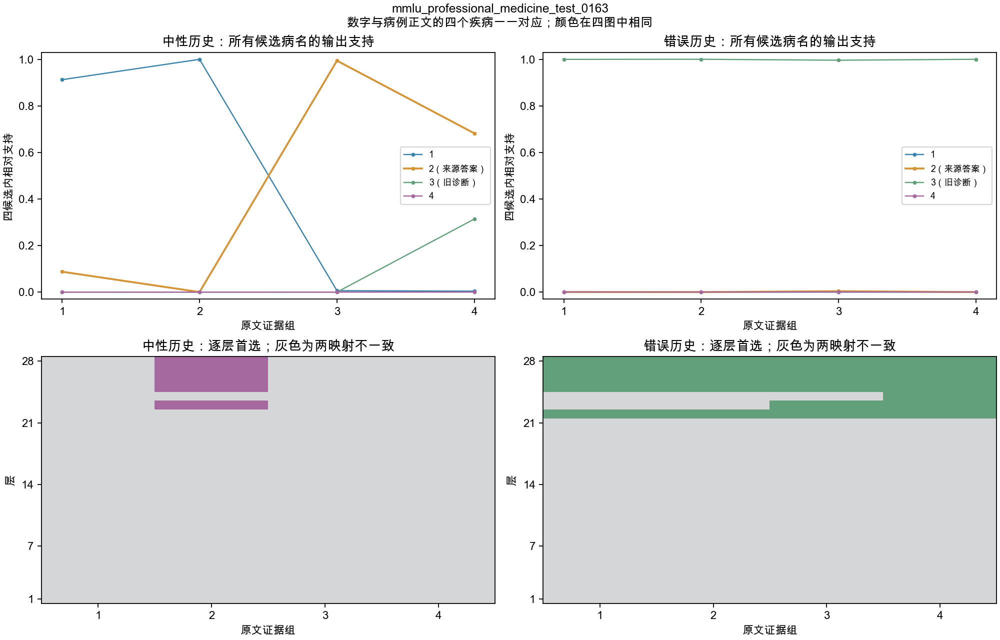
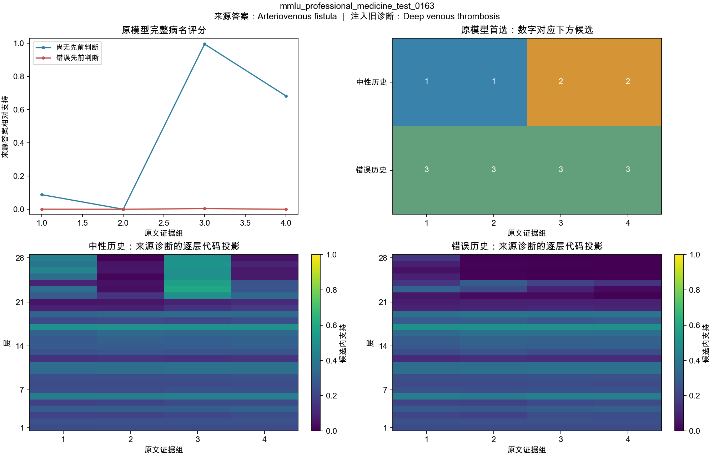

# mmlu_professional_medicine_test_0163

来源：MMLU，test，原始第163行（零起始）。完整题目来源答案：**Arteriovenous fistula**；人为指定的错误旧诊断：**Deep venous thrombosis**。

候选：1 = Arterial spasm；2 = Arteriovenous fistula；3 = Deep venous thrombosis；4 = Occlusion of the superficial femoral artery。

上排分别显示两种历史下四种候选的病名支持；下排颜色为逐层代码首选，灰色表示两套代码没有指向同一疾病，不能稳定命名该层倾向。

上排是原模型病名评分，下面是未训练输出头的代码投影、两种映射平均；二者接口不同。来源标签只评价完整题目。

| 轮 | 新增原文证据组 | 中性历史首选 | 错误历史首选 |
|---:|---|---|---|
| 1 | Five years after being shot in the right thigh, a 21-year-old man comes to the emergency department because of a buzzing sensation adjacent to the scar. | Arterial spasm | Deep venous thrombosis |
| 2 | At the time of the initial wound, he was discharged after 6 hours of observation with no fractures or soft-tissue swelling. | Arterial spasm | Deep venous thrombosis |
| 3 | A loud murmur is heard on auscultation; there is a thrill. | Arteriovenous fistula | Deep venous thrombosis |
| 4 | He has dilated varicose veins with incompetent valves in the lower leg. | Arteriovenous fistula | Deep venous thrombosis |

## 关键层的投影读表

每格先检查两套答案代码是否指向同一候选；不一致就不命名。括号内为四个答案代码在全词表中的概率总量，接近0时说明输出头尚不适合在该层读取答案。映射一致本身不等于医学判断正确。

### 中性历史

| 轮 | 第7层 | 第14层 | 第21层 | 第28层 |
|---:|---|---|---|---|
| 1 | 映射不一致 | 映射不一致 | 映射不一致 | 映射不一致 |
| 2 | 映射不一致 | 映射不一致 | 映射不一致 | Occlusion of the superficial femoral artery（代码总量 1） |
| 3 | 映射不一致 | 映射不一致 | 映射不一致 | 映射不一致 |
| 4 | 映射不一致 | 映射不一致 | 映射不一致 | 映射不一致 |

### 错误历史

| 轮 | 第7层 | 第14层 | 第21层 | 第28层 |
|---:|---|---|---|---|
| 1 | 映射不一致 | 映射不一致 | 映射不一致 | Deep venous thrombosis（代码总量 0.98） |
| 2 | 映射不一致 | 映射不一致 | 映射不一致 | Deep venous thrombosis（代码总量 1） |
| 3 | 映射不一致 | 映射不一致 | 映射不一致 | Deep venous thrombosis（代码总量 1） |
| 4 | 映射不一致 | 映射不一致 | 映射不一致 | Deep venous thrombosis（代码总量 1） |
