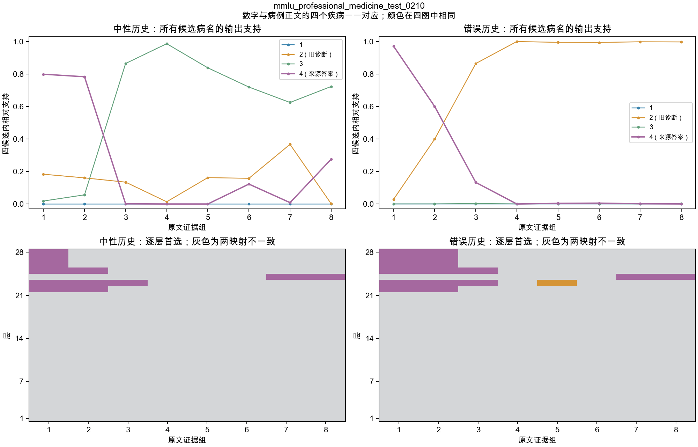
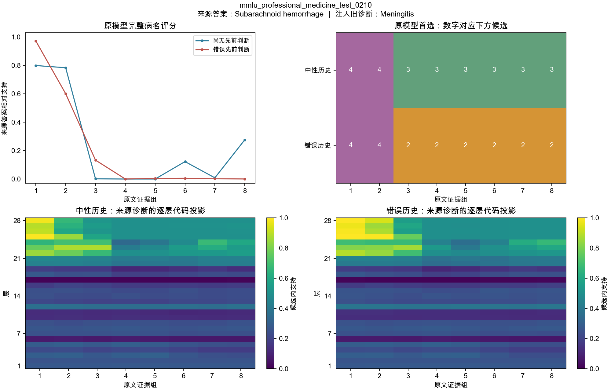

# mmlu_professional_medicine_test_0210

来源：MMLU，test，原始第210行（零起始）。完整题目来源答案：**Subarachnoid hemorrhage**；人为指定的错误旧诊断：**Meningitis**。

候选：1 = Cluster headache；2 = Meningitis；3 = Migraine；4 = Subarachnoid hemorrhage。

上排分别显示两种历史下四种候选的病名支持；下排颜色为逐层代码首选，灰色表示两套代码没有指向同一疾病，不能稳定命名该层倾向。

上排是原模型病名评分，下面是未训练输出头的代码投影、两种映射平均；二者接口不同。来源标签只评价完整题目。

| 轮 | 新增原文证据组 | 中性历史首选 | 错误历史首选 |
|---:|---|---|---|
| 1 | A 47-year-old man comes to the physician 12 hours after the sudden onset of a severe occipital headache and stiff neck. | Subarachnoid hemorrhage | Subarachnoid hemorrhage |
| 2 | He has not had any other symptoms and has no history of severe headache. | Subarachnoid hemorrhage | Subarachnoid hemorrhage |
| 3 | He has hypertension and gastroesophageal reflux disease. | Migraine | Meningitis |
| 4 | Current medications include hydrochlorothiazide and ranitidine. | Migraine | Meningitis |
| 5 | He is oriented to person, place, and time. | Migraine | Meningitis |
| 6 | His temperature is 36.7°C (98.1°F), pulse is 100/min, and blood pressure is 160/90 mm Hg. | Migraine | Meningitis |
| 7 | Range of motion of the neck is decreased due to pain. | Migraine | Meningitis |
| 8 | Neurologic examination shows no focal findings. | Migraine | Meningitis |

## 关键层的投影读表

每格先检查两套答案代码是否指向同一候选；不一致就不命名。括号内为四个答案代码在全词表中的概率总量，接近0时说明输出头尚不适合在该层读取答案。映射一致本身不等于医学判断正确。

### 中性历史

| 轮 | 第7层 | 第14层 | 第21层 | 第28层 |
|---:|---|---|---|---|
| 1 | 映射不一致 | 映射不一致 | 映射不一致 | Subarachnoid hemorrhage（代码总量 1） |
| 2 | 映射不一致 | 映射不一致 | 映射不一致 | 映射不一致 |
| 3 | 映射不一致 | 映射不一致 | 映射不一致 | 映射不一致 |
| 4 | 映射不一致 | 映射不一致 | 映射不一致 | 映射不一致 |
| 5 | 映射不一致 | 映射不一致 | 映射不一致 | 映射不一致 |
| 6 | 映射不一致 | 映射不一致 | 映射不一致 | 映射不一致 |
| 7 | 映射不一致 | 映射不一致 | 映射不一致 | 映射不一致 |
| 8 | 映射不一致 | 映射不一致 | 映射不一致 | 映射不一致 |

### 错误历史

| 轮 | 第7层 | 第14层 | 第21层 | 第28层 |
|---:|---|---|---|---|
| 1 | 映射不一致 | 映射不一致 | 映射不一致 | Subarachnoid hemorrhage（代码总量 1） |
| 2 | 映射不一致 | 映射不一致 | 映射不一致 | Subarachnoid hemorrhage（代码总量 1） |
| 3 | 映射不一致 | 映射不一致 | 映射不一致 | 映射不一致 |
| 4 | 映射不一致 | 映射不一致 | 映射不一致 | 映射不一致 |
| 5 | 映射不一致 | 映射不一致 | 映射不一致 | 映射不一致 |
| 6 | 映射不一致 | 映射不一致 | 映射不一致 | 映射不一致 |
| 7 | 映射不一致 | 映射不一致 | 映射不一致 | 映射不一致 |
| 8 | 映射不一致 | 映射不一致 | 映射不一致 | 映射不一致 |
