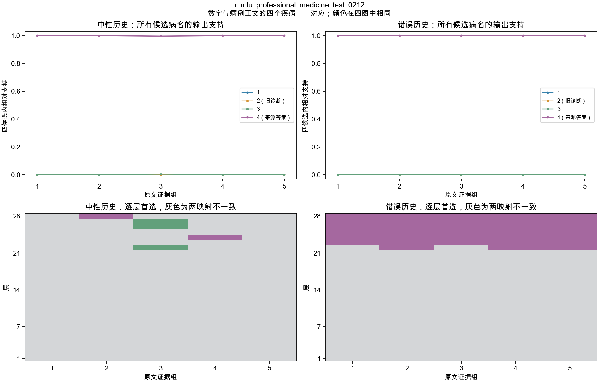
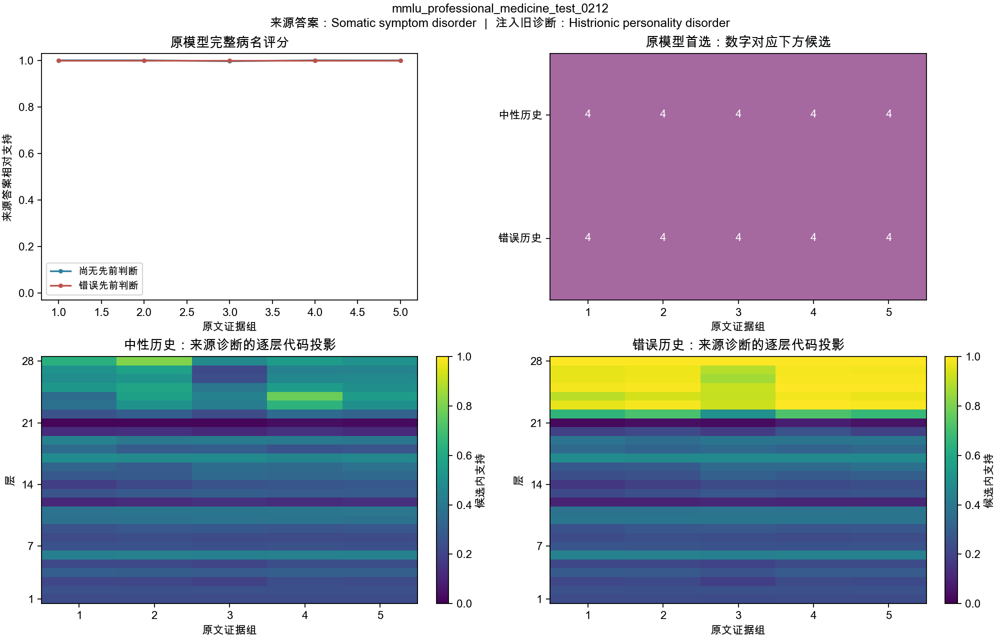

# mmlu_professional_medicine_test_0212

来源：MMLU，test，原始第212行（零起始）。完整题目来源答案：**Somatic symptom disorder**；人为指定的错误旧诊断：**Histrionic personality disorder**。

候选：1 = Conversion disorder；2 = Histrionic personality disorder；3 = Occult medical disorder；4 = Somatic symptom disorder。

上排分别显示两种历史下四种候选的病名支持；下排颜色为逐层代码首选，灰色表示两套代码没有指向同一疾病，不能稳定命名该层倾向。

上排是原模型病名评分，下面是未训练输出头的代码投影、两种映射平均；二者接口不同。来源标签只评价完整题目。

| 轮 | 新增原文证据组 | 中性历史首选 | 错误历史首选 |
|---:|---|---|---|
| 1 | A 50-year-old woman comes to the office for the first time because of recurrent abdominal pain. | Somatic symptom disorder | Somatic symptom disorder |
| 2 | Review of her extensive medical chart, which she has brought with her, discloses that she has a long history of varying physical symptoms. | Somatic symptom disorder | Somatic symptom disorder |
| 3 | Definitive causes for these symptoms have not been found despite extensive diagnostic studies, consultations with many physicians, and several surgical explorations. | Somatic symptom disorder | Somatic symptom disorder |
| 4 | She gives dramatic and exaggerated descriptions of her present and past symptoms, and she makes conflicting statements about her history. | Somatic symptom disorder | Somatic symptom disorder |
| 5 | She has been hospitalized at least 23 times since age 18 years. | Somatic symptom disorder | Somatic symptom disorder |

## 关键层的投影读表

每格先检查两套答案代码是否指向同一候选；不一致就不命名。括号内为四个答案代码在全词表中的概率总量，接近0时说明输出头尚不适合在该层读取答案。映射一致本身不等于医学判断正确。

### 中性历史

| 轮 | 第7层 | 第14层 | 第21层 | 第28层 |
|---:|---|---|---|---|
| 1 | 映射不一致 | 映射不一致 | 映射不一致 | 映射不一致 |
| 2 | 映射不一致 | 映射不一致 | 映射不一致 | Somatic symptom disorder（代码总量 0.43） |
| 3 | 映射不一致 | 映射不一致 | 映射不一致 | 映射不一致 |
| 4 | 映射不一致 | 映射不一致 | 映射不一致 | 映射不一致 |
| 5 | 映射不一致 | 映射不一致 | 映射不一致 | 映射不一致 |

### 错误历史

| 轮 | 第7层 | 第14层 | 第21层 | 第28层 |
|---:|---|---|---|---|
| 1 | 映射不一致 | 映射不一致 | 映射不一致 | Somatic symptom disorder（代码总量 0.57） |
| 2 | 映射不一致 | 映射不一致 | 映射不一致 | Somatic symptom disorder（代码总量 0.59） |
| 3 | 映射不一致 | 映射不一致 | 映射不一致 | Somatic symptom disorder（代码总量 0.66） |
| 4 | 映射不一致 | 映射不一致 | 映射不一致 | Somatic symptom disorder（代码总量 0.99） |
| 5 | 映射不一致 | 映射不一致 | 映射不一致 | Somatic symptom disorder（代码总量 0.99） |
